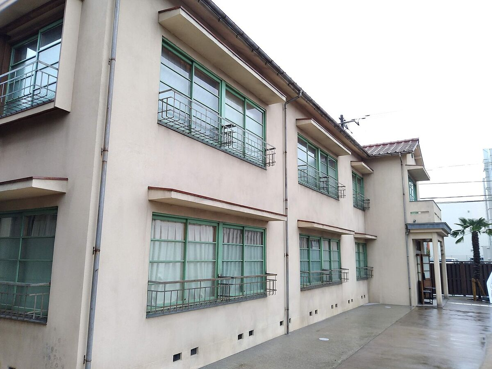
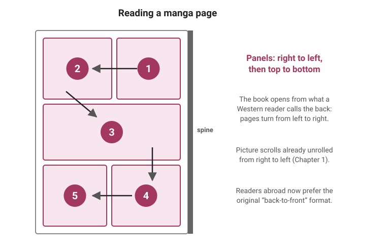

# 2. Manga

In Japan, manga is not a children's medium that some adults also read. It is a mass medium for every age and nearly every subject. It is also a publishing system, built on weekly magazines, paperback volumes and, more and more, smartphones. This chapter explains how that system grew after 1945 and how it works today.

## 2.1 After the war: red books and rental shops

Right after the war, the big Tokyo publishers were "still in disarray". Small Osaka companies got ahead by producing cheap comics for the **rental libraries** that had spread through the cities (Rimmer 2004). Deguchi Hiroshi traces the line (Deguchi 2014):

1. **Akahon** ("red books"), cheap manga sold before the war through sweet shops (*dagashi-ya*) rather than bookshops, boomed after it.
2. They gave way to ***[kashihon](https://en.wikipedia.org/wiki/Kashihon)* manga**, made for rental shops. Picture-story theatre (*[kamishibai](https://en.wikipedia.org/wiki/Kamishibai)*) was replaced by rental manga as well.
3. Rental manga in turn faded as monthly and then **weekly manga magazines** took over.

Rental manga reached older readers. Rentals to high-school students and graduates produced darker, more socially aware stories told in "dramatic pictures" (Rimmer 2004). This is ***[gekiga](https://en.wikipedia.org/wiki/Gekiga)*** ("dramatic pictures"). Deguchi describes postwar manga as split at first between a *gekiga* current, "with one foot in social resentment", and a broader *manga* current. The two were represented in the 1960s by two magazines (Deguchi 2014):

- ***[Garo](https://en.wikipedia.org/wiki/Garo_(magazine))*** (Seirindō), published from 1964 until the death of its founder Nagai in 1996.
- ***COM*** (Mushi Pro Shōji), 1967–1973. It was published by a company connected with Tezuka's animation studio.

## 2.2 Tezuka Osamu

[Tezuka Osamu](https://en.wikipedia.org/wiki/Osamu_Tezuka) is often called the "God of Manga" (*manga no kamisama*) (Rimmer 2004). His official biography records these facts (Tezuka Productions, n.d.):

- **Born** on 3 November 1928 in Toyonaka, Osaka Prefecture. He loved insects so much that he put the character for "insect" (虫) into his pen name.
- **Trained as a doctor.** His wartime experience gave him "an intense understanding of the preciousness of life", and he earned a medical licence. In the end he chose manga and animation.
- **Changed the form.** He transformed the Japanese cartoon by developing the "story cartoon" (*sutōrī manga*).
- **Made the first animated TV series in Japan**, *[Astro Boy](https://en.wikipedia.org/wiki/Astro_Boy)* (Chapter 3).
- **Died** on 9 February 1989, aged 60. "The preciousness of life" remained his central theme.

Rimmer gives the scale of the work: between 1946 and 1989, about 150,000 pages of manga in 400 paperback titles, 60 animated works for television and 17 theatrical films (Rimmer 2004). As Chapter 1 explained, Hosogaya sees Tezuka's decisive change in the "camera work". Dynamic movement, close-ups of faces and the showing of feelings made his pages read like film (Hosogaya 2019).

<figure>

<figcaption>The Tokiwa-sō Manga Museum in Toshima, Tokyo, photographed in 2020. <span class="credit">Image: KQuhen, <a href="https://creativecommons.org/licenses/by-sa/4.0/">CC BY-SA 4.0</a>, via <a href="https://commons.wikimedia.org/wiki/File:Tokiwaso_Manga_Museum_01.jpg">Wikimedia Commons</a>.</span></figcaption>
</figure>

## 2.3 The weekly magazine system

The weekly magazine is the engine of the industry. As Japan grew more prosperous and the baby boomers reached reading age, **Kōdansha launched *[Weekly Shōnen Magazine](https://en.wikipedia.org/wiki/Weekly_Sh%C5%8Dnen_Magazine)* in 1959**, timed to match the weekly rhythm of television. **Shōgakukan's *[Weekly Shōnen Sunday](https://en.wikipedia.org/wiki/Weekly_Sh%C5%8Dnen_Sunday)*** followed (Rimmer 2004). The weekly schedule changed how manga was made (Rimmer 2004):

- **Artists set up studios** to produce pages every week, many of them around Ikebukuro in Tokyo.
- **Publishers assigned hands-on editors.** They made sure artists kept their contracted deadlines and, "if necessary, the editors isolated the artists until they did".
- **The big publishers absorbed rental manga.** In the 1960s they lured artists away from rental manga and the Osaka "red books" by offering "ten times the previous rate per page".

**Weekly Shōnen Jump.** Shūeisha launched *[Weekly Shōnen Jump](https://en.wikipedia.org/wiki/Weekly_Sh%C5%8Dnen_Jump)* in July 1968. Its circulation grew as follows (Ikegami 2009):

| Year | Copies per issue |
|---|---|
| 1968 (first issue) | 105,000 |
| 1980 | 3 million, the top boys' weekly |
| 1995 | 6.53 million |

In a 1987 national reading survey it was the best-liked weekly magazine of all (Ikegami 2009).

### From magazine to paperback

The magazine is only half of the system. The other half is the paperback collected volume, called ***[tankōbon](https://en.wikipedia.org/wiki/Tank%C5%8Dbon)*** or simply *komikkusu* ("comics"). The format took off in **1966** (Yamamori 2013):

- That year, ***Weekly Shōnen Magazine* reached one million copies.** Long-running story manga had become the core of the big publishers' boys' weeklies.
- **Several publishers launched series of small paperback volumes** (*shinsho* size) collecting that story manga.
- **Readers had grown older.** In the mid-1960s, people mocked the fact that "university students read manga". The boys' weeklies' readership had risen into young adulthood, and the industry recognised these older readers as a major market.
- **Kōdansha's own paperback line grew fast.** It sold 0.5 to 1.8 million copies a year in 1967–69, and 8 million copies worth 2 billion yen in 1974.

Deguchi describes the business model that resulted. Many magazines **accept losses** and serve as a way to publish and spread new work, and the profit is recovered from the paperback volumes (Deguchi 2014).

## 2.4 Who manga is for

Manga is sorted mainly by the readership of the **magazine** it appears in, not by its subject. Rimmer, summarising Kinsella's study of the industry, describes how the publishers diversified (Rimmer 2004):

- **Young men's comics.** After absorbing rental manga, the big publishers developed comics for older male readers.
- **Comics for girls drawn by women.** Girls' comics came to be drawn by female artists from the readers' own age group. They later developed love stories with "a penchant for androgynous characters".
- **Ladies' comics.** These were first aimed at office workers and housewives in their forties, and later ranged "from conservative to pornographic".
- **Adults overtook children.** "By the end of the 1980s adult manga for men and ladies comics had surpassed the number of magazines for boys and girls."

In the mid-1990s, one survey counted **370 manga anthology magazines** from 74 publishers, almost all based in Tokyo. The "Big Four", Shūeisha, Shōgakukan, Kōdansha and Akita Shoten, produced almost 30 per cent of them. Two-fifths were aimed at female readers, with ladies' comics the largest category (Rimmer 2004).

In English the readership categories are usually given their Japanese names. These are the terms used throughout this handbook:

| Term | Meaning | Literal sense |
|---|---|---|
| ***[Shōnen](https://en.wikipedia.org/wiki/Sh%C5%8Dnen_manga)*** (少年) | Manga published in magazines for boys | "boy" |
| ***[Shōjo](https://en.wikipedia.org/wiki/Sh%C5%8Djo_manga)*** (少女) | Manga published in magazines for girls | "girl" |
| ***[Seinen](https://en.wikipedia.org/wiki/Seinen_manga)*** (青年) | Manga published in magazines for young and adult men | "youth" |
| ***[Josei](https://en.wikipedia.org/wiki/Josei_manga)*** (女性) / ladies' comics | Manga published in magazines for adult women | "woman" |

### The Year 24 Group and the girls' magazines

The great change in *shōjo* manga came around 1970. Shōgakukan's ***Shōjo Comic***, founded in 1968, and the monthly ***Bessatsu Shōjo Comic*** became the stage for the so-called **[Year 24 Group](https://en.wikipedia.org/wiki/Year_24_Group)** (*24-nen gumi*), including [Hagio Moto](https://en.wikipedia.org/wiki/Moto_Hagio) and [Takemiya Keiko](https://en.wikipedia.org/wiki/Keiko_Takemiya). They opened new territory in science fiction and fantasy and won many male readers too. Deguchi writes that this started a current in which "women's manga led the frontier of expression", one that "continues unbroken to the present" (Deguchi 2014).

Hosogaya adds the background. Postwar education under the Occupation promoted equal opportunity for girls, and this spread to private publishing. Girls' magazines multiplied and manga moved into them. At first girls' manga was mostly drawn by young men, and only a handful of women worked in manga, such as [Hasegawa Machiko](https://en.wikipedia.org/wiki/Machiko_Hasegawa) of *Sazae-san* and Ueda Toshiko. In time the field passed "inevitably" to young women. Girls' manga explored characters' inner feelings and developed "more layered" panel layouts, something Western comics had hardly attempted (Hosogaya 2019).

## 2.5 How to read a manga page

Japanese books bound for vertical text open from what a Western reader thinks of as the back. Manga follows the same order: **pages turn from left to right, and panels are read from right to left and from top to bottom**. When manga was first published in North America, some publishers mirrored the pages to read left to right. Rimmer notes that readers, "like their creators", came to prefer the original "back-to-front" format (Rimmer 2004). The picture scrolls in Chapter 1 already unrolled from right to left (Hosogaya 2019).

<figure class="diagram">

<figcaption>Reading order on a manga page: panels right to left, then top to bottom; the spine is on the right (Rimmer 2004; Hosogaya 2019). <span class="credit">Diagram drawn for this handbook from the sources cited in the chapter.</span></figcaption>
</figure>

One practical point for a learner reading manga in Japanese:

- **Sound effects are drawn as part of the picture**, usually in katakana or hiragana. Hosogaya notes that as panel layouts grew more complex, so did hand-drawn lettering of onomatopoeia (Hosogaya 2019).

## 2.6 The market today

Manga long held a central place in Japanese publishing, and it has moved online:

- **Print fell.** Bryce and colleagues, citing industry reports, give domestic manga sales of 580 billion yen in 1997 and 400 billion yen in 2007 (Bryce et al. 2010). In 2014 Deguchi described a manga market "said to be 500 billion yen" whose overall size was not changing, while the number of magazines kept rising (Deguchi 2014).
- **Digital took over.** The figures below are from the Research Institute for Publications, cited by Uemura (2021):

| Year | Digital manga sales | All digital publishing | Digital share of whole market |
|---|---|---|---|
| 2017 | 171.1 bn yen | 221.5 bn yen | |
| 2020 | 342.0 bn yen | 393.1 bn yen | 24.3% |

- **Books overtook magazines.** In 2016, magazine sales fell below book sales "for the first time in 41 years" (Uemura 2021).
- **Rights now earn more than magazines.** One major publisher's accounts for 2019–20 showed digital income of 24.8 billion yen, more than its income from magazines (Uemura 2021).

## 2.7 Manga and real events

Manga responds to the society around it. Jolyon Baraka Thomas studied how manga treated religion after the 1995 sarin gas attacks by the [Aum Shinrikyō](https://en.wikipedia.org/wiki/Aum_Shinrikyo) group (Thomas 2012).

- **The accusation.** Commentators had suggested that "enthralling apocalyptic narratives characteristic of manga" made Aum members prone to violence.
- **Thomas turns it around.** Manga published after 1995 showed a "morbid fascination" with the Aum incident itself.
- **Three phases followed:**
  1. **"Evil cult" horror.** Early works showed fictional religions modelled on Aum as places of sexual depravity, fraud and violence.
  2. **Psychological thrillers.** These asked which parts of human nature allow "cult-like" behaviour. Thomas discusses *Death Note* and *20th Century Boys* among them.
  3. **Irreverent comedy.** *[Saint Young Men](https://en.wikipedia.org/wiki/Saint_Young_Men)*, in which Jesus and the Buddha share a flat in Tokyo, separates "religion" from "cults" and makes religion sympathetic again.

```quiz
title: Chapter 2 self-check
? What kind of shop did kashihon manga serve?
- Rental libraries *
- Railway kiosks
- Department stores
> Rental manga replaced kamishibai and was later overtaken by weekly magazines (Deguchi 2014).

? Which weekly magazine launched in 1959, timed to the weekly rhythm of television?
- Weekly Shōnen Magazine (Kōdansha) *
- Weekly Shōnen Jump (Shūeisha)
- Garo (Seirindō)
> Shōgakukan's Weekly Shōnen Sunday followed (Rimmer 2004).

? What was Weekly Shōnen Jump's circulation in 1995?
- 6.53 million copies *
- 105,000 copies
- 3 million copies
> It began with 105,000 in 1968 (Ikegami 2009).

? In which order are manga panels read?
- Right to left, top to bottom *
- Left to right, top to bottom
- Bottom to top
> The original "back-to-front" format is now preferred abroad too (Rimmer 2004).

? Who were the Year 24 Group?
- Women artists, including Hagio Moto and Takemiya Keiko, who transformed girls' manga around 1970 *
- The founders of Weekly Shōnen Jump
- Gekiga artists of the rental-manga era
> Shōjo Comic and Bessatsu Shōjo Comic were their stage (Deguchi 2014).

? How do many manga magazines make money, according to Deguchi?
- They accept losses and recover the profit from paperback volumes *
- From advertising alone
- From government subsidies
> The magazine spreads new work; the tankōbon pays.
```

## Sources for this chapter

1. **Bryce et al. 2010.** Bryce M, Barber C, Kelly J, Kunwar S, Plumb A. Manga and anime: fluidity and hybridity in global imagery. *Electronic Journal of Contemporary Japanese Studies*, 29 January 2010. [EJCJS](https://www.japanesestudies.org.uk/articles/2010/Bryce.html).
2. **Deguchi 2014.** Deguchi Hiroshi 出口弘. 日本漫画と文化多様性：マンガをめぐる現状と歴史的経緯 (Japanese manga and cultural diversity: historical and cultural aspects of manga). *Journal of Information Science and Technology Association* 2014;64(4):122–132. doi:[10.18919/jkg.64.4_122](https://doi.org/10.18919/jkg.64.4_122). Quotations translated from the Japanese.
3. **Hosogaya 2019.** See [Chapter 1](01-edo-roots.md).
4. **Ikegami 2009.** Ikegami Satoshi 池上賢. 『週刊少年ジャンプ』という時代経験：解釈枠組みとしてのマスター・ナラティブ (*Weekly Shōnen Jump* as the experience of the times). *Journal of Mass Communication Studies* 2009;75:149–167. doi:[10.24460/mscom.75.0_149](https://doi.org/10.24460/mscom.75.0_149).
5. **Rimmer 2004.** Rimmer PJ. Manga world: globalization theory revisited. *Japanese Journal of Human Geography* 2004;56(6):565–586. doi:[10.4200/jjhg1948.56.565](https://doi.org/10.4200/jjhg1948.56.565).
6. **Tezuka Productions, n.d.** About Tezuka Osamu: profile. Tezuka Osamu Official. [tezukaosamu.net](https://tezukaosamu.net/en/about/).
7. **Thomas 2012.** Thomas JB. Horrific "cults" and comic religion: manga after Aum. *Japanese Journal of Religious Studies* 2012;39(1):127–151. [Nanzan](https://nirc.nanzan-u.ac.jp/journal/6/article/1345/pdf/download).
8. **Uemura 2021.** Uemura Yashio 植村八潮. COVID-19の影響拡大における出版・電子書籍の現状と課題 (Current status and issues of publishing and e-books under the influence of COVID-19). *Shuppan Kenkyū* 2021;51:125–140. doi:[10.24756/jshuppan.51.0_125](https://doi.org/10.24756/jshuppan.51.0_125). Figures from the Research Institute for Publications, *Shuppan geppō*, January 2021.
9. **Yamamori 2013.** Yamamori Hiroshi 山森宙史. 「コミックス」という出版メディアの生成：1960–70年代における新書判マンガ単行本出版を事例に (The emergence of "comics" as a publishing medium). *Journal of Mass Communication Studies* 2013;82:153–172. doi:[10.24460/mscom.82.0_153](https://doi.org/10.24460/mscom.82.0_153).

➡️ Next: [Chapter 3: Anime](03-anime.md)
