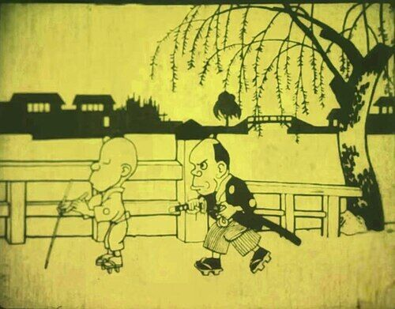
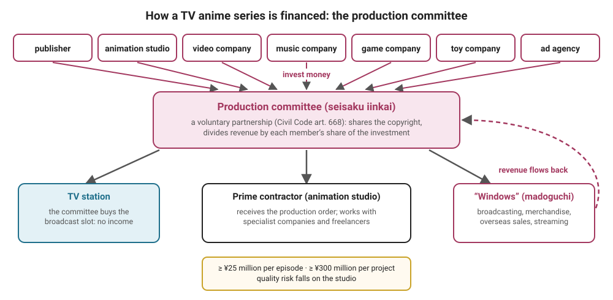
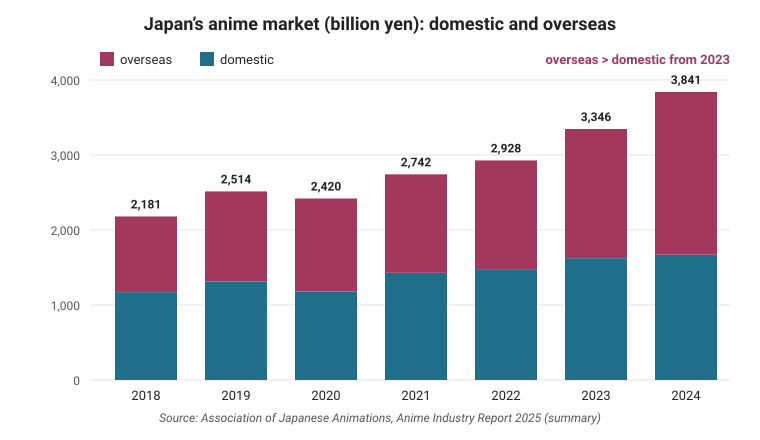

# 3. Anime

*Anime* is the Japanese word for animation. Abroad it has come to mean a recognisable style and an industry. This chapter traces how animation became a concept in Japan, how television changed it, and how today's industry is financed. Spoiler: much of the money no longer comes from Japan.

## 3.1 Before the word existed

Animation reached Japan before anyone had a word for it. The film historian Nishimura Tomohiro, in a lecture for the Japan Society for Animation Studies, describes the first decades (Nishimura 2020):

- **Trick films.** Foreign animation was first shown in Japan in the 1900s. At the time, frame-by-frame shooting was understood as one technique of the **"trick (magic) film"**, alongside reverse motion and stop action. No one thought of animation as a genre of its own.
- **"Dekobō shingachō".** One film released under the title *Dekobō shingachō* ("Funny boy's new sketchbook") was so popular that cartoon films of any origin came to be called by that name. The first one whose original can be identified is [Émile Cohl](https://en.wikipedia.org/wiki/%C3%89mile_Cohl)'s *La Musicomanie*, shown in Japan in 1911.
- **"Manga eiga".** Other names followed, such as "line-drawing trick" and "line-drawing comedy". After the 1920s, the standard term became ***manga eiga*** ("manga film").
- **The word *animation*** was used only in "extremely exceptional" cases before the war. It came into use around the mid-1950s.
- **The word *dōga*** ("moving pictures"), still used in Japanese for animation, appears in [Masaoka Kenzō](https://en.wikipedia.org/wiki/Kenz%C5%8D_Masaoka)'s credits for a 1933 film. It was kept in the names of the companies Nihon Dōga and Nichidō Eiga, and in **Tōei Dōga**, formed in 1956 when Nichidō was absorbed into Tōei (Nishimura 2020).

The [National Film Archive of Japan](https://en.wikipedia.org/wiki/National_Film_Archive_of_Japan) dates the history of Japanese animation to **1917**, to "manga eiga" attempted by "three pioneers" (NFAJ, n.d.-a). Among the earliest surviving works is [Kōuchi Jun'ichi](https://en.wikipedia.org/wiki/Jun%27ichi_K%C5%8Duchi)'s ***[Namakura gatana](https://en.wikipedia.org/wiki/Namakura_Gatana)*** ("The Dull Sword", 1917). Before the war and for years after it, animation stayed in the hands of small independent producers. One was [Ōfuji Noburō](https://en.wikipedia.org/wiki/Nobur%C5%8D_%C5%8Cfuji), a pioneer of cut-paper and shadow animation (NFAJ, n.d.-a).

<figure>

<figcaption>A frame from <em>Namakura gatana</em> (The Dull Sword, 1917) by Kōuchi Jun'ichi, from a toy-film print restored in 2008. It is among the oldest surviving Japanese animated films. <span class="credit">Image: Kōuchi Jun&#x27;ichi (Kobayashi Shōkai), Public domain, via <a href="https://commons.wikimedia.org/wiki/File:Anime_cell_1917.jpg">Wikimedia Commons</a>.</span></figcaption>
</figure>

## 3.2 Tōei Dōga: animation as an industry

The NFAJ calls the founding of **[Tōei Dōga](https://en.wikipedia.org/wiki/Toei_Animation)** in 1956 "the biggest turning point" (NFAJ, n.d.-a). Ichifuji Hirotaka explains why (Ichifuji 2022):

- **Unprecedented investment.** Tōei, a major film company, gathered people who had worked in animation before the war and gave them a studio far better equipped than anything before.
- **A sales channel.** Tōei's distribution network meant that long animated films could be sold directly to audiences on a regular schedule, rather than made for advertising or other purposes.
- **Industrial production.** Planning was done by salaried staff, and production used a large division of labour. This allowed dense, detailed animation, which had been "a long-held wish" of animators since before the war.

Tōei Dōga's first feature was *[Hakujaden](https://en.wikipedia.org/wiki/The_Tale_of_the_White_Serpent)* ("The Tale of the White Serpent", 1958, directed by Yabushita Taiji) (NFAJ, n.d.-a).

## 3.3 Television and *Astro Boy*

The second turning point was television. Tezuka Osamu (Chapter 2) founded his own studio, **[Mushi Production](https://en.wikipedia.org/wiki/Mushi_Production)**, which began a television series in **1963**: *[Tetsuwan Atomu](https://en.wikipedia.org/wiki/Astro_Boy_(1963_TV_series))* (*Astro Boy*), "Japan's first animated TV series" (Tezuka Productions, n.d.). It was a great success, helped by the appeal of Tezuka's original manga (Ichifuji 2022).

Mushi Pro worked in a completely different way from Tōei Dōga (Ichifuji 2022):

- **[Limited animation](https://en.wikipedia.org/wiki/Limited_animation).** Stylised movement cut the number of drawings, and labour was saved at every step.
- **Because of the budget.** The method was adopted to make production possible on television budgets, which were far smaller than those of cinema films.

The consequences were mixed (Ichifuji 2022):

- **The industry grew,** and animation became an attractive, well-paid profession.
- **Weekly broadcasting created a shortage of workers.** Salaried employees secretly took jobs from other studios.
- **Crisis followed in the early 1970s.** Tōei Dōga announced limits on feature production and staff cuts, which led to bitter conflict with its union. Mushi Pro went bankrupt, and Tezuka was left personally with large debts.

Tezuka's company also produced *Jungle Emperor Leo*, an early colour television series, and the two-hour television special *Bander Book*. His experimental animation in later years received international acclaim (Tezuka Productions, n.d.).

### The media mix

Television animation tied manga, anime and merchandise together. Rimmer describes a "media alliance" of manga, animation, films, games and video. Tezuka forged it through his own studio, and it later worked in the other direction: an original anime such as [Miyazaki Hayao](https://en.wikipedia.org/wiki/Hayao_Miyazaki)'s *Nausicaä* or *Spirited Away* would "sell associated manga and merchandise" (Rimmer 2004). The phrase used in Japan for this is ***[media mix](https://en.wikipedia.org/wiki/Media_mix)***.

## 3.4 How an anime series is financed today

Most television anime today is financed by a ***[production committee](https://en.wikipedia.org/wiki/Production_committee)*** (*seisaku iinkai*). Yoshimi Aki studied the system through published research and an interview with a producer at a major publisher (Yoshimi 2023):

- **Legal form.** A production committee is a **voluntary partnership** (*nin'i kumiai*) under Article 668 of Japan's Civil Code. Several investors raise the money to make one work and **share its copyright**. Revenue from the finished work is divided according to each member's share of the investment.
- **Members.** Investors typically include publishers, animation studios, video companies, music companies, game companies, toy companies and advertising agencies. Publishers are often involved because much anime adapts a manga or novel, and the publisher manages the original author's rights.
- **Windows.** Each member takes charge of its own area. The advertising agency handles promotion, the toy company makes toys. Each sets up a ***madoguchi*** ("window") inside the committee, for example for domestic broadcasting, merchandising, overseas sales or streaming. Every window forecasts its own income and costs.
- **The committee pays for broadcasting.** It **buys the broadcast slot** from the TV station, so broadcasting by itself brings the committee no income. The money comes from everything that follows.
- **Scale.** A project needs **25 million yen or more per episode, and 300 million yen or more in total**. Promotion costs about 10 to 15 million yen per *kūru* (broadcast season). Since the 2000s, committee-financed television series have mostly been broadcast **late at night**.
- **Risk falls on the studio.** The committee handles one project, but viewers judge the studio that made it. A poor result damages the studio's chances of winning its next order. Production costs are rising because higher quality is expected, so this is "a threat to the supplier side".

<figure class="diagram">

<figcaption>How a production committee finances a TV anime series (Yoshimi 2023; AJA 2026). <span class="credit">Diagram drawn for this handbook from the sources cited in the chapter.</span></figcaption>
</figure>

The Association of Japanese Animations (AJA) describes the same chain from the studio's side. The prime contractor "receives a production order from the client, such as the production committee", and the work is done in-house "along with orders from a number of specialty companies and freelance creators". The share of income from rights is larger for big studios. **"Mid-level and smaller production companies are only receiving production fees as revenue"** (AJA 2026).

## 3.5 The market in numbers

The AJA publishes an annual survey of the industry. Its 2025 report covers the year 2024 (AJA 2026):

| | 2024 | Change on 2023 |
|---|---|---|
| **Whole anime market** (spending on everything anime-related) | **3,840.7 bn yen**, a record | +14.8% |
| **Overseas** | 2,170.2 bn yen (56.5% of the total) | +26.0% |
| Merchandising (largest domestic item) | 748.8 bn yen | +6.8% |
| Streaming | 265.5 bn yen | +6.2% |
| Pachinko and similar machines | 301.5 bn yen | −10.5% |
| Live entertainment | 122.5 bn yen | +13.3% |
| TV | 98.2 bn yen | +0.9% |
| Cinema | 69.0 bn yen | +1.3% |
| **Studios' own revenue** ("narrow" market) | **466.2 bn yen** | +9.1% |

Points worth noting (AJA 2026):

- **The whole market** is 2.1 times its 2015 size and 3.5 times its 2002 size.
- **The overseas market first overtook the domestic market in 2023.** The gap was 97.9 billion yen in 2023 and 499.7 billion yen in 2024. During the pandemic, worldwide home viewing on Netflix, Disney+ and Crunchyroll strengthened anime's overseas growth.
- **Streaming** now exceeds TV, cinema and video combined.
- **Studios earn far less.** The studios' own revenue (466.2 bn) is only a fraction of what consumers spend.
- **Labour.** "All production locations are facing labor shortages." Labour and production costs are rising sharply.

<figure class="diagram">

<figcaption>The anime market in billion yen, 2018–2024. Overseas revenue has exceeded domestic revenue since 2023 (AJA 2026). <span class="credit">Diagram drawn for this handbook from the sources cited in the chapter.</span></figcaption>
</figure>

## 3.6 Studios and directors

The sources used here discuss a few directors in detail.

- **[Studio Ghibli](https://en.wikipedia.org/wiki/Studio_Ghibli) and Miyazaki Hayao.** Japan's official Academy Award submissions included *[Pom Poko](https://en.wikipedia.org/wiki/Pom_Poko)* ([Takahata Isao](https://en.wikipedia.org/wiki/Isao_Takahata), 1995) and *[Princess Mononoke](https://en.wikipedia.org/wiki/Princess_Mononoke)* (Miyazaki, 1998). *[Spirited Away](https://en.wikipedia.org/wiki/Spirited_Away)* won the Academy Award for Best Animated Feature in 2003, and *[The Boy and the Heron](https://en.wikipedia.org/wiki/The_Boy_and_the_Heron)* (Miyazaki and producer Suzuki Toshio) won it in 2024 (Eiren, n.d.-b). The [Ghibli Museum](https://en.wikipedia.org/wiki/Ghibli_Museum) in Mitaka is covered in Chapter 13.
- **[Shinkai Makoto](https://en.wikipedia.org/wiki/Makoto_Shinkai).** He worked at the game company Nihon Falcom, where he made advertising art and animated sequences for games. His breakthrough came in 2000 with the short *She and Her Cat*, which won the grand prix of a computer-graphics animation contest. He then left Falcom and made *[Voices of a Distant Star](https://en.wikipedia.org/wiki/Voices_of_a_Distant_Star)* (2002) and other films. After *[5 Centimeters per Second](https://en.wikipedia.org/wiki/5_Centimeters_per_Second)* (2007), commentators began calling him a "new Miyazaki". Alistair Swale stresses Shinkai's preoccupation with time and its measurement, which returns in *[Your Name](https://en.wikipedia.org/wiki/Your_Name)* (2016) (Swale 2018). In a later article, Swale reads anime from [Oshii Mamoru](https://en.wikipedia.org/wiki/Mamoru_Oshii) and [Kon Satoshi](https://en.wikipedia.org/wiki/Satoshi_Kon) to Shinkai as **cinema** rather than as a separate world of fantasy (Swale 2020).
- **Blockbusters.** In Japan's 2025 box office, the top film was *Demon Slayer: Infinity Castle* (part 1), with 39.14 billion yen. Animated films also took third and fourth place (Eiren, n.d.-a). Chapter 11 looks at what *Demon Slayer* borrows from folklore.

```quiz
title: Chapter 3 self-check
? How was frame-by-frame animation understood when it first reached Japan in the 1900s?
- As one technique of the "trick film" *
- As a branch of manga
- As puppet theatre
> The concept of animation as a genre did not yet exist (Nishimura 2020).

? Why does the NFAJ call 1956 the biggest turning point in Japanese animation?
- Tōei founded Tōei Dōga, a large, well-funded studio with national distribution *
- Astro Boy was first broadcast
- The word anime was invented
> Tōei Dōga's first feature, Hakujaden, followed in 1958.

? Why did Mushi Production use limited animation for Astro Boy?
- To make weekly production possible on small television budgets *
- Because it was the only technique known in Japan
- To imitate Tōei Dōga's style
> Stylised movement reduced the number of drawings (Ichifuji 2022).

? In a production committee, who pays for the broadcast slot?
- The committee itself buys the slot from the TV station *
- The TV station pays the committee
- The animation studio
> Broadcasting brings no income; revenue comes from merchandise, sales abroad, streaming and so on (Yoshimi 2023).

? What share of the 2024 anime market came from overseas?
- 56.5% *
- 15.9%
- 7.9%
> 2,170.2 billion yen of 3,840.7 billion (AJA 2026).

? Which companies earn mainly production fees rather than rights income, according to the AJA?
- Mid-level and smaller animation studios *
- Publishers
- Toy companies
> Rights income goes mostly to larger studios and committee members.
```

## Sources for this chapter

1. **AJA 2026.** Association of Japanese Animations. *Anime Industry Report 2025: Summary*. Tokyo: AJA, March 2026. [aja.gr.jp](https://aja.gr.jp/english/japan-anime-data).
2. **Eiren, n.d.-a.** Motion Picture Producers Association of Japan (Eiren). 2025年（令和7年）全国映画概況 (Japanese film industry statistics 2025), released January 2026. [eiren.org](https://www.eiren.org/toukei/index.html).
3. **Eiren, n.d.-b.** Motion Picture Producers Association of Japan (Eiren). 米国アカデミー賞 過去データ (Academy Awards: past submissions and results). [eiren.org](https://www.eiren.org/academy/data.html).
4. **Ichifuji 2022.** Ichifuji Hirotaka 一藤浩隆. アニメーション産業における1960年代後半という時代：東映動画の経営と「放映権」「商品化権」の変化を中心にして (The late 1960s in the animation industry: the management of Tōei Animation). *Journal of Mass Communication Studies* 2022;100:279–295. doi:[10.24460/mscom.100.0_279](https://doi.org/10.24460/mscom.100.0_279). Quotations translated from the Japanese.
5. **NFAJ, n.d.-a.** National Film Archive of Japan. *Nihon Eiga: The History of Japanese Film* (permanent exhibition). [nfaj.go.jp](https://www.nfaj.go.jp/english/exhibition/historyofjapanesefilm/).
6. **Nishimura 2020.** Nishimura Tomohiro 西村智弘. 日本のアニメーションはいかにして成立したのか (How did Japanese animation come about?). *Japanese Journal of Animation Studies* 2020;21(2):43–50. doi:[10.34370/jjas.21.2_43](https://doi.org/10.34370/jjas.21.2_43).
7. **Rimmer 2004.** See [Chapter 2](02-manga.md).
8. **Swale 2018.** Swale A. Shinkai Makoto: the "new Miyazaki" or a new voice in cinematic anime? In: International Research Center for Japanese Studies, symposium proceedings, 2018: 263–271. doi:[10.15055/00006891](https://doi.org/10.15055/00006891).
9. **Swale 2020.** Swale A. Anime and the conquest of time: memory, fantasy, and the "time-image" from *Ghost in the Shell* to *Your Name*. *Japan Review* 2020;35:199–217. doi:[10.15055/00007607](https://doi.org/10.15055/00007607).
10. **Tezuka Productions, n.d.** See [Chapter 2](02-manga.md).
11. **Yoshimi 2023.** Yoshimi Aki 吉見明希. 製作委員会方式における管理会計：日本のアニメーション制作の事例 (Management accounting issues in the production committee: the production of Japanese anime). *Journal of Management Accounting, Japan* 2023;31(1):23–36. doi:[10.24747/jma.31.1_23](https://doi.org/10.24747/jma.31.1_23).

➡️ Next: [Chapter 4: Symbols and stock voices](04-shorthand.md)
