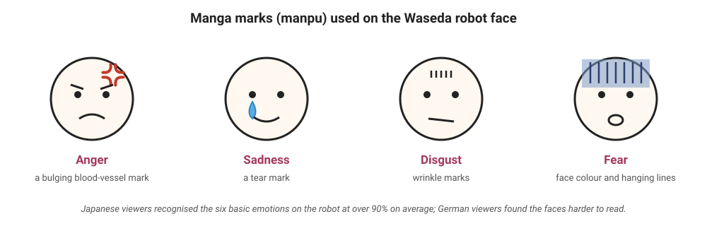

# 4. Symbols and Stock Voices

Manga and anime use a shorthand that Japanese readers absorb without thinking and foreign readers have to learn. One part is visual: marks drawn on or around a face to show a feeling. The other part is verbal: ways of speaking that instantly tell you what kind of person a character is. Linguists call the second ***yakuwarigo***, "role language". For a learner it is the most useful idea in this handbook. It explains why characters in anime often talk unlike anyone you will meet in Japan.

## 4.1 Lines for what cannot be seen

Chapter 1 showed how old some of these devices are (Hosogaya 2019):

- **Speed lines.** The twelfth-century *Chōjū-giga* already draws lines behind flying arrows and leaping animals.
- **Lines for invisible things.** The same scroll draws a shout coming out of a frog's mouth.
- **Words beside the speaker.** Muromachi picture scrolls wrote characters' lines next to them (*gachūshi*), "the prototype of the modern manga speech balloon".
- **Flashes and explosions.** Hokusai drew them as radiating lines in his book illustrations.

## 4.2 *Manpu*: the symbols on the face

Japanese has a word for the conventional symbols that manga attaches to faces: ***manpu*** (漫符, "manga marks"). A robotics team at Waseda University used them to make a robot's face easier to read (Kishi et al. 2014):

- **The robot.** In 2013 they built a version of the humanoid robot head KOBIAN that could display manga marks on flexible full-colour LED panels:

| Emotion | Mark used on the robot |
|---|---|
| Anger | A **bulging blood vessel** mark |
| Sadness | A **tear** mark |
| Disgust | **Wrinkle** marks |
| Fear | A change of **face colour** and **vertical "hanging" lines** |

- **Results with Japanese viewers.** With these marks, the robot's expressions were recognised by Japanese participants at a rate above 90 per cent on average across the six basic emotions.

<figure class="diagram">

<figcaption>The four manga marks used on the Waseda robot face, drawn for this handbook (Kishi et al. 2014). <span class="credit">Diagram drawn for this handbook from the sources cited in the chapter.</span></figcaption>
</figure>

The team then asked whether the marks work across cultures. They showed the same faces to 56 Japanese and 12 German participants (Kishi et al. 2014):

- **People read faces from their own culture more easily.** Expressions were "less easy to understand if they are evaluated by people [who] belong to the other cultural background".
- **Preferences split.** Earlier work had found that people with a Japanese background **prefer** faces with manga marks, and people with a Western background prefer faces without them.

The conclusion: manga marks are a **learned code**, not a universal language. A foreign reader who finds a face in manga hard to read is meeting a convention, not a failure of drawing.

## 4.3 Role language: who talks like that?

The linguist Kinsui Satoshi coined the term *yakuwarigo* in 2000. His definition is quoted by Figueira (Figueira 2019):

> When, on hearing a particular way of speaking (vocabulary, grammar, turns of phrase, intonation and so on), we can call to mind a particular type of person (age, sex, occupation, class, era, appearance, character and so on); or when, given a particular type of person, we can call to mind the way of speaking that person seems likely to use, that way of speaking is called "role language". (Kinsui 2003, quoted in Figueira 2019; translated from the Japanese)

Kinsui's standard illustration is one sentence, "Yes, I know", said by eight different stock characters (Kinsui 2011, quoted in Figueira 2019):

| Japanese | Stock character | What gives it away |
|---|---|---|
| そうよ、あたしが知ってるわ | Woman | あたし for "I"; sentence-final よ, わ |
| そうじゃ、わしが知っておる | **Old man** (the elderly professor, the wise master) | わし; じゃ instead of だ; おる instead of いる |
| そや、わてが知っとるでぇ | **Osaka person** | や; わて; とる; でぇ |
| さよう、拙者が存じておる | **Samurai** | さよう; 拙者 (*sessha*) for "I" |
| そうですわよ、わたくしが存じておりますわ | ***Ojōsama*** (well-bred young lady) | わたくし; ですわよ; humble 存じております |
| そうあるよ、わたしが知ってるあるよ | **"Chinese" character** (a stereotype; see below) | あるよ added to sentences |
| そうだよ、ぼくが知ってるのさ | **Young man / boy** | ぼく; のさ |
| んだ、おら知ってるだ | **Country person** | おら; んだ; だ |

Role language is signalled by personal pronouns, sentence endings, politeness forms, how the copula is expressed, accent, interjections, the way a character laughs, intonation, speed and fluency (Kinsui 2003, cited in Figueira 2019).

### Role language is not how people talk

The key point for a learner is that role language is **a stereotype, not a dialect**. Kinsui stresses that it does not exist as language people naturally use. It is an idea that each of us holds about reality: a **"virtual reality"** Japanese. "Role language is a linguistic stereotype" (Kinsui 2003, cited in Figueira 2019).

- **The old man.** No real professor in Tokyo says *sō ja, washi ga shitte oru*, yet every reader recognises him at once.
- **Where the stereotypes live.** Novels, newspapers, manga, film, anime and games spread role language, amplify it and fix it in place (Kinsui 2000, cited in Figueira 2019).
- **Standard Japanese is a role language too.** It is the one that serves as "the reference point for all other role languages". Characters who speak it, usually the heroes, sound neutral (Kinsui 2003, cited in Figueira 2019).

Kinsui is careful about where stereotypes become harmful (Kinsui 2003, cited in Figueira 2019):

- **A stereotype** is a natural part of how people sort out a confusing world.
- **It becomes prejudice** when it is tied to negative feelings.
- **It becomes discrimination** when prejudice leads to actions with unjust results for the people concerned.

### Speech for outsiders

Kinsui groups the speech of "outsiders" (*ijin kotoba*), beings who are not modern Japanese, into three families (Kinsui 2003, cited in Figueira 2019):

| Group | Examples |
|---|---|
| Foreigners | Westerners, Black people, Chinese people |
| People of past times | Samurai, court nobles |
| Non-humans | Gods, ghosts, fairies, aliens, robots |

Two techniques give these characters a voice (Kinsui 2003, cited in Figueira 2019):

1. **Projection.** An existing Japanese role language is lent to someone who would not speak Japanese at all. A medieval Western knight speaks samurai Japanese. **Ghosts and gods speak old man's Japanese.**
2. **Pidgin.** Extremely simplified or broken Japanese. The "*aru yo*" speech of stock Chinese characters is the typical example. It is thought to originate in the broken Japanese of the Yokohama treaty port at the end of the Edo period, where at first both Westerners and Chinese were recorded using "~*arimasu*" endings (Kinsui 2014, cited in Figueira 2019). The artificial sentence endings of aliens and robots, the so-called ***kyara gobi*** ("character endings"), work the same way.

Westerners in manga often speak in katakana and are always polite: ソレ、チガイマース ("That, is-wrong"). Kinsui suggests this "may have inherited in part" the features of the old *arimasu*-type pidgin (Kinsui 2007, cited in Figueira 2019).

## 4.4 Women's speech, men's speech and power

Role language also encodes gender and status, and the two interact. In a 2023 article, Kinsui builds on Sadanobu Toshiyuki's analysis of "speech characters" along four dimensions: sex, age, *hin* (refinement) and *kaku* (standing, the sense of authority produced by "experience, power and status") (Kinsui 2023):

- **Politeness sounds feminine.** In modern Japanese social convention, "male" is linked with higher *kaku* and "female" with higher *hin*. So the more polite and refined a way of speaking, the more feminine it sounds, and the reverse.
- **Power neutralises gender.** A master's thesis by Jin, one of Kinsui's students, studied the Japanese dubbing and subtitles of Chinese, Korean, British and American films and dramas, with Japanese period dramas for comparison. High-ranking women addressing inferiors, especially when showing authority, use forms otherwise classed as "men's language":
  - the plain assertive **だ**;
  - **imperatives**;
  - the sentence-final particle **ぞ**;
  - the prohibitive **な**.
- **Masculinity stays male.** These women do **not** use **ぼく, おれ, きさま** or **ぜ**. Jin therefore separated "language tied to status, power and rank" from "language tied to masculinity".
- **Kinsui's explanation** uses politeness theory. A "principle of face-risk consideration" normally softens women's speech in fiction, and power lifts that constraint. A separate "principle of preserving grace" also weakens female speech (Kinsui 2023).

For a learner this has a practical consequence. **The "feminine" and "masculine" speech of anime is fiction's version of Japanese.** It exaggerates differences that real speakers express much more lightly. Chapter 14 gives a guide to which features of anime speech are safe to copy.

## 4.5 Role language in translation

Translators have to decide what to do with these voices:

- **Character language.** Eaveson distinguishes role language from ***kyarakutā gengo*** ("character language"): a distinctive way of speaking that is neither standard Japanese nor a widely shared stereotype (Kinsui 2016, cited in Eaveson 2021). In *Spy × Family*, the young telepath Anya uses a peculiar baby talk mixed with occasional adult masculine expressions, and the assassin Yor speaks with excessive politeness. Eaveson finds the English version "only partially successful" with Anya but rather effective with Yor's consistently over-polite speech (Eaveson 2021).
- **The Portuguese example.** Figueira compared *Samurai Champloo* and other manga with their Brazilian Portuguese translations. To mark foreign speech, translators used **spelling that imitates an accent** and **wrong verb endings**. In one example, a Western character's ワ・・・ワタシニッポンジンデース ("I... am-Japanese") became *mi… mim serr japoniês* (Figueira 2019).
- **Kinsui's warning.** Role language used well expresses character, scene "and even the intention of the work extremely efficiently". But leaning on "commonplace" role language risks making a work "thin and vulgar" (Kinsui 2011, quoted in Figueira 2019).

```quiz
title: Chapter 4 self-check
? What is manpu?
- The conventional symbols manga draws on and around faces to show feelings *
- A kind of speech balloon
- A style of manga lettering
> The Waseda robot KOBIAN used a blood-vessel mark for anger and a tear for sadness (Kishi et al. 2014).

? What did the Waseda team find when German participants judged manga-style robot faces?
- Faces designed for one culture were harder to read for the other *
- Germans read them more accurately than Japanese
- Culture made no difference
> Manga marks are a learned code (Kishi et al. 2014).

? Which stock character says "sō ja, washi ga shitte oru"?
- The old man *
- The samurai
- The young lady of good family
> Washi, ja and oru mark the "old man" role language.

? According to Kinsui, what is role language?
- A linguistic stereotype, a "virtual reality" Japanese that people recognise but do not naturally speak *
- A regional dialect
- The polite language of business
> Media spread and fix it (Kinsui 2000, 2003).

? How do ghosts and gods usually speak in Japanese fiction?
- In old man's Japanese, by "projection" *
- In katakana pidgin
- In standard Japanese only
> An existing role language is lent to non-human characters (Kinsui 2003).

? What did Jin find about high-ranking women in dubbed period dramas?
- They use だ, imperatives, ぞ and な, but not ぼく, おれ or ぜ *
- They always use わ and よ
- They speak exactly like men
> Power neutralises some gender markers, but not those tied to masculinity (Kinsui 2023).
```

## Sources for this chapter

1. **Eaveson 2021.** Eaveson Fusae イーヴァソン房枝. 漫画『SPY×FAMILY』におけるキャラクター言語の日英翻訳：アーニャとヨルの言葉遣いとキャラクターを考える (The Japanese–English translation of character language in the manga *Spy × Family*). *Invitation to Interpreting and Translation Studies* 2021;23:1–21. doi:[10.50837/iits.2301](https://doi.org/10.50837/iits.2301).
2. **Figueira 2019.** De Nazareth Figueira F. 日本語からブラジル・ポルトガル語への翻訳における「役割語」への対応手法：漫画における「異人ことば」を中心に (Methods of handling role language in translation from Japanese to Brazilian Portuguese). *Invitation to Interpreting and Translation Studies* 2019;21:41–60. doi:[10.50837/iits.2103](https://doi.org/10.50837/iits.2103). Source of the quotations from Kinsui Satoshi's books *Vācharu Nihongo: yakuwarigo no nazo* (2003) and related works (2000, 2007, 2011, 2014), translated from the Japanese.
3. **Hosogaya 2019.** See [Chapter 1](01-edo-roots.md).
4. **Kinsui 2023.** Kinsui Satoshi 金水敏. 役割語のジェンダーとパワー (Gender and power in role language). *Japanese Journal of Language in Society* 2023;26(1):37–48. doi:[10.19024/jajls.26.1_37](https://doi.org/10.19024/jajls.26.1_37).
5. **Kishi et al. 2014.** Kishi T, Futaki H, Trovato G, Cosentino S, Hashimoto K, Takanishi A. 日本の漫画に特有な"漫符"を用いたロボット表情の文化的背景による印象の変化 (Cross-cultural impression survey of Japanese "manga" marks based robotic facial expressions). *Proceedings of the JSME Conference on Robotics and Mechatronics* 2014: 2A1-L01. doi:[10.1299/jsmermd.2014._2A1-L01_1](https://doi.org/10.1299/jsmermd.2014._2A1-L01_1).

➡️ Next: [Chapter 5: Cinema beyond monsters](05-cinema.md)
