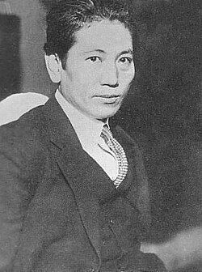
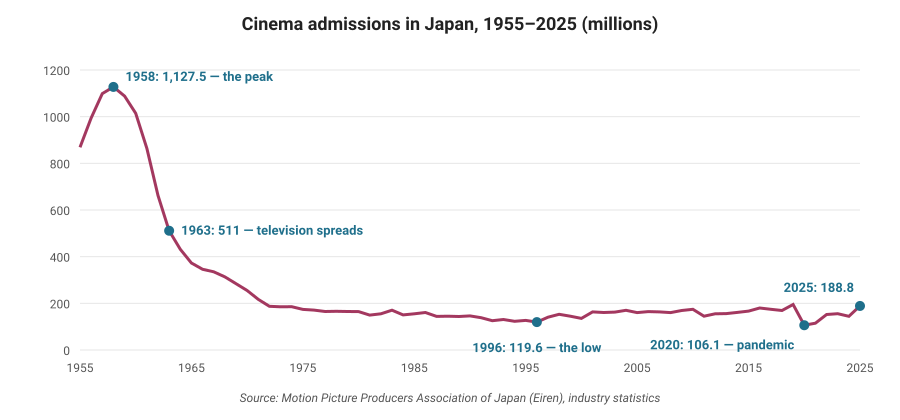
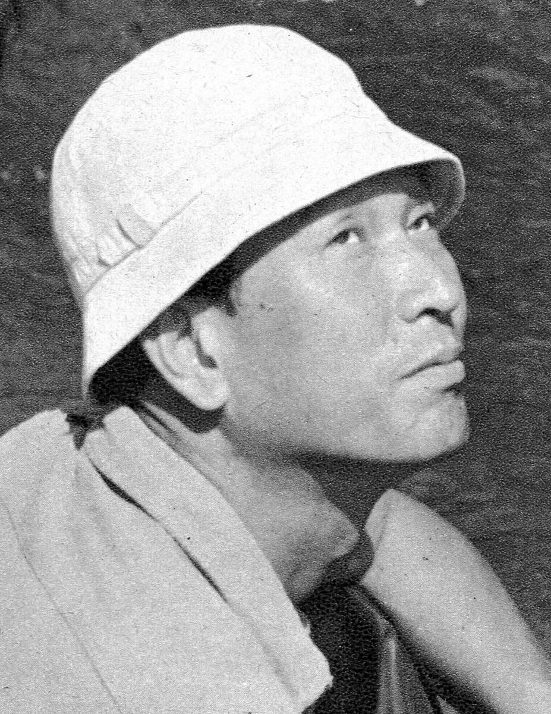
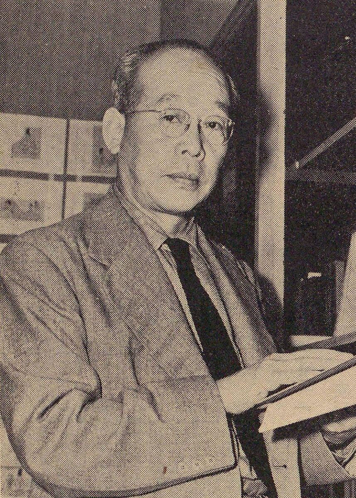
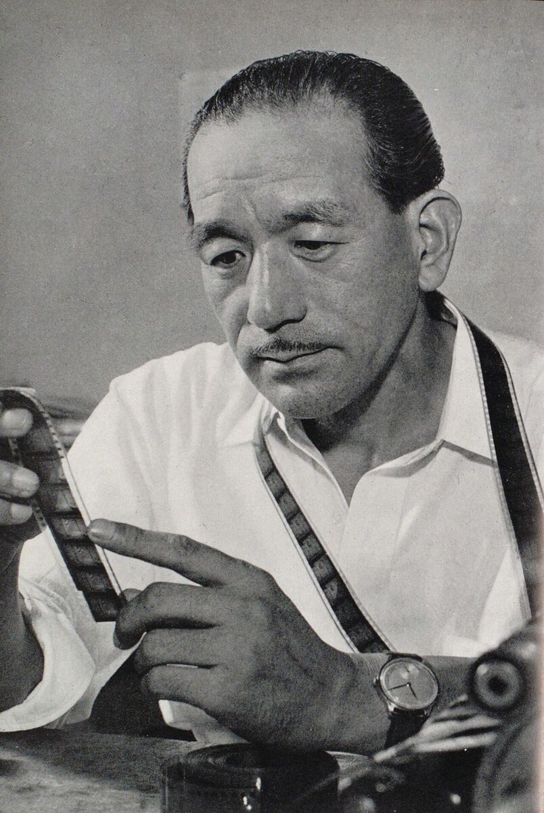

# 5. Cinema Beyond Monsters

Japanese cinema is often reduced abroad to samurai, monsters and anime. Its real history is a story of great studios, of directors who changed world cinema, and of an industry that lost most of its audience and had to reinvent itself. This chapter covers live-action film; Chapter 6 covers monster and special-effects films.

## 5.1 Before the studios: lanterns and narrators

The [National Film Archive of Japan](https://en.wikipedia.org/wiki/National_Film_Archive_of_Japan) (NFAJ) begins its permanent exhibition well before cinema (NFAJ, n.d.-a):

- **1803: *utsushi-e*.** Kameya Toraku adapted the magic lantern imported from Holland and ran a show called *utsushi-e* ("projected pictures"). Accompanied by noisemakers, shamisen, drums and traditional narrative singing, it prepared the way for the ***[benshi](https://en.wikipedia.org/wiki/Benshi)***, the live narrators "peculiar to Japanese film".
- **1896–97: moving pictures arrive.** Film technology came from the United States and France and was called *katsudō shashin* ("moving photographs").
- **1912: Nikkatsu.** Four film companies merged into Nikkatsu, the first step towards an organised industry.
- **The first star** was Onoe Matsunosuke, in period films made in Kyoto. In the "new school" films shot in Tokyo, men still played women's roles, as in kabuki.
- **Late 1910s: the Pure Film Movement.** Reformers led by Kaeriyama Norimasa wanted film to stand on its own. They inserted intertitles so that the story could be followed without a *benshi*, and used actresses instead of female impersonators, which made close-ups of faces possible.
- **1920s: genres.** After the [1923 earthquake](https://en.wikipedia.org/wiki/1923_Great_Kant%C5%8D_earthquake), audiences wanted faster films. Action films, comedies and modern youth films flourished, along with period dramas whose nihilistic heroes fought spectacular sword battles. Censorship tightened at the same time.
- **The avant-garde.** [Kinugasa Teinosuke](https://en.wikipedia.org/wiki/Teinosuke_Kinugasa)'s *[A Page of Madness](https://en.wikipedia.org/wiki/A_Page_of_Madness)* (*Kurutta ippēji*, 1926) is among the silent films the NFAJ highlights.

<figure>

<figcaption>Tokugawa Musei, prewar Shōwa era. The NFAJ exhibition on the <em>benshi</em> era includes his narration for <em>The Cabinet of Dr. Caligari</em>. <span class="credit">Image: Unknown author, Public domain, via <a href="https://commons.wikimedia.org/wiki/File:Musei_Tokugawa_1.JPG">Wikimedia Commons</a>.</span></figcaption>
</figure>

**Sound** came with Shōchiku's success with *Madamu to nyōbō* ("The Neighbor's Wife and Mine", 1931). Shōchiku's Kamata studio specialised in the "petit bourgeois film" about the feelings of ordinary people. In period dramas, directors such as Itami Mansaku and Yamanaka Sadao turned from sword fights to ordinary characters. [Mizoguchi Kenji](https://en.wikipedia.org/wiki/Kenji_Mizoguchi) deepened his realism by having characters speak in Kansai dialect in *[Sisters of the Gion](https://en.wikipedia.org/wiki/Sisters_of_the_Gion)* (1936) (NFAJ, n.d.-a).

**War** turned film into "a military resource". The Film Law of 1939 required the registration of film staff, censorship of scripts in advance, compulsory screening of "culture films" and newsreels, and restrictions on foreign films. Nikkatsu, Shinkō Kinema and Daito Eiga were merged into a new company, **Daiei** (NFAJ, n.d.-a).

## 5.2 The golden age: six studios, two films a week

In the 1950s film was "the king of entertainment". The NFAJ gives the peak figures (NFAJ, n.d.-a):

- **1958:** annual cinema admissions reached an all-time high of **1,127,450,000**.
- **1960:** more than **547 feature films** were produced, and the number of cinemas reached **7,457**.

Hiroyuki Kitaura calculates that between 1957 and 1959 the average Japanese went to the cinema twelve or more times a year (Kitaura 2017).

<figure class="diagram">

<figcaption>Cinema admissions in Japan, 1955–2025, from Eiren's statistics. The 1958 peak was never approached again. <span class="credit">Diagram drawn for this handbook from the sources cited in the chapter.</span></figcaption>
</figure>

Six major companies controlled the whole chain from production to distribution to the box office (NFAJ, n.d.-a). Each had contracted directors and actors who could not work for rivals, and each specialised (Kitaura 2017):

| Studio | Known for, in the 1950s |
|---|---|
| **[Nikkatsu](https://en.wikipedia.org/wiki/Nikkatsu)** | Action films |
| **[Tōhō](https://en.wikipedia.org/wiki/Toho)** | Special-effects films, especially monster films such as *Godzilla*; comedies |
| **[Tōei](https://en.wikipedia.org/wiki/Toei_Company)** | Historical dramas and *matatabi* (wandering gangster) films |
| **[Shōchiku](https://en.wikipedia.org/wiki/Shochiku)** | Melodramas and family dramas |
| **[Daiei](https://en.wikipedia.org/wiki/Daiei_Film)** | *Haha-mono* (films about mothers' suffering) after the war; historical dramas in the 1960s |
| **Shintōhō** | Erotic and grotesque films; bankrupt in 1961 |

How the studios competed (Kitaura 2017):

- **Double features.** Tōei, founded in 1951, began distributing new double features in 1954. Theatres found a contract with one studio cheaper than assembling programmes themselves. Tōei-exclusive cinemas rose from 42 at the end of 1953 to 155 by August 1954.
- **Two new films a week.** From January 1956 the other studios followed, and each released two new films a week to win exclusive cinemas.
- **Block booking.** Underneath lay the selling of films to cinemas in blocks. By 1955 the Japan Fair Trade Commission had found violations of antimonopoly law four times, but the studios never followed through on their promises to improve.
- **"Quantity was increasingly valued over quality."**

The NFAJ adds two technical milestones of the period. *[Carmen Comes Home](https://en.wikipedia.org/wiki/Carmen_Comes_Home)* (1951, [Kinoshita Keisuke](https://en.wikipedia.org/wiki/Keisuke_Kinoshita)) was the first Japanese colour feature film. *Godzilla* (1954) showed advanced special effects (NFAJ, n.d.-a).

## 5.3 The masters

### Kurosawa Akira

The NFAJ names the international breakthrough exactly: an "artistically glorious era... symbolized by **[Rashomon](https://en.wikipedia.org/wiki/Rashomon)'s Golden Lion Award from the Venice International Film Festival**". The trophy itself (1951) is in its collection (NFAJ, n.d.-a). *Rashomon* also received an honorary Academy Award, listed by the Motion Picture Producers Association of Japan (Eiren) under 1951 (Eiren, n.d.-b).

[Kurosawa Akira](https://en.wikipedia.org/wiki/Akira_Kurosawa)'s later record:

| Year | Honour |
|---|---|
| 1975 (as listed by Eiren) | Academy Award for Best Foreign Language Film for *[Dersu Uzala](https://en.wikipedia.org/wiki/Dersu_Uzala_(1975_film))*, entered as a Soviet film (Eiren, n.d.-b) |
| 1980 | Palme d'Or at Cannes, shared, for *[Kagemusha](https://en.wikipedia.org/wiki/Kagemusha)* (Festival de Cannes, n.d.-a) |
| 1989 (as listed by Eiren) | Honorary Academy Award (Eiren, n.d.-b) |

Shimura Miyoko reads Kurosawa through the figure of the **demobilised soldier** (Shimura 2015):

- **Soldiers who carry the war home.** In *Drunken Angel* (1948), *The Quiet Duel* (1949) and *[Stray Dog](https://en.wikipedia.org/wiki/Stray_Dog_(film))* (1949), returning soldiers carry the war inside them. They have "ghostly attributes": like a dream, a double or a germ, they work on others' unconscious and spread misfortune.
- **Ghosts in period films.** In *[Throne of Blood](https://en.wikipedia.org/wiki/Throne_of_Blood)* (1957), his adaptation of *Macbeth*, an eerie old spirit woman foretells the hero's future, and a Noh dance at the banquet triggers his vision of the friend he murdered.
- **The ghost of a soldier.** In "The Tunnel", the fourth episode of *[Dreams](https://en.wikipedia.org/wiki/Dreams_(1990_film))* (1990), the ghost of a soldier asks his former commander, "Did I really die in battle?"
- **"A last will."** The screenwriter [Hashimoto Shinobu](https://en.wikipedia.org/wiki/Shinobu_Hashimoto), who co-wrote *Rashomon*, *[Ikiru](https://en.wikipedia.org/wiki/Ikiru)* and *[Seven Samurai](https://en.wikipedia.org/wiki/Seven_Samurai)*, named *Dreams* his favourite: "as a film director's last will, there is nothing finer" (quoted in Shimura 2015).

<figure>

<figcaption>Kurosawa Akira on the set of <em>Seven Samurai</em>, photographed for the magazine <em>Eiga no tomo</em>, 1953. <span class="credit">Image: Eiga no tomo (magazine), Public domain, via <a href="https://commons.wikimedia.org/wiki/File:Akirakurosawa-onthesetof7samurai-1953-page88_%28cropped%29.jpg">Wikimedia Commons</a>.</span></figcaption>
</figure>

### Mizoguchi Kenji

In 2026, the 70th anniversary of his death, the NFAJ held its first exhibition devoted to Mizoguchi Kenji (died 1956). Its outline of his career (NFAJ, n.d.-b):

- **Beginnings.** He first wanted to be a painter, joined Nikkatsu's Mukōjima studio in 1920 and directed his first film in 1923. After the Great Kantō Earthquake he moved to Kyoto.
- **The 1930s.** *[Osaka Elegy](https://en.wikipedia.org/wiki/Osaka_Elegy)* and *Sisters of the Gion* (both 1936) showed women as victims of society "with uncompromising realism". *[The Story of the Last Chrysanthemums](https://en.wikipedia.org/wiki/The_Story_of_the_Last_Chrysanthemums)* (1939) and the two-part *[The 47 Ronin](https://en.wikipedia.org/wiki/The_47_Ronin_(1941_film))* (1941–42), with its "unprecedentedly massive sets", followed.
- **After the war**, three films based on classical literature, *[The Life of Oharu](https://en.wikipedia.org/wiki/The_Life_of_Oharu)* (1952), *[Ugetsu](https://en.wikipedia.org/wiki/Ugetsu)* (1953) and *[Sansho the Bailiff](https://en.wikipedia.org/wiki/Sansho_the_Bailiff)* (1954), **won awards at Venice three years running**.
- **His method.** "His frequent use of **long takes and tracking shots**, along with his perfectionist direction", inspired the French New Wave, [Theo Angelopoulos](https://en.wikipedia.org/wiki/Theo_Angelopoulos) and [Andrei Tarkovsky](https://en.wikipedia.org/wiki/Andrei_Tarkovsky). His regular team included the cinematographer [Miyagawa Kazuo](https://en.wikipedia.org/wiki/Kazuo_Miyagawa), the art director Mizutani Hiroshi and the composer [Hayasaka Fumio](https://en.wikipedia.org/wiki/Fumio_Hayasaka).

<figure>

<figcaption>Mizoguchi Kenji, 1950. <span class="credit">Image: Unknown author, Public domain, via <a href="https://commons.wikimedia.org/wiki/File:Mizoguchi_kenji.jpg">Wikimedia Commons</a>.</span></figcaption>
</figure>

### Ozu Yasujirō

[Ozu Yasujirō](https://en.wikipedia.org/wiki/Yasujir%C5%8D_Ozu)'s poster and script for *[Tokyo Story](https://en.wikipedia.org/wiki/Tokyo_Story)* (1953) are in the NFAJ's permanent exhibition (NFAJ, n.d.-a). Ozu is often called the most "Japanese" of directors. Gu Hyewon shows that the label has a history (Gu 2020):

- **The American reading.** The debate took off after American critics in the **1970s** read Ozu's **postwar** films as expressions of tradition.
- **The original label.** Japanese critics had already called Ozu "Japanese" in the **1930s**, starting with the change in style seen in *[Passing Fancy](https://en.wikipedia.org/wiki/Passing_Fancy)* (*Dekigokoro*, 1933).
- **What those critics meant.** Imamura Taihei, Kitagawa Fuyuhiko and Sawamura Tsutomu described Ozu's "Japaneseness" as **two-dimensionality**, as ***haragei*** (unspoken understanding) and **stillness**, and as **cultural hybridity**.
- **A shared modern style.** These qualities "were not limited to traditional things" and were seen as shared by Ozu's contemporaries.

In other words, Ozu's "Japaneseness" was first a description of a modern style, not of an ancient tradition (Gu 2020).

<figure>

<figcaption>Ozu Yasujirō, photographed by Tamura Shigeru, 1953. <span class="credit">Image: Shigeru Tamura, Public domain, via <a href="https://commons.wikimedia.org/wiki/File:Yasujiro_Ozu_by_Shigeru_Tanura.jpg">Wikimedia Commons</a>.</span></figcaption>
</figure>

### Others of the golden age

- **[Kinugasa Teinosuke](https://en.wikipedia.org/wiki/Teinosuke_Kinugasa)'s *[Gate of Hell](https://en.wikipedia.org/wiki/Gate_of_Hell_(film))*.** It received an honorary Academy Award (listed by Eiren under 1954), and Wada Sanzō won for colour costume design (Eiren, n.d.-b).
- **Inagaki Hiroshi's *[Samurai I: Musashi Miyamoto](https://en.wikipedia.org/wiki/Samurai_I:_Musashi_Miyamoto)*.** It received an honorary award (listed under 1955) (Eiren, n.d.-b).
- **Kinoshita Keisuke's *[The Ballad of Narayama](https://en.wikipedia.org/wiki/The_Ballad_of_Narayama_(1958_film))*.** Cannes showed it in a restored version in 2012 and called it "his most stylized work", in "the kabuki tradition", on painted soundstages (Festival de Cannes, n.d.-b).
- **[Naruse Mikio](https://en.wikipedia.org/wiki/Mikio_Naruse).** His films *Mother* (1952) and *The Sound of the Mountain* (1954) are represented in the NFAJ's collection (NFAJ, n.d.-a).

## 5.4 Television, crisis and a new wave

The year **1958 "turned out to be the last year of growth"**. Television broadcasting had begun in 1953 and spread fast, and by 1963 admissions had more than halved, to 510 million (Kitaura 2017). The studios cut back (Kitaura 2017):

- **Fewer films.** Tōei had distributed more than 100 films a year in the 1950s, and only 40 in 1965. The weekly double feature disappeared.
- **Fewer people.** Studios ended exclusive contracts and cut staff. Shōchiku closed its Kyoto studio in 1965, and Nikkatsu turned a stage over to making films for television.
- **Room for independents.** Studios began buying and distributing independent films. In 1967, one third of the films Shōchiku distributed were made outside the company.
- **Television arrives in film.** In 1969, the Fuji TV network co-produced the film *Goyōkin* with Tōhō. Television networks lead most production committees today.

Out of the crisis came a new generation. From the late 1950s the NFAJ names Masumura Yasuzō, Nakahira Kō, Okamoto Kihachi, Sawashima Tadashi and [Ōshima Nagisa](https://en.wikipedia.org/wiki/Nagisa_%C5%8Cshima). Directors and crews who did not belong to any major studio appeared, and "Japanese films entered an age of diversity" (NFAJ, n.d.-a). [Imamura Shōhei](https://en.wikipedia.org/wiki/Sh%C5%8Dhei_Imamura) later won a shared Palme d'Or for *[The Eel](https://en.wikipedia.org/wiki/The_Eel_(film))* (*Unagi*, 1997) (Festival de Cannes, n.d.-c).

## 5.5 Ghosts on screen: from *kaidan* to J-horror

Horror is one of Japan's most influential film genres, and it grows straight out of the folklore in this course's [Folklore handbook](../folklore/08-yurei.md). Shimura describes how (Shimura 2015):

- **The origin.** Japanese horror film began with ***[kaidan](https://en.wikipedia.org/wiki/Kaidan)* films** adapted from kabuki, Noh and *kōdan* storytelling in which ghosts and yōkai appear.
- **Summer films.** As long as the studios kept their production units, up to the 1960s, ghost-cat films (*kaibyō eiga*) and endless remakes of *[Yotsuya kaidan](https://en.wikipedia.org/wiki/Yotsuya_Kaidan)* stayed popular as **summer "cool-down" films** (*nōryō eiga*).
- **The ghost is a woman.** Almost all their avenging spirits are **women**, wronged by a man in a tangled relationship, who return to kill him.

In the 1990s this tradition was reinvented as **[J-horror](https://en.wikipedia.org/wiki/Japanese_horror)**. Imai Hitomi notes how the field has been studied (Imai 2026):

- **Japanese research** has focused on the political workings of media technology. When it discusses gender, it mostly criticises how women are represented.
- **English-language critics** see [Miike Takashi](https://en.wikipedia.org/wiki/Takashi_Miike)'s *[Audition](https://en.wikipedia.org/wiki/Audition_(1999_film))* (1999) as important, reading it as a woman's revenge on men. Japanese J-horror studies have hardly discussed it.
- **Imai's own reading** turns to the men. The hero suffers because he betrays the warnings of his male friend, so the horror arises from broken bonds between men.

## 5.6 The new century

After the bubble, production committees became the standard way to finance commercial films, as they are for anime (Chapter 3). Kitaura describes how they work (Kitaura 2017):

- **Who joins.** Television networks lead them, together with publishers, video companies and the film distributors, "in order to disperse risk and plan secondary sales".
- **The old studio system has "completely disappeared".** Its role in training young filmmakers has passed to universities.

Japanese films then won back their home audience. In 2006, Japanese films earned more at the box office than imported films "for the first time since 1985" (Hirano 2011). The Eiren statistics show the trend (Eiren, n.d.-a; Eiren, n.d.-c):

| Year | Admissions | Japanese films' share of box office |
|---|---|---|
| 2006 | 164.6 million | 53.2% |
| 2019 | 194.9 million | 54.4% |
| 2020 (pandemic) | 106.1 million | 76.3% |
| 2025 | 188.8 million | 75.6% |

### International recognition

| Year | Film | Honour |
|---|---|---|
| 2009 (Academy Awards) | *[Departures](https://en.wikipedia.org/wiki/Departures_(2008_film))* (Takita Yōjirō) | Best Foreign Language Film. *La Maison en Petits Cubes* (Katō Kunio) won Best Animated Short (Eiren, n.d.-b) |
| 2018 (Cannes) | *[Shoplifters](https://en.wikipedia.org/wiki/Shoplifters_(film))* ([Kore-eda Hirokazu](https://en.wikipedia.org/wiki/Hirokazu_Kore-eda)) | Palme d'Or (Festival de Cannes, n.d.-d); Academy Award nomination in 2019 (Eiren, n.d.-b) |
| 2021 (Cannes) | *[Drive My Car](https://en.wikipedia.org/wiki/Drive_My_Car_(film))* ([Hamaguchi Ryūsuke](https://en.wikipedia.org/wiki/Ry%C5%ABsuke_Hamaguchi)) | Best Screenplay (Festival de Cannes, n.d.-e) |
| 2022 (Academy Awards) | *Drive My Car* | Best International Feature Film (Eiren, n.d.-b) |
| 2024 (Academy Awards) | *Godzilla Minus One* | Best Visual Effects (Chapter 6) (Eiren, n.d.-b) |

**Hamaguchi's table readings.** *Drive My Car* contains a strange rehearsal scene. An international cast sits around a table reading a play in several languages, flatly, without expression (*bō-yomi*), and knocking on the table after each line. The actor Yamauchi Kenji explains it as Hamaguchi's trademark ***hon-yomi*** (script reading). Hamaguchi developed the method while making *[Happy Hour](https://en.wikipedia.org/wiki/Happy_Hour_(2015_Japanese_film))*, modelled on the "Italian method" of reading recorded in a film about [Jean Renoir](https://en.wikipedia.org/wiki/Jean_Renoir)'s direction of actors (Yamauchi 2022).

### *Kokuhō*: an ambitious live-action hit

The most striking recent success is a film about **kabuki**. In 2025 *[Kokuhō](https://en.wikipedia.org/wiki/Kokuho_(film))* ("National Treasure", directed by Lee Sang-il) took **19.55 billion yen**, second only to the *Demon Slayer* film in Japan's box office for the year (Eiren, n.d.-a). It was Japan's submission to the Academy Awards for 2026 and reached the shortlist (Eiren, n.d.-b). Japan's submission for the following year is Hamaguchi's *Kyū ni guai ga waruku naru* (Eiren, n.d.-b).

```quiz
title: Chapter 5 self-check
? What were benshi?
- Live narrators who performed alongside silent films *
- Studio censors
- Film critics of the 1930s
> Their roots go back to the utsushi-e magic-lantern shows of 1803 (NFAJ).

? In which year did Japanese cinema admissions peak?
- 1958 *
- 1963
- 1975
> 1,127,450,000 admissions (NFAJ; Eiren).

? Which film's Golden Lion at Venice symbolised Japanese cinema's international breakthrough?
- Rashomon *
- Tokyo Story
- Gate of Hell
> The NFAJ holds the 1951 trophy.

? Which technique does the NFAJ highlight in Mizoguchi Kenji's work?
- Long takes and tracking shots *
- Fast cutting
- Hand-held camera
> They influenced the French New Wave, Angelopoulos and Tarkovsky.

? When were Ozu's films first called "Japanese"?
- By Japanese critics in the 1930s, who meant a modern style shared by his contemporaries *
- Only by American critics in the 1970s
- Only after his death
> Gu 2020.

? Who are the avenging ghosts of classic Japanese kaidan films usually?
- Women wronged by men *
- Samurai killed in battle
- Children
> Shimura 2015.
```

## Sources for this chapter

1. **Eiren, n.d.-a.** See [Chapter 3](03-anime.md).
2. **Eiren, n.d.-b.** See [Chapter 3](03-anime.md).
3. **Eiren, n.d.-c.** Motion Picture Producers Association of Japan (Eiren). 過去データ一覧 (Statistics of the film industry in Japan, 1955 onwards). [eiren.org](https://www.eiren.org/toukei/data.html).
4. **Festival de Cannes, n.d.-a.** *Kagemusha*, Akira Kurosawa, 1980: Palme d'Or (ex aequo). [festival-cannes.com](https://www.festival-cannes.com/en/f/kagemusha/).
5. **Festival de Cannes, n.d.-b.** *Narayama Bushi Ko* (*The Ballad of Narayama*), Keisuke Kinoshita: Cannes Classics 2012. [festival-cannes.com](https://www.festival-cannes.com/en/f/narayama-bushi-ko/).
6. **Festival de Cannes, n.d.-c.** *Unagi*, Shôhei Imamura, 1997: Palme d'Or (ex aequo). [festival-cannes.com](https://www.festival-cannes.com/en/f/unagi/).
7. **Festival de Cannes, n.d.-d.** *Manbiki Kazoku* (*Shoplifters*), Koreeda Hirokazu, 2018: Palme d'Or. [festival-cannes.com](https://www.festival-cannes.com/en/f/manbiki-kazoku/).
8. **Festival de Cannes, n.d.-e.** *Drive My Car*, Hamaguchi Ryusuke, 2021: Award for Best Screenplay. [festival-cannes.com](https://www.festival-cannes.com/en/f/drive-my-car/).
9. **Gu 2020.** Gu Hyewon 具慧原. 1930年代の批評言説からみる小津映画の「日本的なもの」 ("Japaneseness" of Yasujirō Ozu's films from the critical discourse in the 1930s). *Iconics (Eizōgaku)* 2020;104:31–50. doi:[10.18917/eizogaku.104.0_31](https://doi.org/10.18917/eizogaku.104.0_31).
10. **Hirano 2011.** Hirano Kyōko. Recent Japanese film. In: International Research Center for Japanese Studies, symposium proceedings, 2011: 129–139. doi:[10.15055/00001196](https://doi.org/10.15055/00001196).
11. **Imai 2026.** Imai Hitomi 今井瞳良. 男性ホモソーシャルの恐怖：『オーディション』（三池崇史、1999年）とJホラーの諸問題 (The horror of male homosociality: *Audition* and the problems of J-horror). *Iconics (Eizōgaku)* 2026;115:5–22. doi:[10.18917/eizogaku.115.0_5](https://doi.org/10.18917/eizogaku.115.0_5).
12. **Kitaura 2017.** Kitaura Hiroyuki. The lost studio system: reconsidering Japanese film production after the bubble's collapse. In: International Research Center for Japanese Studies, symposium proceedings, 2017: 251–255. doi:[10.15055/00006557](https://doi.org/10.15055/00006557).
13. **NFAJ, n.d.-a.** See [Chapter 3](03-anime.md).
14. **NFAJ, n.d.-b.** National Film Archive of Japan. *Film Director Kenji Mizoguchi* (exhibition, 11 August–13 December 2026). [nfaj.go.jp](https://www.nfaj.go.jp/english/exhibition/mizoguchi2026/).
15. **Shimura 2015.** Shimura Miyoko 志村三代子. 彷徨する復員兵：黒澤映画のなかの〈幽霊〉を中心に (Wandering demobilised soldiers: ghosts in Kurosawa's films). International Research Center for Japanese Studies, 2015. [Nichibunken repository](https://nichibun.repo.nii.ac.jp/records/2168).
16. **Yamauchi 2022.** Yamauchi Kenji 山内健司. 映画『ドライブ・マイ・カー』演劇リハーサルのシーン：「イタリエンヌ」の今日性 (Theatre rehearsal scenes in the film *Drive My Car*). *Journal of Arts and Tourism* 2022;1:207–210. doi:[10.60292/artsandtourism.1.0_207](https://doi.org/10.60292/artsandtourism.1.0_207).

➡️ Next: [Chapter 6: Monsters and special effects](06-kaiju.md)
