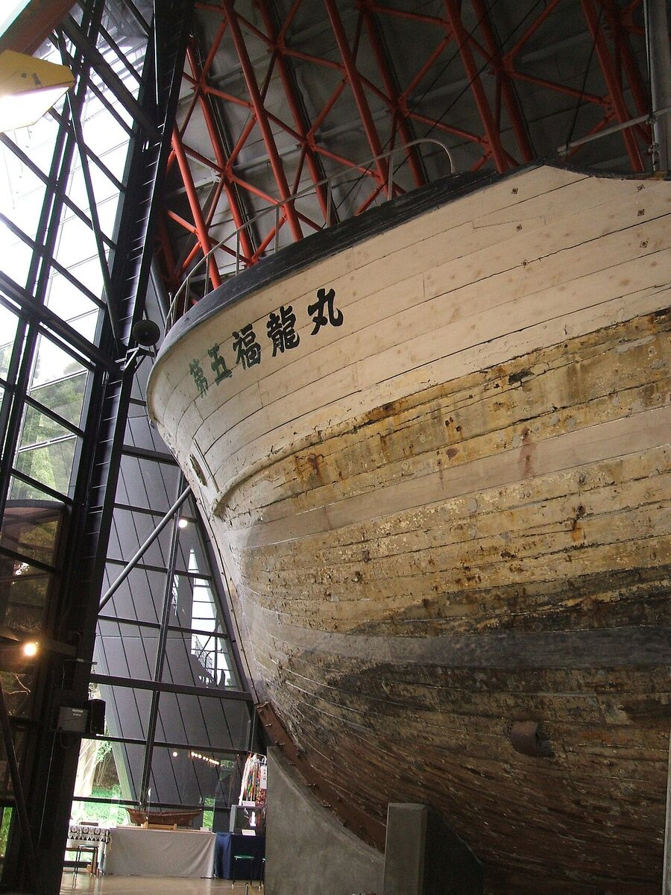
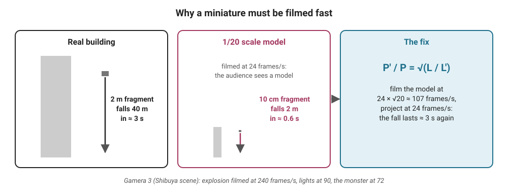

# 6. Monsters and Special Effects

***Kaijū*** (怪獣, "strange beasts") and ***tokusatsu*** (特撮, "special photography", special effects) are among Japan's best-known exports. They began as something more serious than children's entertainment. The first *Godzilla* was a film about the atomic age, and the effects that made it possible became an art form, a fan culture and even a subject for physicists.

## 6.1 *Godzilla*, 1954

*[Gojira](https://en.wikipedia.org/wiki/Godzilla_(1954_film))* was directed by [Honda Ishirō](https://en.wikipedia.org/wiki/Ishir%C5%8D_Honda) for Tōhō, the studio known in the 1950s for special-effects and monster films (Kitaura 2017). The National Film Archive of Japan cites it as an example of the "advanced special effects techniques" of the golden age (NFAJ, n.d.-a).

Motoko Tanaka explains why the first film differs from what followed (Tanaka 2022):

- **Not a children's film.** Unlike its "unsophisticated low-budget sequels", the original is "a dark horror/SF film".
- **Shaped by real catastrophes.** It is strongly influenced by the atomic bombings of Hiroshima and Nagasaki in 1945. It is also influenced by the **[Lucky Dragon No. 5](https://en.wikipedia.org/wiki/Daigo_Fukury%C5%AB_Maru) incident**: on **1 March 1954**, the crew of a Japanese tuna-fishing boat were contaminated by fallout from a US thermonuclear test at [Bikini Atoll](https://en.wikipedia.org/wiki/Bikini_Atoll).
- **The opening echoes it.** A Japanese fishing boat is struck by a mysterious flash of light near Ōdo Island.
- **Godzilla's origin.** The archaeologist Dr Yamane, played by Shimura Takashi, concludes that Godzilla, asleep since the Mesozoic, has been woken by **American nuclear testing**.
- **A political message.** The film implicitly criticises the United States as "the opposing Other with a nuclear weapon". It also helps restore Japanese national identity, since the Japanese defeat Godzilla by themselves.

Japanese-language teachers still use the film to teach postwar history. One class of advanced learners used *Godzilla* as a starting point for research on the politics, economy, society and culture of 1950s Japan, including the Lucky Dragon (Yamazaki 2018).

<figure>

<figcaption>The bow of the <em>Daigo Fukuryū Maru</em> (Lucky Dragon No. 5), the tuna boat contaminated by fallout from a US hydrogen-bomb test at Bikini Atoll on 1 March 1954. <span class="credit">Image: carpkazu, Public domain, via <a href="https://commons.wikimedia.org/wiki/File:Daigo_Fukury%C5%AB_Maru_01.JPG">Wikimedia Commons</a>.</span></figcaption>
</figure>

## 6.2 Tsuburaya Eiji and the art of the miniature

The special effects were directed by [Tsuburaya Eiji](https://en.wikipedia.org/wiki/Eiji_Tsuburaya), whose title was *tokugi kantoku* (special-effects director). His company, **[Tsuburaya Productions](https://en.wikipedia.org/wiki/Tsuburaya_Productions)**, is one of the studios that later built monster tourism and events (Futaesaku 2022). Manabe Kōki has studied Tsuburaya from two angles.

**What audiences watched.** Research has concentrated on *Godzilla*, but Manabe looks at *[Rodan](https://en.wikipedia.org/wiki/Rodan_(film))* (*Sora no daikaijū Radon*, 1956), which was highly praised when it came out (Manabe 2018):

- **Tsuburaya's aim.** He wanted special effects first of all to serve the story.
- **His tolerance.** At the same time, he **accepted that traces of the effects would remain visible**.
- **The result.** In *Rodan* the effects become an "attraction" in a particular sense. They do not merely shock; they invite a **reflective attitude**, in which viewers pay attention to the effects themselves.
- **A turning point.** That attitude "leads to the later psychology of the *otaku* audience" (Chapter 10). *Rodan* thus marks a turning point in how audiences watched effects films.

**How Tsuburaya presented himself.** Manabe analysed **267 articles** that Tsuburaya wrote over his career. They show a strategy that **turned the commercial success of monster films into artistic prestige**, creating "a new norm of perception" for judging them (Manabe 2020).

## 6.3 The physics of a falling building

Why do miniatures look like miniatures? Two engineers at Toyohashi University of Technology use special effects to teach the **scaling laws** of model experiments (Matsuoka and Nakamura 2020):

- **Time does not scale like size.** A model must be similar to the real thing not only in shape but in all the physical quantities that matter.
- **The falling-debris problem.** A 2-metre concrete fragment falling from a height of 40 metres hits the ground in about **3 seconds**. In a 1/20 scale model it falls in about **0.6 seconds**. Filmed at normal speed, "however elaborate the model", the audience would see that it is a model.
- **The rule.** For falling objects, the filming speed must grow with the **square root of the scale factor**: P′/P = √(L/L′).
- **The fix.** For a 1/20 model, film at about **107 frames per second** instead of 24. Projected at the normal 24 frames per second, the fall lasts about 3 seconds again and "almost matches the real thing".
- **In practice.** Real productions do not always follow the formula. Objects at different scales may share a frame, and suit actors can only move so fast. In *Gamera 3*, the destruction of Shibuya was reportedly filmed with the building explosion at **240 frames per second** (ten times normal), lighting effects at 90 and the monster Gamera at 72 (three times normal).

<figure class="diagram">

<figcaption>Why miniatures are filmed at high speed (Matsuoka and Nakamura 2020). <span class="credit">Diagram drawn for this handbook from the sources cited in the chapter.</span></figcaption>
</figure>

## 6.4 Heroes on television

Special effects moved to television, and with them came the **costumed hero**. The longest-running series are Tōei's (Futaesaku 2022; Futaesaku 2025):

- ***[Kamen Rider](https://en.wikipedia.org/wiki/Kamen_Rider)***, from 1971.
- **The *[Super Sentai](https://en.wikipedia.org/wiki/Super_Sentai)* series**, beginning with *Himitsu Sentai Gorenjā* (1975).
- **The "Metal Hero" series.**

These "tokusatsu heroes" have been broadcast for more than half a century (Futaesaku 2025).

**Events for children.** Tōhō held an event inviting children to its studio for the *Godzilla* series in **1955**. Ever since, for about seventy years, special-effects series have been used for shows at department stores, amusement parks and theme parks around the country (Futaesaku 2022).

**Events for grown-ups.** The *Kamen Rider* audience has widened. Events aimed at **young adults who watched the series as children** were already held **about forty years ago** (Futaesaku 2022).

**Abroad.** Japanese tokusatsu hero programmes were exported to the United States and developed a life of their own. US conventions devoted to them have run for **about thirty years**, some drawing tens of thousands of visitors. Futaesaku explains this by America's strong culture of comic and film conventions and by the fans' own initiative (Futaesaku 2025).

## 6.5 *Shin Godzilla* and *Godzilla Minus One*

Godzilla keeps returning when Japan faces a new catastrophe. Tanaka compares the 1954 film with ***[Shin Godzilla](https://en.wikipedia.org/wiki/Shin_Godzilla)*** (*Shin Gojira*, 2016), directed by [Anno Hideaki](https://en.wikipedia.org/wiki/Hideaki_Anno) (Tanaka 2022):

- **Inspired by 2011.** Critics in Japan and abroad agree the film is "clearly inspired" by the earthquake, tsunami and Fukushima nuclear disaster of **11 March 2011**.
- **No foreign enemy.** Unlike the original, it does not clearly put the blame on the United States, because "nuclear power policies and disaster response systems belong to the domestic" sphere.
- **Its real subject** is Japan's own response to disaster.

In 2024, ***[Godzilla Minus One](https://en.wikipedia.org/wiki/Godzilla_Minus_One)*** won the **Academy Award for Best Visual Effects**. The award went to [Yamazaki Takashi](https://en.wikipedia.org/wiki/Takashi_Yamazaki), Shibuya Kiyoko, Takahashi Masaki and Nojima Tatsuji (Eiren, n.d.-b).

```quiz
title: Chapter 6 self-check
? Which real event of 1 March 1954 is echoed at the start of Godzilla?
- The Lucky Dragon No. 5 fishing boat contaminated by fallout from a US H-bomb test *
- The Tōhoku earthquake
- The bombing of Tokyo
> A Japanese fishing boat is hit by a mysterious flash (Tanaka 2022).

? Who directed the special effects of Godzilla and Rodan?
- Tsuburaya Eiji *
- Honda Ishirō
- Anno Hideaki
> Honda directed Godzilla; Tsuburaya was the special-effects director.

? Why must a 1/20 scale model of a falling building be filmed at about 107 frames per second?
- So that, played back at 24 frames per second, the fall takes as long as in reality *
- Because film cameras cannot run slower
- To save film
> Filming speed scales with the square root of the scale (Matsuoka and Nakamura 2020).

? What attitude did Rodan encourage in its audience, according to Manabe?
- A reflective attention to the special effects themselves *
- Pure shock and fear
- Indifference to the effects
> Manabe links this attitude to later otaku audiences.

? Which disaster inspired Shin Godzilla (2016)?
- The earthquake, tsunami and Fukushima nuclear accident of 11 March 2011 *
- The Lucky Dragon incident
- The 1923 Kantō earthquake
> It places responsibility at home rather than on the United States (Tanaka 2022).

? Since when has the Kamen Rider series been broadcast?
- 1971 *
- 1954
- 1995
> Super Sentai followed in 1975 (Futaesaku 2025).
```

## Sources for this chapter

1. **Eiren, n.d.-b.** See [Chapter 3](03-anime.md).
2. **Futaesaku 2022.** Futaesaku Masamitsu 二重作昌満. 東映制作『仮面ライダー（1971）』シリーズの観光史研究：特撮ツーリズム研究の一環として (Research on the tourism history of the *Kamen Rider* series). *Proceedings of the JITR Annual Conference* 2022;37:187–192. doi:[10.18979/jitrproceedings.37.0_187](https://doi.org/10.18979/jitrproceedings.37.0_187).
3. **Futaesaku 2025.** Futaesaku Masamitsu 二重作昌満. 米国における日本特撮ヒーロー番組の放送から催事開催までの記録と変遷 (The record and evolution of Japanese tokusatsu hero programmes in the United States: from broadcast to event organisation). *Proceedings of the JITR Annual Conference* 2025;40:217–222. doi:[10.18979/jitrproceedings.40.0_217](https://doi.org/10.18979/jitrproceedings.40.0_217).
4. **Kitaura 2017.** See [Chapter 5](05-cinema.md).
5. **Manabe 2018.** Manabe Kōki 真鍋公希. 『空の大怪獣ラドン』における特撮の機能：怪獣映画の「アトラクション」をめぐって (The function of special effects in *Rodan*). *Iconics (Eizōgaku)* 2018;99:25–45. doi:[10.18917/eizogaku.99.0_25](https://doi.org/10.18917/eizogaku.99.0_25).
6. **Manabe 2020.** Manabe Kōki 真鍋公希. 特撮技師の執筆戦略：P. Bourdieuの場の理論の視座から (Writing strategy of a special-effects technician). *Sociologi* 2020;65(2):57–74. doi:[10.14959/soshioroji.65.2_57](https://doi.org/10.14959/soshioroji.65.2_57).
7. **Matsuoka and Nakamura 2020.** Matsuoka Tsuneyoshi, Nakamura Yūji 松岡常吉・中村祐二. 特撮における時間の相似則 (A time scaling: scaling laws in SFX films). *Journal of the Japanese Society for Experimental Mechanics* 2020;20(4):229–236. doi:[10.11395/jjsem.20.229](https://doi.org/10.11395/jjsem.20.229).
8. **NFAJ, n.d.-a.** See [Chapter 3](03-anime.md).
9. **Tanaka 2022.** Tanaka Motoko. Apocalyptic imagination in *Godzilla Resurgence*. *Electronic Journal of Contemporary Japanese Studies* 2022;22(3), article 10. [EJCJS](https://www.japanesestudies.org.uk/ejcjs/vol22/iss3/tanaka.html).
10. **Yamazaki 2018.** Yamazaki Tomoko 山﨑智子. 映画の時代背景から発展させた日本理解のための活動：『ゴジラ』（1954）を動機付けとして (Activities for understanding Japan based on the historical background of a movie: *Godzilla* (1954)). *Journal of the Society for Japanese Language Education Methods* 2018;24(2):138–139. doi:[10.19022/jlem.24.2_138](https://doi.org/10.19022/jlem.24.2_138).

➡️ Next: [Chapter 7: Video games](07-games.md)
