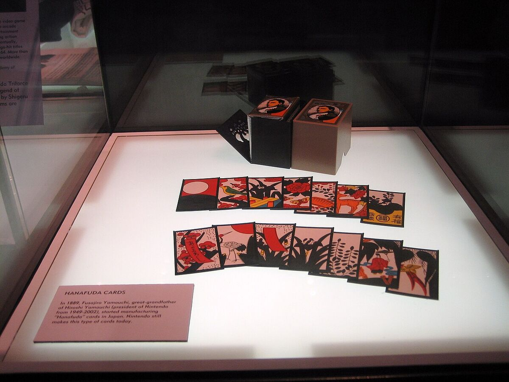
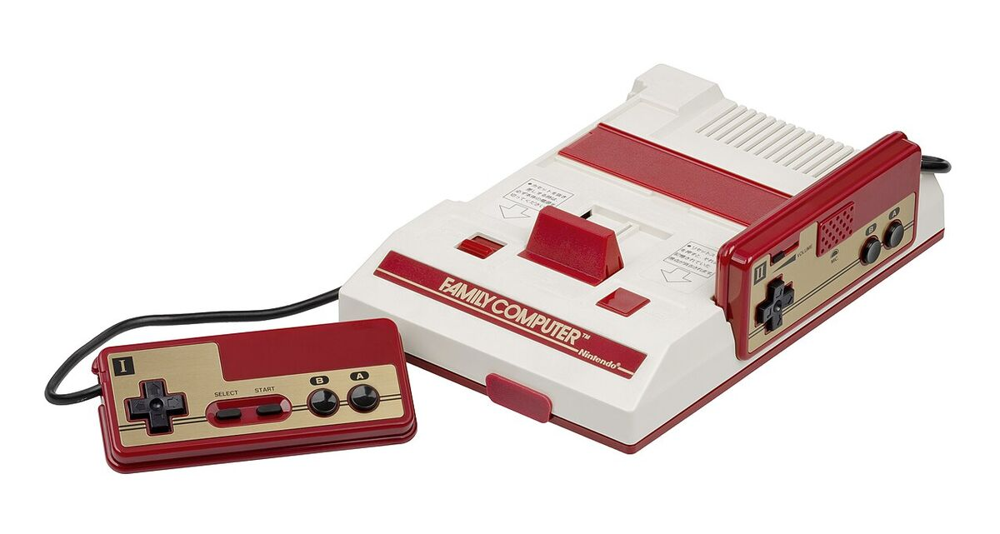

# 7. Video Games

Japan did not invent the video game. It became, for a generation, the place where the most influential games and machines came from. This chapter follows that story through one company's official history, the testimony of an engineer who helped design the Famicom, and studies of arcades and role-playing games. As elsewhere in this handbook, it shows no screenshots or characters. The pictures are of hardware, places and the playing cards where it all began.

## 7.1 From playing cards to consoles: Nintendo's timeline

[Nintendo](https://en.wikipedia.org/wiki/Nintendo)'s official company history shows how far back one of the industry's founders reaches (Nintendo, n.d.):

| Year | Event |
|---|---|
| **1889** | Yamauchi Fusajirō begins making and selling ***[hanafuda](https://en.wikipedia.org/wiki/Hanafuda)*** (Japanese playing cards) in Kyoto |
| 1902 | First Western-style playing cards made in Japan |
| 1953 | First company in Japan to mass-produce plastic playing cards |
| 1959 | Starts selling playing cards with Disney characters |
| 1963 | Takes the name Nintendo Co., Ltd. |
| 1977 | First home video game machines, *TV Game 15* and *TV Game 6* |
| 1978 | Arcade video game machines |
| 1980 | *Game & Watch* handheld games |
| 1981 | Arcade game *Donkey Kong* |
| **1983** | ***[Family Computer](https://en.wikipedia.org/wiki/Nintendo_Entertainment_System)*** (Famicom; the Nintendo Entertainment System abroad) |
| 1985 | *Super Mario Bros.* |
| 1989 | Game Boy |
| 1990 | Super Famicom |
| 1996 | Nintendo 64 |
| 2004 | Nintendo DS |
| 2006 | Wii |
| 2017 | Nintendo Switch, "a home video game system that can also be used as a handheld" |
| 2019 | Nintendo TOKYO, Japan's first official flagship store, opens in Shibuya |
| 2021 | Super Nintendo World opens at Universal Studios Japan, the first Nintendo theme park area in the world |

<figure>

<figcaption>Nintendo hanafuda cards. The company began by making these Japanese playing cards in Kyoto in 1889 (Nintendo, n.d.). <span class="credit">Image: fuzzcat, <a href="https://creativecommons.org/licenses/by/2.0/">CC BY 2.0</a>, via <a href="https://commons.wikimedia.org/wiki/File:Nintendo_Hanafuda.jpg">Wikimedia Commons</a>.</span></figcaption>
</figure>

## 7.2 The first boom: calculators and television

Uemura Masayuki took part in developing the Famicom as an engineer and later wrote its history as a researcher. His account starts with two postwar mass products: **the television set** and **the electronic calculator** (Uemura 2009).

- **The first boom was American.** Home versions of the tennis game *PONG* were sold across the United States from 1975.
- **The boom reached Japan,** but not as electronics. Here TV games spread "as a new electronic toy", mainly through toy departments, and the boom soon ended.
- **Calculators supplied the chips.** The calculator industry, which swept "the home of abacus culture, Japan" as well as the United States, gave the new LSI chips a mass market. Calculators and LSIs grew together, creating a market in which digital products gain functions as their prices fall. TV games rode on the same technology.
- **Microprocessors.** By the end of the 1970s it was clear that microprocessor-controlled games were the future. A microprocessor-based arcade game, ***[Space Invaders](https://en.wikipedia.org/wiki/Space_Invaders)***, set off an "unprecedented Invader boom" centred on game centres in **Japan and the United States**.

### *Space Invaders* and the game centre

An overview in the journal of the Institute of Electrical Engineers of Japan adds detail (Inakazu et al. 2016):

- ***Space Invaders* was released by Taito** and was a game of human against computer.
- **Its novelty** was that the microprocessor inside the cabinet "reads the player's movements".
- **It was a national news story.** Its popularity was reported on television day after day.

The same overview traces amusement machines in Japan back to **1931**. In that year amusement was first recognised as a form of business, with the opening of "Sportsland" on the seventh floor and roof of the [Matsuya](https://en.wikipedia.org/wiki/Matsuya_(department_store)) department store in Asakusa, Tokyo. The adult sports machines drew mostly onlookers, and the business found its audience with miniature cars that parents and children could enjoy together. Game centres today aim at every age group "from infants to the elderly", with crane games and rhythm games such as *Taiko no Tatsujin* ("Master of the drums"). A version of *Taiko no Tatsujin* was even redeveloped for rehabilitation, adjusting its speed to the player's pulse and blood pressure (Inakazu et al. 2016).

### How politicians saw the arcade

Kawasaki Yasuo searched the minutes of Japan's parliament for statements about game centres. Lawmakers and officials saw them mainly through two issues, **the protection of young people** and **gambling**. The wish to keep regulating them, especially to protect the young, has continued (Kawasaki 2022).

## 7.3 The Famicom era and the Japanese RPG

<figure>

<figcaption>The Nintendo Family Computer (Famicom), launched in Japan in 1983. <span class="credit">Image: Evan-Amos, Public domain, via <a href="https://commons.wikimedia.org/wiki/File:Nintendo-Famicom-Console-Set-FL.jpg">Wikimedia Commons</a>.</span></figcaption>
</figure>

Uemura's history treats the Famicom as the machine "said to have laid the foundation of the present video game industry" (Uemura 2009). One genre shows how Japan reshaped what it imported.

**Two paths from one root.** Takeaki Wada compares role-playing games in the West and in Japan (Wada 2017):

- **In the West**, computer role-playing games grew out of tabletop role-playing games. Many tabletop fans became developers and tried to recreate the tabletop experience: "story developments based on the free selection of actions" and "realistic simulations in virtual worlds".
- **In Japan**, players met computer RPGs **first**, imported from the West, before tabletop games.
- **Three features followed:**
  1. **Fixed storylines**, at first because of the technical limits of the time.
  2. **Experience points and levels**: the system that develops characters by "accumulating experience points and increasing the levels" was considered "fun" in itself.
  3. **Anime-style character designs** drawn from manga and anime culture.
- **The result** is the genre known abroad as the **"JRPG"**.

**How RPGs spread.** Kobayashi Nobushige reconstructs how Japan adopted the genre (Kobayashi 2025):

- **Two channels in the 1980s.** RPGs reached enthusiasts through personal-computer magazines, and reached children and the general public through **boys' manga magazines**.
- ***[Dragon Quest](https://en.wikipedia.org/wiki/Dragon_Quest)*** made Western RPGs easy to understand and approachable.
- ***[Final Fantasy](https://en.wikipedia.org/wiki/Final_Fantasy)*** and others aimed instead to return towards the Western model.

The designer of *Dragon Quest*, [Horii Yūji](https://en.wikipedia.org/wiki/Yuji_Horii), spent 1978–1988 as a **freelance writer** before becoming a famous game designer. His work was supported by a network of graduates of university manga clubs, by Tokyo's mass media and by the new consumer society (Kobayashi 2023). It is a small example of how closely games, manga and magazines were tied together.

## 7.4 Games as part of the media mix

Games are now one part of the "media alliance" of manga, anime, film and merchandise described in Chapter 3 (Rimmer 2004). Nintendo's own timeline shows the same movement outwards:

- **A flagship store** in Shibuya (2019).
- **A theme-park area** at Universal Studios Japan in Osaka (2021).
- **The Super Mario Bros. Movie** (2023), described as the first animated film produced in partnership with Nintendo (Nintendo, n.d.).

Chapter 13 gives practical advice on visiting game centres and retro-game shops.

```quiz
title: Chapter 7 self-check
? What did Nintendo make when it was founded in 1889?
- Hanafuda playing cards *
- Toys
- Arcade machines
> Yamauchi Fusajirō began in Kyoto (Nintendo, n.d.).

? In which year was the Family Computer (Famicom) launched?
- 1983 *
- 1977
- 1989
> Super Mario Bros. followed in 1985.

? Which mass product supplied the chips that made TV games cheap, according to Uemura?
- The electronic calculator *
- The transistor radio
- The washing machine
> The calculator and LSI industries grew together.

? What was new about Space Invaders, according to the IEEJ overview?
- The microprocessor in the cabinet "read" the player's movements *
- It was the first game in colour
- It was the first home console game
> Its popularity was reported on TV day after day.

? Why do Japanese RPGs typically have fixed storylines, according to Wada?
- Japan met computer RPGs before tabletop RPGs, and early technical limits fixed the story *
- Japanese players dislike choice
- Because of censorship
> Levelling up and anime-style characters were the other two defining features.

? How did lawmakers mainly view game centres, according to Kawasaki?
- In terms of youth protection and gambling *
- As tourist attractions
- As high art
> The wish to regulate them, especially to protect the young, has continued.
```

## Sources for this chapter

1. **Inakazu et al. 2016.** Inakazu Kōsuke, Obuse Taishi, Okada Keisuke et al. アミューズメントマシンとゲームセンター (Amusement machines and game centres). *Journal of the Institute of Electrical Engineers of Japan* 2016;136(7):438–441. doi:[10.1541/ieejjournal.136.438](https://doi.org/10.1541/ieejjournal.136.438).
2. **Kawasaki 2022.** Kawasaki Yasuo 川﨑寧生. 日本のゲームセンターに対する社会的認識の変遷：国会議事録の調査分析を中心に (Transition of social recognition of Japanese game centres: the Diet proceedings). *Proceedings of the DiGRA Japan Summer Conference* 2022: 49–54. doi:[10.57518/digrajprocsummer.2022.0_49](https://doi.org/10.57518/digrajprocsummer.2022.0_49).
3. **Kobayashi 2023.** Kobayashi Nobushige 小林信重. フリーライター時代の堀井雄二の創作活動を支えた社会的文脈 (The social contexts that supported Yuji Horii's creative activities as a freelance writer). *Proceedings of the DiGRA Japan Summer Conference* 2023: 90–94. doi:[10.57518/digrajprocsummer.2023.0_90](https://doi.org/10.57518/digrajprocsummer.2023.0_90).
4. **Kobayashi 2025.** Kobayashi Nobushige 小林信重. 日本におけるロールプレイングゲームの領有過程：『ドラゴンクエスト』と『ファイナルファンタジー』を中心に (The appropriation process of role-playing games in Japan). *Proceedings of the DiGRA Japan Summer Conference* 2025: 113–118. doi:[10.57518/digrajprocsummer.2025.0_113](https://doi.org/10.57518/digrajprocsummer.2025.0_113).
5. **Nintendo, n.d.** Nintendo Co., Ltd. Corporate information: company history. [nintendo.co.jp](https://www.nintendo.co.jp/corporate/en/history/index.html).
6. **Rimmer 2004.** See [Chapter 2](02-manga.md).
7. **Uemura 2009.** Uemura Masayuki 上村雅之. テレビゲームの産業・技術史（第一部）：世界初のテレビゲームブーム (The video game industry and its technological history, part I: the world's first video game boom). *Journal of Digital Games Research* 2009;3(2):191–203. doi:[10.9762/digraj.3.2_191](https://doi.org/10.9762/digraj.3.2_191).
8. **Wada 2017.** Wada T. History of Japanese role-playing games. *Annals of Business Administrative Science* 2017;16:137–147. doi:[10.7880/abas.0170228a](https://doi.org/10.7880/abas.0170228a).

➡️ Next: [Chapter 8: Music](08-music.md)
