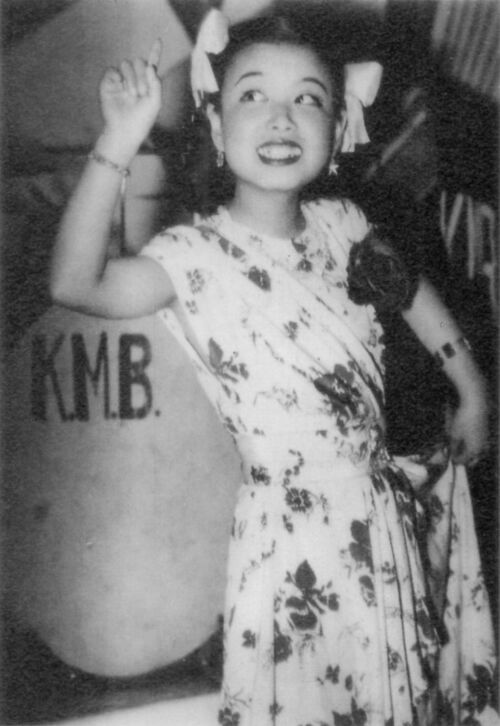

# 8. Music

Japanese popular music is a huge domestic industry with its own history of genres, stars and fan practices. This chapter follows four threads the sources examine closely:

- ***enka***, which turns out to have begun as protest song;
- **idols**, a star system built on closeness to fans;
- **city pop**, rediscovered by listeners abroad;
- **Hatsune Miku**, a "virtual singer" anyone can make sing.

## 8.1 *Enka*: from political song to "the heart of Japan"

Today ***[enka](https://en.wikipedia.org/wiki/Enka)*** is used loosely for a style of popular song said to have "Japanese" musical and emotional features. The music historian Gondō Atsuko shows that the word once meant something very different (Gondō 1988).

**Songs of the activists.** *Enka* (演歌) originally meant songs sung by the ***sōshi***, young activists of the Meiji-period [Freedom and People's Rights Movement](https://en.wikipedia.org/wiki/Freedom_and_People%27s_Rights_Movement).

- **Songs as speeches.** Songs such as the *Dynamite-bushi* voiced anger at politics, rallied the people and carried political messages while escaping official suppression.
- **Street singers.** Until early Shōwa, when records became common, they were sung by ***enkashi***: street performers who sang and sold printed songbooks.
- **No fixed style.** *Enka* was defined by who sang it, not by its musical form.

**From anger to private feeling.** After the movement failed and the Meiji order was established, the lyrics changed (Gondō 1988):

1. **Satire, self-mockery and clowning** replaced anger.
2. **Then private feelings** took over: grudges, desperation and lingering regret.

**News in song.** *Enka* was topical. Sensational news stories and current fashions were quickly turned into songs and sung in the street. Singers borrowed melodies from whatever was popular, including Chinese music of the Ming and Qing style, school songs (*shōka*), folk songs and Asakusa opera. In an age without mass media, *enkashi* spread popular songs across the country. Gondō counts about 450 songs called *enka*, of which 280 can be identified today (Gondō 1988).

**The violin and Western music.** Inspired by the bands that played in cinemas, the singer Kaminaga Ryōgetsu began to accompany his songs on the **violin**. Soon *enkashi* said they could not do business without one, and "violin *enka*" became the standard form. From the mid-Taishō period, **original songs overtook new words set to borrowed tunes**, and **more than 80 per cent of the originals were written in a Western musical idiom** (Gondō 1988).

So the genre now heard as the sound of old Japan took shape through politics, street journalism and Western music.

<figure>

<figcaption>The singer Misora Hibari performing at the Yokohama Kokusai Gekijō theatre in 1948. <span class="credit">Image: Unknown, Public domain, via <a href="https://commons.wikimedia.org/wiki/File:Misora_Hibari_in_Yokohama_Kokusai_Gekij%C5%8D_-_1948.png">Wikimedia Commons</a>.</span></figcaption>
</figure>

## 8.2 Idols

Japan's ***[idols](https://en.wikipedia.org/wiki/Japanese_idol)*** (*aidoru*) are performers whose appeal lies as much in their persona and their relationship with fans as in their songs. Amano Kensaku and Tamura Natsuki describe how the system works (Amano and Tamura 2026).

**Becoming an idol.** There are two routes:

- **Scouting.** An agency spots a promising young person. Harajuku's Takeshita Street was called "the holy land of scouting", and today scouts also contact people through TikTok and Instagram. In the scouting model, the agency drives the process and the idol is an object of admiration.
- **Auditions.** These spread through television from the 1980s. The selection process itself is shown to the public, so the audition finds performers and fans at once. The groups produced by Akimoto Yasushi, such as **[AKB48](https://en.wikipedia.org/wiki/AKB48)** and Nogizaka46, hold regular open auditions. Here the drive comes from the candidate, and fans "grow up together" with the idol.

**Television.** The idols of the 1970s and 1980s, such as Yamaguchi Momoe, Matsuda Seiko and Nakamori Akina, became national stars through television music programmes. Later idols also needed variety-show skills: talk, reactions and a distinct "character". The group SMAP showed singing, dancing, comedy and talk on its own programme (Amano and Tamura 2026).

**"Idols you can go and meet."** AKB48 succeeded with the concept of *aini ikeru aidoru* (会いに行けるアイドル, "idols you can go and meet"):

- **A theatre** of its own in Akihabara.
- **Handshake events** (*akushukai*).
- **"General elections"**, in which fans vote for the members they support.

Personal contact gives each fan a sense of a special relationship. The flip side is that a romantic scandal makes fans feel "betrayed" (Amano and Tamura 2026).

### The dating ban and the courts

Why do so many idols promise not to date? Amano and Tamura give two reasons (Amano and Tamura 2026):

- **"Pseudo-romance" as a business.** The idol is, in effect, every fan's partner.
- **"Incomplete earnestness."** The idol's story is that of an unfinished girl who works hard to reach her dream. A romance seems to make that effort a fiction.

A court has tested this. In a judgment of the **Tokyo District Court on 18 January 2016**, an agency sued a former idol for damages (Amano and Tamura 2026):

- **The contract.** The woman had signed a management contract at 19, with a clause allowing damages if she had sexual relations with a fan.
- **The breach.** She began a relationship with a male fan and later left the group.
- **The ruling.** The court rejected the claim. Whatever the contract said, a damages penalty restricted her constitutional "right to the pursuit of happiness" too severely. Whether someone has had sexual relations is a "secret of private life".

The authors also raise wider problems (Amano and Tamura 2026):

- **Minors.** Many idols are under age. Their training and work in practice resemble demanding labour.
- **Ageism.** Most leave in their twenties, and over thirty, discrimination by age becomes stark. Youth is the idol industry's central value.
- **"Graduation".** Leaving a group (*sotsugyō*) is followed by the difficult question of a career afterwards.

### Idols and the nation

Yunuen Mandujano argues that after the March 2011 earthquake and Fukushima disaster, Japan's media, government and corporations used a "national idol" group to reinforce ***nihonjinron*** ideas of Japanese uniqueness. She calls this a case of "banal nationalism": not openly aggressive, but constantly "flagging" a flattering national image (Mandujano 2014).

## 8.3 City pop

***[City pop](https://en.wikipedia.org/wiki/City_pop)*** is Japanese pop music that took shape **in the late 1970s** under the influence of North American popular music, Black music and Latin music. Kondō and colleagues list its representative artists as Yamashita Tatsurō, Matsutōya (Arai) Yumi and Ōtaki Eiichi. Its lyrics and sound are usually described as "urban" and "sophisticated", pop music for city dwellers (Kondō et al. 2025).

City pop **has drawn worldwide attention since the mid-2010s**. Kondō and colleagues analysed its lyrics with natural-language processing (Kondō et al. 2025):

- **Two "cities".** Different words for "city" carry different images, one prosperous and one nostalgic.
- **Real places.** The images in the lyrics reflect real cityscapes and historical contexts, especially Tokyo's.
- **Change over time.** The images have shifted as the genre developed.

## 8.4 Hatsune Miku: a singer anyone can use

On **31 August 2007**, Crypton Future Media released the singing-synthesis software ***[Hatsune Miku](https://en.wikipedia.org/wiki/Hatsune_Miku)***, built on Yamaha's **[VOCALOID](https://en.wikipedia.org/wiki/Vocaloid)** technology. Gotō Masataka of the National Institute of Advanced Industrial Science and Technology (AIST) explains what made it different (Gotō 2012):

- **A character as well as a program.** The box carried an anime-style illustration of a "virtual singer" named Hatsune Miku, with an age and a profile.
- **Anyone could use it.** Anyone who bought the software could make it sing their own songs, so amateur creators released song after song.
- **Rights opened to fans.** "Above all", the publisher released the rights in a suitable way. This set off chain reactions: fans drew illustrations of the character and of songs, and made new videos for other people's music.
- **A body for a voice.** Giving the synthesised voice a body, in the form of a character, "played an essential role" in its spread.

Koyama Yūsuke calls Miku the symbol of ***N-ji sōsaku*** ("Nth-order creation"). The term comes from manga *dōjinshi* (Chapter 10), where a work that borrows characters or a world from an original is a "secondary creation" (*niji sōsaku*). A work built on that is third-order, and so on (Koyama 2013):

- **Google's advertisement.** In December 2011, Google's worldwide advertising for its Chrome browser told the story of Hatsune Miku and the creators around her.
- **Its reception.** The advertisement passed a million views in five days.
- **"A virtual singer anyone can make sing."** In Google's description, Miku had produced an explosive Nth-order creation movement of music, illustration, video, computer graphics, cosplay, live performance and dance.

```quiz
title: Chapter 8 self-check
? What did the word enka originally mean?
- Songs sung by activists of the Freedom and People's Rights Movement *
- Traditional court music
- Folk songs of fishing villages
> Later enkashi sold songbooks in the street (Gondō 1988).

? Which instrument became standard for enka singers in the Taishō period?
- The violin *
- The shamisen
- The piano
> Kaminaga Ryōgetsu took the idea from cinema bands.

? What was AKB48's founding concept?
- "Idols you can go and meet", with a theatre in Akihabara and handshake events *
- Idols who appear only on television
- Virtual idols
> Amano and Tamura 2026.

? How did the Tokyo District Court rule in January 2016 on an idol who broke a no-dating clause?
- It rejected the agency's claim for damages *
- It ordered her to pay full damages
- It banned her from performing
> A damages penalty restricted her right to the pursuit of happiness too severely.

? When did city pop take shape?
- In the late 1970s *
- In the 1950s
- In the 2010s
> It has drawn worldwide attention since the mid-2010s (Kondō et al. 2025).

? According to Gotō, what made Hatsune Miku spread so widely?
- Giving the synthesised voice a character, and opening the rights to fans *
- Heavy television advertising
- Concerts with a human singer
> Fans made songs, illustrations and videos in chains of "Nth-order creation".
```

## Sources for this chapter

1. **Amano and Tamura 2026.** Amano Kensaku, Tamura Natsuki 天野健作・田村菜月. アイドルはいかに生まれ、いかに終わるのか：恋愛禁止と卒業後キャリア (How are idols born, and how do they end? Dating bans and post-graduation careers). *Globe, Universe, Next Future* 2026;3(1):73–86. doi:[10.60420/globeuniversefuture.3.1_73](https://doi.org/10.60420/globeuniversefuture.3.1_73).
2. **Gondō 1988.** Gondō Atsuko 権藤敦子. 明治・大正期の演歌における洋楽受容 (The reception of Western music in the *enka* of the Meiji and Taishō periods). *Tōyō Ongaku Kenkyū* 1988;53:1–27. doi:[10.11446/toyoongakukenkyu1936.1989.1](https://doi.org/10.11446/toyoongakukenkyu1936.1989.1).
3. **Gotō 2012.** Gotō Masataka 後藤真孝. 「初音ミク」はなぜ注目されているのか (Why does "Hatsune Miku" attract attention?). *Journal of the Institute of Electrical Engineers of Japan* 2012;132(9):630–633. doi:[10.1541/ieejjournal.132.630](https://doi.org/10.1541/ieejjournal.132.630).
4. **Kondō et al. 2025.** Kondō Takumu, Watanabe Ichirō, Inoue Takuo et al. シティ・ポップにおける「シティ」のイメージ (The image of "city" in Japanese city pop). *Journal of the City Planning Institute of Japan* 2025;60(3):540–547. doi:[10.11361/journalcpij.60.540](https://doi.org/10.11361/journalcpij.60.540).
5. **Koyama 2013.** Koyama Yūsuke 小山友介. 初音ミク：N次創作が拓く新しい世界 (Hatsune Miku: user-generated content opens a new world). *Systems, Control and Information* 2013;57(5):189–194. doi:[10.11509/isciesci.57.5_189](https://doi.org/10.11509/isciesci.57.5_189).
6. **Mandujano 2014.** Mandujano Y. Flagging the national identity, reinforcing Japaneseness: the case of the national idols pre- and post-2011. *Electronic Journal of Contemporary Japanese Studies* 2014;14(1), article 3. [EJCJS](https://www.japanesestudies.org.uk/ejcjs/vol14/iss1/mandujano.html).

➡️ Next: [Chapter 9: Kawaii and character culture](09-kawaii.md)
