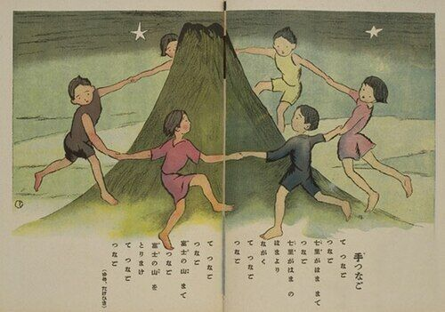
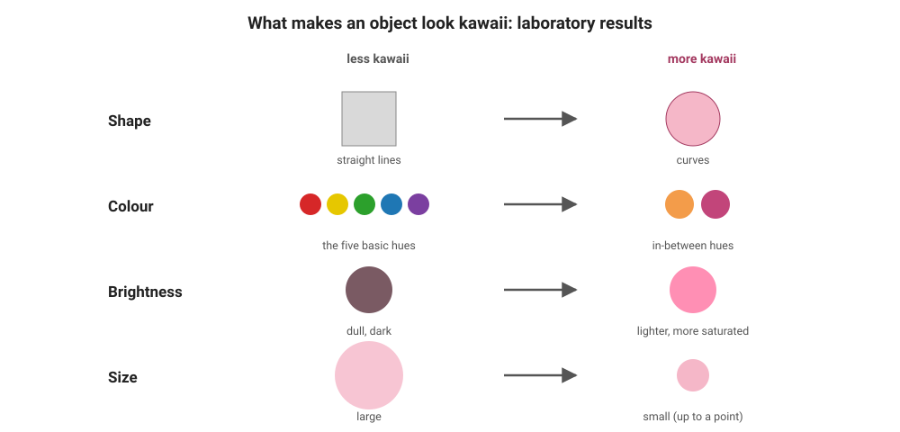
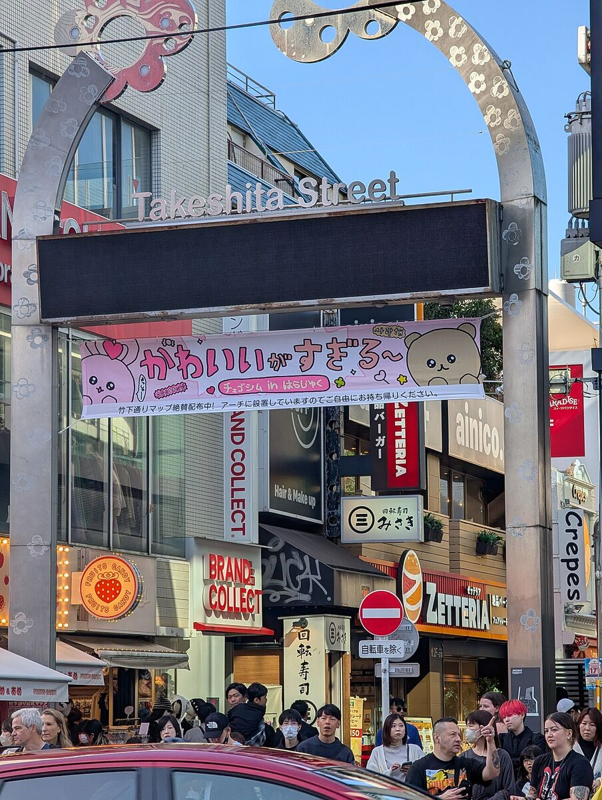

# 9. Kawaii and Character Culture

***Kawaii*** (かわいい, "cute") is one of the few Japanese words that has become an international one. This chapter covers:

- **where the word comes from** and how the idea of "cute" developed;
- **what laboratory experiments say** makes something look cute;
- **kawaii fashion** from the postwar years to Instagram;
- **local mascot characters** that towns and prefectures use to promote themselves;
- **the government's interest** in kawaii.

## 9.1 A word with a long history

Miyatake Keiko traces the word and the sensibility behind it (Miyatake 2026):

- **Etymology.** *Kawaii* comes from the old word ***kawayushi***, "so embarrassed that one's face flushes" or "arousing pity". At first it expressed a feeling towards **weak beings one wants to protect**.
- **Today** it has a more active and positive range: "small and lovable", "approachable", "comfortable and true to oneself".
- **The Heian court.** In *[The Pillow Book](https://en.wikipedia.org/wiki/The_Pillow_Book)*, Sei Shōnagon wrote that "small things are all lovely" (*chiisaki mono wa mina utsukushi*). She treated the charm of little beings as a value of beauty.
- **Edo.** Dolls, toys and ukiyo-e prints competed in "lovableness", and an "aesthetic of cherishing" spread among ordinary people.
- **Taishō and early Shōwa.** The illustrations of [Takehisa Yumeji](https://en.wikipedia.org/wiki/Takehisa_Yumeji) and [Nakahara Jun'ichi](https://en.wikipedia.org/wiki/Jun%27ichi_Nakahara), and the girls' magazine *Shōjo no tomo*, presented "a sweet and independent image of the girl". They linked cuteness to inner worth.

Ohkura Michiko notes that the passage usually cited as the origin of today's *kawaii* is section 151 of *The Pillow Book*, "Things that are lovely" (*utsukushiki mono*) (Ohkura 2015).

<figure>

<figcaption>Takehisa Yumeji, <em>Holding Hands</em>, from the children's magazine <em>Kodomo no kuni</em>, December 1922. Miyatake names Yumeji's illustrations among the sources of today's idea of kawaii. <span class="credit">Image: Takehisa Yumeji, Public domain, via <a href="https://commons.wikimedia.org/wiki/File:Kodomo_no_kuni_magazine%2C_vol._1_no._12_%2C_Holding_Hands_by_Yumeji_Takehisa%2C_December_1922.jpg">Wikimedia Commons</a>.</span></figcaption>
</figure>

## 9.2 What makes something look kawaii?

Kawaii is usually described by its visual features: **smallness, roundness, softness, pale colours and cleanliness**. These give people a sense of security and closeness (Miyatake 2026).

Ohkura's team at the Shibaura Institute of Technology has tested this since 2006. They showed people abstract objects, many in virtual reality, varying shape, colour, size, texture and touch (Ohkura 2015). Their findings:

- **Curves beat straight lines.** Curved shapes are more kawaii than straight-edged ones.
- **Bright, saturated colours.** Within the same hue, higher lightness and saturation are more kawaii.
- **In-between hues.** Intermediate colours (yellow-red, red-purple) are more kawaii than the five basic hues (red, yellow, green, blue and purple).
- **Small, up to a point.** Up to a certain size, smaller is more kawaii.
- **Details matter.** Even the same object, such as a ribbon, varies in cuteness with its colour, pattern and shape.

<figure class="diagram">

<figcaption>What makes an object look kawaii, according to Ohkura's experiments (Ohkura 2015). <span class="credit">Diagram drawn for this handbook from the sources cited in the chapter.</span></figcaption>
</figure>

## 9.3 Kawaii fashion, decade by decade

Miyatake's history of kawaii fashion runs as follows (Miyatake 2026):

| Period | Typical design | Main media and actors |
|---|---|---|
| Postwar to 1950s | Round-collared blouses, frilled dresses, big ribbons; home-made with the newly common sewing machine | Girls' magazines *Shōjo no tomo* and *Shōjo kurabu* reprinting Nakahara Jun'ichi's illustrations. *Soreiyu* (founded 1946) printed patterns and colour advice |
| 1960s–1970s | Rococo dresses, lace, frilled aprons, big ribbons; finer lines and larger eyes in drawings | Girls' manga such as *The Rose of Versailles* and *Candy Candy*; the Year 24 Group (Chapter 2) |
| 1980s–early 2000s | Neat, refined silhouettes, soft colours, A-lines, frills | Women's fashion magazines such as *JJ*, *CanCam*, *ViVi*, *Olive* |
| 1990s | Vintage mixes, remakes, clashing patterns, layering; Gothic and Lolita; Shibuya *gyaru* with bleached hair and platform shoes | *Zipper*, *CUTiE*; Harajuku street style; Gothic & Lolita communities |
| 2000s | *Mori gāru* ("forest girl") natural materials and pale colours; "elegant cute" for office workers | Bloggers; *CanCam*, *Sweet* |
| 2010s–2020s | Many coexisting styles: "Harajuku eclectic", "Lolita", "street kawaii" | Social media and indie brands; Generation Z; international events |

Two turning points stand out:

- **The 1970s girls' manga.** The Year 24 Group drew androgynous characters and fantastic worlds that crossed the boundaries of gender, nation and reality. Miyatake argues that they took apart the old equation of "kawaii = childishness and obedience" and redefined it as "kawaii = sensitivity and aesthetic intensity". From the late 1970s, readers' pages showed how to recreate characters' outfits: cuteness moved from "something you read" to "something you wear".
- **The 1990s.** After the bubble burst, Harajuku street culture came to the fore and "self-creativity" was emphasised (Miyatake 2026).

<figure>

<figcaption>Takeshita Street in Harajuku, Tokyo, 2024. The banner reads <em>kawaii ga sugiru</em> ("too cute"). Amano and Tamura note that the street was called the "holy land of scouting" for idols. <span class="credit">Image: Syced, <a href="https://creativecommons.org/publicdomain/zero/1.0/">CC0</a>, via <a href="https://commons.wikimedia.org/wiki/File:Takeshita_Street.jpg">Wikimedia Commons</a>.</span></figcaption>
</figure>

## 9.4 *Yuru-kyara*: towns with mascots

Japanese local governments create mascot characters to promote their areas, called ***gotōchi kyarakutā*** (local characters) or ***[yuru-kyara](https://en.wikipedia.org/wiki/Yuru-chara)*** ("loose", laid-back characters). Terayama and Tanaka describe the boom (Terayama and Tanaka 2015):

- **Older than the boom.** Local characters were already active in the late twentieth century.
- **The name.** In the early 2000s Miura Jun featured them in magazines and events as *yuru-kyara*.
- **The breakthrough.** Attention rose with ***[Hikonyan](https://en.wikipedia.org/wiki/Hikonyan)***, the character for the 400th anniversary of [Hikone Castle](https://en.wikipedia.org/wiki/Hikone_Castle) in 2006.
- **A contest.** The **Yuru-kyara Grand Prix** began in 2010, and both "yuru-kyara" and the contest's name became registered trademarks.
- **Scale.** In 2014, **1,698 characters** entered.
- **Rules.** To compete in the "local" division, a character had to belong to one specific area and **have a costume** (*kigurumi*).

**The economics of licensing.** Hirayama and Tokizane surveyed local governments about their characters (Hirayama and Tokizane 2014):

- **Partly successful.** Most felt the characters had achieved their aims to some extent.
- **Problems.** They reported low recognition, too few staff and the work of maintaining the costumes.
- **Rights.** Governments generally held the intellectual property themselves, and **often licensed the characters free of charge**. Other researchers have studied Kumamoto Prefecture's bear, [Kumamon](https://en.wikipedia.org/wiki/Kumamon), as a model of regional revitalisation (cited in Terayama and Tanaka 2015).

**After the boom.** The idol and character enthusiast Terashima Yufu recalls that coverage of the Grand Prix peaked around 2014–17 (Terashima 2025):

- **The contest ended.** It finished with the 2020 Iwate event, having largely fulfilled its purpose of energising regions after the 2011 earthquake.
- **The characters stayed.** After the pandemic cancellations, mascot events resumed in earnest, and both the number of characters taking part and the number of human visitors remain large.

## 9.5 Kawaii as policy

Kawaii has caught the government's attention (Ohkura 2015; Yamada and Morimoto 2015):

- **"An international word."** On New Year's Day 2006, the *Asahi* newspaper declared that kawaii "is already an international word".
- **Kawaii ambassadors.** In 2009 the Ministry of Foreign Affairs announced "pop culture diplomacy" and appointed **pop culture envoys**, nicknamed "kawaii ambassadors".
- **Cool Japan.** In 2011 the Ministry of Economy, Trade and Industry made kawaii culture one of the main contents of its Cool Japan strategy (Chapter 12).
- **Television.** From 2008 to March 2013, NHK broadcast *Tokyo Kawaii TV*, which reported on foreign interest in Japanese kawaii.

Yamada and Morimoto add an important caveat. Most of the overseas spread of kawaii culture has been driven **by fans abroad**: events such as Japan Expo in France and Hyper Japan in Britain are mostly organised by non-Japanese (Yamada and Morimoto 2015).

```quiz
title: Chapter 9 self-check
? What did the old word kawayushi, the source of kawaii, originally express?
- Embarrassment or pity, a feeling towards weak beings one wants to protect *
- Admiration for strength
- Fear of the unknown
> Its meaning has since become more positive and active (Miyatake 2026).

? Which shapes did Ohkura's experiments find more kawaii?
- Curved shapes rather than straight ones *
- Angular shapes
- Large shapes
> Brighter, more saturated and intermediate colours were also more kawaii.

? How did girls' manga of the 1970s change the idea of kawaii, according to Miyatake?
- From childishness and obedience to sensitivity and aesthetic intensity *
- From fashion to food
- From Japanese to Western
> Cuteness moved from something you read to something you wear.

? Which character, made for Hikone Castle's 400th anniversary in 2006, set off the yuru-kyara boom?
- Hikonyan *
- Kumamon
- Hello Kitty
> The Yuru-kyara Grand Prix followed in 2010.

? How do many local governments license their mascots?
- Often free of charge *
- Only to large companies
- Never
> Hirayama and Tokizane 2014.

? Who has mostly driven the spread of kawaii culture abroad, according to Yamada and Morimoto?
- Fans abroad, who organise most of the events *
- The Japanese government alone
- Japanese fashion companies
> Japan Expo and Hyper Japan are examples.
```

## Sources for this chapter

1. **Hirayama and Tokizane 2014.** Hirayama Yōko, Tokizane Sōichi 平山陽子・時実象一. ご当地キャラクターの活用とライセンシング (Local characters and their licensing). *Journal of Japan Society of Information and Knowledge* 2014;24(2):197–203. doi:[10.2964/jsik_2014_018](https://doi.org/10.2964/jsik_2014_018).
2. **Miyatake 2026.** Miyatake Keiko 宮武恵子. 日本のかわいいファッションの変遷と展望：時代性からみる「かわいい」デザイン (The evolution and outlook of Japanese kawaii fashion). *Journal of Japan Society of Kansei Engineering* 2026;24(1):26–30. doi:[10.5057/kansei.24.1_26](https://doi.org/10.5057/kansei.24.1_26).
3. **Ohkura 2015.** Ohkura Michiko 大倉典子. 感性価値としての「かわいい」 ("Kawaii" as an affective value). *Oukan* 2015;9(1):14–19. doi:[10.11487/trafst.9.1_14](https://doi.org/10.11487/trafst.9.1_14).
4. **Terashima 2025.** Terashima Yufu 寺嶋由芙. ゆるキャラの今：新型コロナウイルス影響後のゆるキャラ事情 (Current status of yuru-kyara after the COVID-19 pandemic). *Globe, Universe, Next Future* 2025;1(2):9–21. doi:[10.60420/globeuniversefuture.1.2_9](https://doi.org/10.60420/globeuniversefuture.1.2_9).
5. **Terayama and Tanaka 2015.** Terayama Hikari, Tanaka Hideyuki 寺山ひかり・田中秀幸. ご当地キャラクター活用実態の変遷に関する考察 (A study on changes of so-called yuru-charas' activities). *Proceedings of the Annual Conference of the Society for Socio-Informatics* 2015: 64–69. doi:[10.14836/ssiproceedings.2015.0_64](https://doi.org/10.14836/ssiproceedings.2015.0_64).
6. **Yamada and Morimoto 2015.** Yamada Shinsaku, Morimoto Shōichi 山田晋作・森本祥一. かわいい文化の普及過程と伝達手段に関する情報学的考察 (An analysis of processes and media in the spread of the "kawaii" culture). *Proceedings of the JASMIN Autumn Conference* 2015: 136–139. doi:[10.11497/jasmin.2015f.0_136](https://doi.org/10.11497/jasmin.2015f.0_136).

➡️ Next: [Chapter 10: Otaku and fandom](10-otaku.md)
