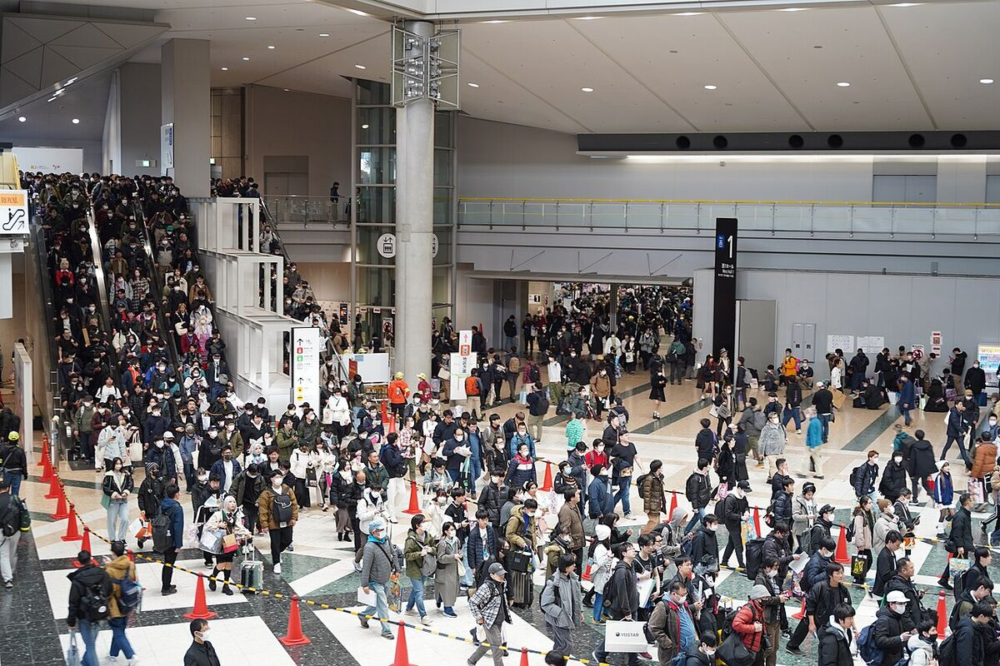
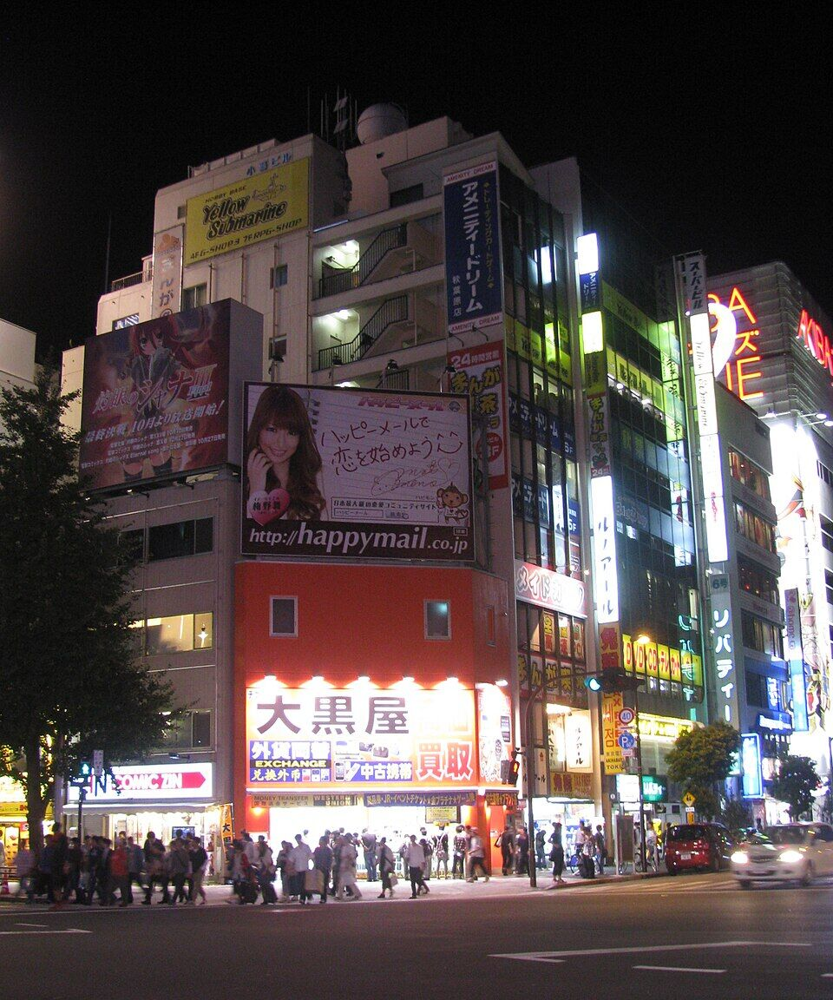

# 10. Otaku and Fandom

***Otaku*** is the Japanese word for devoted fans of manga, anime, games, idols and similar worlds. This handbook does not try to define it or trace its origin; the sources used here do not settle either. What they do describe in detail are the **places** and **practices** of fandom:

- **Comiket**, the world's largest fair for self-published works;
- ***dōjinshi***, the self-published books sold there;
- **Akihabara**, the district that changed from electronics to anime;
- **cosplay**;
- **the habits of attention** that make a fan.

## 10.1 *Dōjinshi*: publishing for its own sake

The Comic Market Committee explains the term for foreign readers (Comic Market Committee 2014):

- **Dictionary definition.** *Dōjinshi* are "magazines published as a cooperative effort by a group of individuals who share a common ideology or goals with the aim of establishing a medium through which their works can be presented".
- **Origins.** They began in literature, fine arts and academia, and grew "as a medium of self-expression for various subcultures centered around manga".
- **Today**, a book edited and published by one person to present their own work also counts.
- **Outside the trade.** As a rule, *dōjinshi* stay outside commercial publishing. "Ordinarily commercial gain is not the primary rationale" for making them, and their distribution is limited.

Much *dōjinshi* is ***niji sōsaku*** ("secondary creation"): work that borrows characters or worlds from an existing manga, anime or game (Koyama 2013; Chapter 8).

Deguchi Hiroshi argues that this reflects a long Japanese tradition. Japanese picture stories, from scrolls and ukiyo-e to manga, have been made across social classes and have **accepted copying and derivative works**. He contrasts this with the European art tradition, which treats the original as having an "aura" and judges works through authorities from above (Deguchi 2014). Hosogaya finds an early parallel: medieval court women who loved picture scrolls of romances sometimes made their own, "close to what we now call amateur *dōjinshi* activity" (Hosogaya 2019).

## 10.2 Comiket

The ***[Comic Market](https://en.wikipedia.org/wiki/Comiket)*** (*Komikku Māketto*, usually **Comiket** or **Comike**) is run by the Comic Market Committee.

**Beginnings.** The first Comic Market, in **1975**, had **32 circles** (groups of creators) and roughly **700 attendees** (Comic Market Committee 2014). Deguchi notes that it grew out of the fanzine culture of the early 1970s. Groups rented ward community halls to screen anime, make hand-animated "dynavision" films and distribute *dōjinshi*. Among them, the group **Meikyū** became the core of the Comic Market (Deguchi 2014).

**The early years** (Comic Market Committee 2014):

- **1975–81.** It was launched "to counter prevailing trends in established forums over manga". *Shōjo* manga by the Year 24 Group (Chapter 2) was "embraced by women". Booms for *Space Cruiser Yamato* (from 1977) and *Mobile Suit Gundam* (from 1979) drew both men and women.
- **From 1979** crowding became a pressing problem. Demand for space outstripped supply, so a **lottery** was introduced for circles.
- **1981–86**, at the Harumi venue. Circles grew from 600 to 4,000 and visitors from 9,000 to 35,000. The printed **catalogue** began, and the event moved to its present pattern of **twice a year**.

**Today.** The Comic Market fills the whole of **Tokyo Big Sight** in Ariake for **three days in summer and in winter**. Excluding industry shows such as the Tokyo Motor Show, it is "Japan's largest indoor public gathering operated by a single private non-governmental group". Figures for Comic Market 84 (August 2013) (Comic Market Committee 2014):

| | C84, summer 2013 |
|---|---|
| Circles | about 35,000, chosen from more than 51,000 applicants |
| Attendance over three days | about **590,000** |
| Cosplay participants | about 19,000 |
| Books sold (reported by circles) | 8.7 million of 11.4 million brought |
| Corporate booths | more than 130 companies, in a separate wing |
| Staff | about 3,250, **all volunteers** |

The Committee has no legal personality of its own. A company, Comiket Inc. (incorporated in 1985), handles contracts and dealings with public agencies on its behalf (Comic Market Committee 2014).

**Its ideals.** The Comic Market calls itself a "space" that "functions to expand the possibilities of self expression". It is run cooperatively by all participants: circles, visitors, staff and companies. Its goal is to accept "the maximum number of participants possible while enforcing a minimum set of rules". It hopes everyone will enjoy it as a "**Day of *Hare***", the Japanese idea of a festive, extraordinary time as opposed to *ke*, the everyday (Comic Market Committee 2014). Chapter 13 has practical advice for visitors.

<figure>

<figcaption>Crowd control near the West Halls on day 2 of the winter Comic Market (C105), Tokyo Big Sight, December 2024. <span class="credit">Image: Benlisquare, <a href="https://creativecommons.org/licenses/by-sa/4.0/">CC BY-SA 4.0</a>, via <a href="https://commons.wikimedia.org/wiki/File:Crowd_control_near_the_West_Halls_at_day_2_of_Comiket_105.jpg">Wikimedia Commons</a>.</span></figcaption>
</figure>

## 10.3 Akihabara: from radios to anime

[Akihabara](https://en.wikipedia.org/wiki/Akihabara) in Tokyo is the best-known otaku district. The geographer Ushigaki Yūya explains how it became one (Ushigaki 2012):

1. **Electrical goods.** After the Second World War, shops selling electrical goods clustered there because land was cheaper than in the surrounding areas.
2. **Personal computers, then anime.** The main goods later changed from home electronics to PCs, and then to anime-related goods. In the switch to anime, **long-established electrical shops** played a large part.
3. **The station front.** As each trade grew, new shops opened and some moved to the station front and the main streets. Among PC shops, it was mostly the early-established ones that reached the station front. Among anime shops, it was **recent arrivals**, which moved onto the main streets quickly and changed the area more.
4. **Upper floors.** Anime shops and **maid cafés** also occupy the upper floors of mixed-use buildings, which are hard to reach, and buildings on the cheaper back streets.

As a result, Akihabara has kept its character as a **cluster of small shops** (Ushigaki 2012).

<figure>

<figcaption>The Chūō-dōri crossing in Akihabara at night, 2011. <span class="credit">Image: Vantey, Public domain, via <a href="https://commons.wikimedia.org/wiki/File:Akihabara_Chuo-dori_Crossing_SW_20110925.jpg">Wikimedia Commons</a>.</span></figcaption>
</figure>

## 10.4 Cosplay

***[Cosplay](https://en.wikipedia.org/wiki/Cosplay)*** (*kosupure*) means dressing up as characters from manga, anime and games. About 19,000 people took part in cosplay at a single Comiket in 2013 (Comic Market Committee 2014).

Fukuyama Michi and Satō Tatsuya wrote a psychological study based on Fukuyama's own **thirteen years of cosplay** (Fukuyama and Satō 2025):

- **Shifting aims.** A cosplayer's goals keep moving between three dimensions: **evaluation by others**, **the quality of the costume and props**, and **self-satisfaction**.
- **Never finished.** A cosplayer is always in a state of becoming, never finished.
- **The pleasure.** The authors see this "eternal incompleteness" as part of the hobby's appeal.

## 10.5 Habits of attention

Two studies look at what being a fan does.

- **Watching the effects.** Manabe Kōki argues that the special-effects film *Rodan* (1956) encouraged viewers to pay **reflective attention to the effects themselves**, not just to feel shocked. That attitude, he suggests, "leads to the later psychology of the *otaku* audience" (Manabe 2018; Chapter 6).
- **Fans who do it themselves.** Fandom also spreads works. A study of anime fandom in Mexico shows fans doing the distribution and promotion themselves, as its title puts it: "If no one else will bring it, I'll do it myself" (Peláez Mazariegos 2020).

```quiz
title: Chapter 10 self-check
? What are dōjinshi?
- Self-published works, usually outside commercial publishing *
- Official manga magazines
- Anime production documents
> Commercial gain is not the primary aim (Comic Market Committee 2014).

? How big was the first Comic Market in 1975?
- 32 circles and about 700 attendees *
- 35,000 circles
- 590,000 attendees
> C84 in 2013 drew about 590,000 over three days.

? Who staffs the Comic Market?
- About 3,250 volunteers *
- Employees of a publishing company
- City officials
> The committee itself has no legal personality; Comiket Inc. handles contracts.

? Why did electrical shops first cluster in Akihabara after the war?
- Land was cheaper than in surrounding areas *
- The government ordered it
- It was next to a factory district
> Later the goods changed to PCs and then to anime (Ushigaki 2012).

? What does the Comic Market hope participants will experience?
- A "Day of Hare", a festive, extraordinary time *
- A business fair
- A quiet day of reading
> Hare is the extraordinary, as opposed to ke, the everyday.

? Between which aims does a cosplayer's motivation move, according to Fukuyama and Satō?
- Evaluation by others, quality of the costume, and self-satisfaction *
- Money, fame and travel
- Winning contests only
> The cosplayer remains "eternally incomplete".
```

## Sources for this chapter

1. **Comic Market Committee 2014.** Comic Market Committee. *What is the Comic Market?* Presentation, January 2008, updated January 2014. [comiket.co.jp](https://www.comiket.co.jp/info-a/WhatIsEng201401.pdf).
2. **Deguchi 2014.** See [Chapter 2](02-manga.md).
3. **Fukuyama and Satō 2025.** Fukuyama Michi, Satō Tatsuya 福山未智・サトウタツヤ. あるコスプレイヤーは何を目指して13年間コスプレを続けてきたのか (What has one cosplayer been aiming for over thirteen years of cosplay?). *TEA and Qualitative Inquiry* 2025;3(1):1–22. doi:[10.60421/jatqi.3.1_1](https://doi.org/10.60421/jatqi.3.1_1).
4. **Hosogaya 2019.** See [Chapter 1](01-edo-roots.md).
5. **Koyama 2013.** See [Chapter 8](08-music.md).
6. **Manabe 2018.** See [Chapter 6](06-kaiju.md).
7. **Peláez Mazariegos 2020.** Peláez Mazariegos ES. "If no one else will bring it, I'll do it myself": the role of fandom in the distribution and promotion of anime in Mexico. *Dōjin Journal* 2020;1:27–36. doi:[10.15055/00007557](https://doi.org/10.15055/00007557).
8. **Ushigaki 2012.** Ushigaki Yūya 牛垣雄矢. 東京都千代田区秋葉原地区における商業集積地の形成と変容 (Formation of and change in commercial accumulation in the Akihabara district). *Geographical Review of Japan, Series A* 2012;85(4):383–396. doi:[10.4157/grj.85.383](https://doi.org/10.4157/grj.85.383).

➡️ Next: [Chapter 11: Pop culture, religion and folklore](11-sacred.md)
