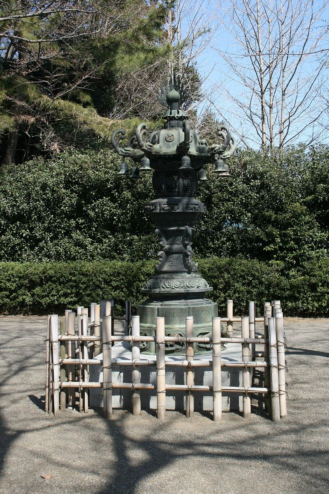
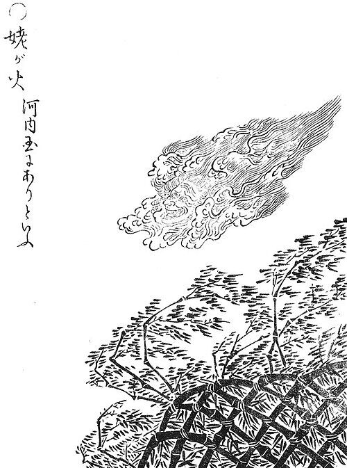

# 11. Pop Culture, Religion and Folklore

Japanese pop culture draws constantly on religion and folklore. Fans in turn borrow the language and practices of religion: they go on "pilgrimages", hang votive plaques at shrines and carry portable shrines at festivals. This chapter connects the pop culture handbook to the course's [Folklore handbook](../folklore/00-start.md).

## 11.1 Anime "pilgrimage"

Fans visit the real places where their favourite works are set and call it ***seichi junrei*** (聖地巡礼), "pilgrimage to sacred places". Ichifuji Hirotaka examines the term (Ichifuji 2025):

- **The ordinary meaning.** *Seichi junrei* usually means going to religious sacred sites.
- **The fans' meaning.** Here it means fans who, interested in a work, "go round its settings". They liken the places linked to a much-loved work to religious holy places and call them *seichi*.
- **A narrower definition.** One researcher defines an anime *seichi* as a filming location of an anime, or a place connected to the work or its creator, "whose value is recognised by fans" (Yamamura 2008, quoted in Ichifuji 2025).
- **Even the government uses it.** Japan's Intellectual Property Strategy Headquarters now uses the term.
- **The term is muddled.** It is also used for memorial museums and events that are not settings at all.

**Why ordinary places?** Yukimura Mayumi explains this through the rise of **background art**. Animation studios began scouting real locations and developing new ways of drawing perspective, and audiences started paying attention to backgrounds as well as characters. Many pilgrimage sites are everyday places. Linking a real space to a work "creates new cultural value there", and can give back a focal point to communities "lost to regional development" (Yukimura 2023).

## 11.2 Washinomiya Shrine and *Lucky Star*

The classic case is **[Washinomiya Shrine](https://en.wikipedia.org/wiki/Washinomiya_Shrine)** in the town of Washimiya, Saitama Prefecture, about 50 km from Tokyo. The shrine appears as a background in the anime *[Lucky Star](https://en.wikipedia.org/wiki/Lucky_Star_(manga))*. Okamoto Takeshi studied what happened (Okamoto 2012).

**Fans came first.** Okamoto calls this ***traveller-led* content tourism**. Visitors did not come because of a promotion campaign; their arrival started the town's revival. The steps:

1. **Fans' *ema*.** Pilgrims hung ***[ema](https://en.wikipedia.org/wiki/Ema_(Shinto))*** (wooden votive plaques) **with drawings from the anime** in the shrine's ema rack.
2. **The town listened.** A management adviser of the local chamber of commerce noticed, spoke to the pilgrims and learned that the shrine appeared in *Lucky Star*. He asked fans on the internet forum 2channel what goods and events they wanted.
3. **Events followed.** The town ran a poetry contest for fans in November 2008 and a festival in July 2009.

**New Year visitors.** The number of people making the New Year shrine visit (*[hatsumōde](https://en.wikipedia.org/wiki/Hatsum%C5%8Dde)*) to Washinomiya Shrine rose sharply (Okamoto 2012):

| Year | *Hatsumōde* visitors |
|---|---|
| 2007 | 130,000 |
| 2008 | 300,000 |
| 2009 | 420,000 |

Around New Year 2009, Bandai and Good Smile Company sold goods near the shrine (Okamoto 2012).

**A shrine for the fans.** At the town's annual **Haji Festival** in September, fans have carried a ***Lucky Star* *mikoshi*** (portable shrine) since 2008, alongside the festival's main *mikoshi*. The idea came from the head of the festival's *mikoshi* association, a shopkeeper who sold phone straps shaped like paulownia-wood ema (Okamoto 2012).

<figure>

<figcaption>The grounds of Washinomiya Shrine, Kuki, Saitama Prefecture, 2012. <span class="credit">Image: Peter Schlömer, <a href="https://creativecommons.org/licenses/by-sa/3.0/">CC BY-SA 3.0</a>, via <a href="https://commons.wikimedia.org/wiki/File:Washinomiya_Shrine_7418.JPG">Wikimedia Commons</a>.</span></figcaption>
</figure>

Okamoto compares a second case. Toyosato in Shiga Prefecture became a pilgrimage site because its old elementary-school buildings are thought to be the model for the school in the anime *K-On!* (Okamoto 2012).

## 11.3 Sakaiminato: a pilgrimage to Kitarō

Barbara Greene studied **Sakaiminato**, a port town on the Sea of Japan near the birthplace of the manga artist [Mizuki Shigeru](https://en.wikipedia.org/wiki/Shigeru_Mizuki), creator of *GeGeGe no Kitarō* (Greene 2016):

- **Remoteness turned into an advantage.** Far even by bullet train, the town "was able to leverage the relative disadvantage of its location into a positive image".
- **A town-centre revival.** From 1989, a national programme to revitalise town centres was under way. Municipal support, local businesses and Mizuki himself led to the opening of a **Yōkai Road** with related merchandise in the mid-1990s, and later a **museum** devoted to Mizuki.
- **A pilgrim's circuit.** The town centre forms a loop: it starts at the station, climaxes at the Mizuki Shigeru Museum and leads back to the station. The station and sometimes the trains themselves are decorated with the characters.
- **Pilgrimage, secularised.** The strategy "closely replicates the traditional pilgrimage patterns established in Japan", with the focus shifted "from a religious to secular world view". The emotional resonance stays the same: fans share a sense of community. The town also presents itself as a ***furusato*** (home village) for visitors who grew up in cities.

Mizuki's *yōkai* were not invented from nothing. He said he had "collected paintings by Toriyama Sekien (1712–1788) and read volumes of folklore" (Hirota 2021). Toriyama Sekien's illustrated catalogues of yōkai are described in Chapter 11 of the [Folklore handbook](../folklore/11-night-parade.md), and Mizuki's yōkai boom in its [Chapter 13](../folklore/13-yokai-today.md).

<figure>

<figcaption>Toriyama Sekien, <em>Ubagabi</em>, from <em>Gazu hyakki yagyō</em>, 1776. Mizuki Shigeru said he collected Sekien's paintings (Hirota 2021). <span class="credit">Image: Toriyama Sekien, Public domain, via <a href="https://commons.wikimedia.org/wiki/File:Sekien_Ubagabi.jpg">Wikimedia Commons</a>.</span></figcaption>
</figure>

## 11.4 Oni in *Demon Slayer*

*[Demon Slayer: Kimetsu no Yaiba](https://en.wikipedia.org/wiki/Demon_Slayer:_Kimetsu_no_Yaiba)*, by Gotōge Koyoharu, is a manga that became an anime, films, games and merchandise: "a societal phenomenon in Japan". Its 2025 film topped Japan's box office (Chapter 3). The folklorist Noriko T. Reider shows how it reworks the ***[oni](https://en.wikipedia.org/wiki/Oni)*** (Reider 2024):

- **Setting.** The story is set in the **Taishō era** (1912–1926). An unofficial Demon Slayer Corps has fought demons for centuries.
- **Traditional traits.** The oni keep traditional features: they **eat human flesh** and **change shape**. Reider compares older oni such as Shuten-dōji, the demon of Mount Ōe, who savoured human flesh at banquets.
- **Western additions.** New traits come from the West, from superheroes and above all from **vampires**. All the demons are former humans turned by injections of the blood of the progenitor, Kibutsuji Muzan. They can be killed by decapitation with a demon slayer's sword called *nichirintō* ("sun sword") or by poison extracted from **wisteria** flowers.
- **Grim, not cute.** Many oni in today's pop culture have "morph[ed] into benign creatures", but these are "grotesquely eerie and cruel".
- **Reider's conclusion.** The phenomenon "reveals how oni still occupy an important position in Japanese culture" and shows their "ongoing evolution".

The folklore behind the oni, including Shuten-dōji, is in the [Folklore handbook's bestiary](../folklore/12-bestiary.md).

## 11.5 Ghosts, cults and other borrowings

Other chapters of this handbook show the same traffic between religion, folklore and entertainment:

- **Ghost films.** The avenging female ghosts of kabuki and Noh became the stars of Japanese horror film (Chapter 5).
- **Religion in manga.** After the 1995 Aum attack, manga depicted religion first as horror and later as gentle comedy (Chapter 2).
- **A festive day.** The Comic Market describes itself as a "Day of *Hare*", borrowing the old distinction between festive and everyday time (Chapter 10).

```quiz
title: Chapter 11 self-check
? What does seichi junrei mean among fans?
- Visiting the real places where a favourite work is set *
- Visiting Buddhist temples on a pilgrimage route
- Attending a convention
> Fans liken the places to religious holy sites (Ichifuji 2025).

? What did pilgrims to Washinomiya Shrine hang on the ema rack?
- Votive plaques with drawings from the anime *
- Photographs of themselves
- Paper cranes
> A chamber-of-commerce adviser noticed and began working with the fans (Okamoto 2012).

? How many people made the New Year visit to Washinomiya Shrine in 2009?
- About 420,000 *
- About 130,000
- About 30,000
> Up from 130,000 in 2007.

? What do fans carry at Washimiya's Haji Festival since 2008?
- A Lucky Star portable shrine (mikoshi) *
- A giant ema
- A float shaped like a game console
> It is carried alongside the festival's main mikoshi.

? How does Greene describe tourism to Mizuki Shigeru's Sakaiminato?
- As traditional pilgrimage patterns with a secular focus *
- As a purely commercial theme park
- As a religious festival
> The circuit runs from the station to the museum and back.

? Which Western figure gave the oni of Demon Slayer new traits?
- The vampire *
- The werewolf
- The zombie
> They still eat human flesh and change shape like traditional oni (Reider 2024).
```

## Sources for this chapter

1. **Greene 2016.** Greene B. Furusato and emotional pilgrimage: *Ge Ge Ge no Kitarō* and Sakaiminato. *Japanese Journal of Religious Studies* 2016;43(2):333–356. doi:[10.18874/jjrs.43.2.2016.333-356](https://doi.org/10.18874/jjrs.43.2.2016.333-356).
2. **Hirota 2021.** Hirota Ryūhei. Traversing the natural, supernatural, and paranormal: yōkai in postwar Japan. *Japanese Journal of Religious Studies* 2021;48(2):321–339. doi:[10.18874/jjrs.48.2.2021.321-339](https://doi.org/10.18874/jjrs.48.2.2021.321-339).
3. **Ichifuji 2025.** Ichifuji Hirotaka 一藤浩隆. 「聖地巡礼」概念再考：観光との相違とファンの消費傾向との関連に注目して (Rethinking the concept of "anime pilgrimage"). *Journal of Media Studies* 2025;106:127–143. doi:[10.24460/jamsmedia.106.0_127](https://doi.org/10.24460/jamsmedia.106.0_127).
4. **Okamoto 2012.** Okamoto Takeshi 岡本健. 旅行者主導型コンテンツツーリズムにおける観光資源マネジメント：らき☆すた聖地「鷲宮」とけいおん！聖地「豊郷」の比較から (Tourism resource management in tourist-led contents tourism). *Journal of the Japan Society for Information and Management* 2012;32(3):59–71. doi:[10.20627/jsim.32.3_59](https://doi.org/10.20627/jsim.32.3_59).
5. **Reider 2024.** Reider NT. *Demon Slayer Kimetsu no yaiba*: oni, vampires, and sexuality. *Japan Review* 2024;39:203–219. [Nichibunken repository](https://nichibun.repo.nii.ac.jp/records/2000378).
6. **Yukimura 2023.** Yukimura Mayumi 雪村まゆみ. アニメ聖地巡礼による空間価値の創出 (Creation of spatial value through anime pilgrimages). *Japanese Journal of Animation Studies* 2023;23(1):89–100. doi:[10.34370/jjas.23.1_89](https://doi.org/10.34370/jjas.23.1_89).

➡️ Next: [Chapter 12: Cool Japan](12-cool-japan.md)
