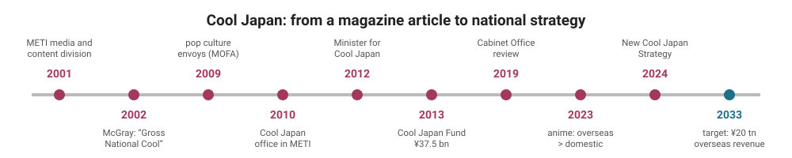

# 12. Cool Japan

When Japanese pop culture became popular abroad, the Japanese state took notice. The result is **Cool Japan**: a policy, a slogan and a set of institutions meant to turn manga, anime, games, food and fashion into exports, tourism and good will. This chapter explains:

- where the name came from;
- what the government has done;
- what the policy has achieved;
- how scholars judge it.

## 12.1 A concept discovered abroad

The name comes from **"[Japan's Gross National Cool](https://en.wikipedia.org/wiki/Cool_Japan)"**, an article by the American journalist **Douglas McGray** published in **2002**. It described the vitality of Japanese pop culture and its global success, and Japan's cultural industries "have been the centre of attention" ever since (Garvizu 2019).

Nakamura Ichiya, who has worked on Japan's content policy since founding a "media software" study group at the Ministry of Posts and Telecommunications in 1993, stresses the origin of the idea (Nakamura 2025):

- **What McGray saw.** Japan had changed "from an economic superpower in the 1980s to a pop-culture superpower in the 1990s".
- **Found abroad.** The important point is that this was a concept "discovered and valued **from abroad**, not one that originated in Japan". The question is how to offer what foreigners want.
- **Six features.** Nakamura names six features of Japanese pop culture:

| Feature | Meaning |
|---|---|
| Import | Taking in foreign forms of expression |
| Diversity | A wide range of variations |
| Freedom | Few regulations |
| Popular culture | Supported by ordinary people |
| Technology | Fusing technology and culture |
| Participation | Raised by everyone together |

Hatsune Miku (Chapter 8) is his symbolic example, combining singing-synthesis technology, a character and participation through social media.

The state did not start the boom. Garvizu stresses that it "did not trigger the exports of Japanese pop culture. It rather reacted to its dissemination at the beginning of the 2000s" (Garvizu 2019). For a long time it did not even see anime studios as an industry, only as an extension of manga publishers (Garvizu 2019).

## 12.2 What the government did

| Year | Step | Source |
|---|---|---|
| 2001 | METI's **Media and Content Industry Division** set up when MITI became METI | Garvizu 2019 |
| 2009 | Ministry of Foreign Affairs announces "pop culture diplomacy" and appoints **pop culture envoys** ("kawaii ambassadors") | Yamada and Morimoto 2015; Ohkura 2015 |
| 2010 | **Cool Japan Promotion Office** set up in METI. METI's *Industrial Structure Vision 2010* names the "creative industries" (tourism, content, food, fashion) among five strategic industries | Cabinet Office 2019; Garvizu 2019 |
| 2012 | A **Minister of State for Cool Japan Strategy** appointed (December) | Cabinet Office 2019 |
| 2013 | **Cool Japan Fund** established (November), with capital of 37.5 billion yen | Garvizu 2019 |
| 2015 | Cool Japan Public-Private Partnership Platform (December) | Cabinet Office 2019 |
| 2018–19 | Cool Japan made part of the national **intellectual property strategy** | Cabinet Office 2019 |
| 2024 | A **"New Cool Japan Strategy"** names the content industry, including anime, a key industry | AJA 2026 |
| 2024 | METI merges its content division and its Cool Japan division into a single division for "cultural creative industries" | Nakamura 2025 |

**Why METI cared.** Its *Industrial Structure Vision 2010* reflected a sense of crisis (Garvizu 2019):

- **Decline.** Between 2000 and 2008, Japan fell from 3rd to 23rd in the world in GDP per head. Its share of world GDP fell from 14.3 per cent in 1990 to 8.9 per cent in 2008.
- **Too few exports.** Japan's cultural industries had a very low export ratio, **1.9 per cent**.
- **The theory.** Success in the creative industries would lead foreigners to buy Japanese products, such as cosmetics, cars and electronics, and to visit Japan.

**The Cool Japan Fund** makes equity investments as a minority investor in selected projects, typically for five to seven years, and may operate for up to twenty years (Garvizu 2019). It has no priority sector. It interprets "Cool Japan" broadly, including fashion, lifestyle, crafts, food and tourism as well as media (Garvizu 2019).

<figure class="diagram">

<figcaption>Cool Japan from McGray's article to the 2033 target (Garvizu 2019; Cabinet Office 2019; AJA 2026; Nakamura 2025). <span class="credit">Diagram drawn for this handbook from the sources cited in the chapter.</span></figcaption>
</figure>

## 12.3 The government's own assessment

In 2019 the Cabinet Office's Intellectual Property Strategy Headquarters reviewed the policy, partly through meetings with foreign experts (Cabinet Office 2019).

**Outcomes it listed:**

- Higher exports and more foreign visitors.
- Initiatives in more varied fields.
- More foreign nationals with a deep understanding of Japan.

**Problems it admitted:**

- Lack of collaboration among stakeholders "resulted in failure to generate good initiatives".
- A "lack of foreign nationals' viewpoints" and a "product-out mindset".
- "Failure to drill down deeper into Japan's appeal."
- "Failure to spread the word effectively."
- "Control tower functions of the Cabinet Office are weak."
- Harm from "reliance on existing/stereotypical attractions".

**The new aim.** The strategy now aims to increase the number of **"Japan fans"**: foreigners "who feel affection towards Japan" (Cabinet Office 2019).

## 12.4 The numbers now

The 2024 strategy set a target: raise overseas revenue from Japanese content **from 4.7 trillion yen in 2022 to 20 trillion yen by 2033**. Anime's overseas market alone grew from 1.5 trillion yen in 2022 to 2.1 trillion in 2024 (AJA 2026). The anime industry association adds a warning: "the driving force of the anime industry is the work itself". Without enough trained people, quality and growth will suffer (AJA 2026).

Nakamura gives some further points (Nakamura 2025):

- **Overseas growth.** The overseas market for Japanese content more than **tripled in ten years**.
- **Japanese characters lead.** In a world ranking of intellectual properties, 10 of the top 25 are Japanese. Pokémon is first and Anpanman sixth.
- **Merchandise is the money.** Of Pokémon's 10 trillion yen in sales, more than 6 trillion came from character goods.
- **Three challenges:**
  1. Business people for overseas expansion, of whom there are too few, though creators are plentiful.
  2. Digital platforms, piracy and copyright in the age of AI.
  3. Combining content with other fields.
- **What to protect.** Japan's strengths are its "freedom", meaning loose regulation of expression, and its art education in compulsory schooling.

## 12.5 How to judge it

Scholars read Cool Japan in different ways:

- **Industrial policy.** Garvizu argues that Cool Japan is a classic **industrial policy** of the Japanese "developmental state", now applied to the cultural industries. METI and the Cool Japan Fund act as they once did for steel or cars (Garvizu 2019).
- **Fans, not the state.** Most of the international spread of kawaii culture has been carried by **fans abroad**, who organise most of the events (Yamada and Morimoto 2015; Chapter 9). Fan communities also took the lead in distributing anime in places such as Mexico (Peláez Mazariegos 2020; Chapter 10).
- **"Banal nationalism".** After 2011, media, government and corporations used pop culture to "flag" a flattering image of Japanese uniqueness (Mandujano 2014; Chapter 8).
- **Weak co-ordination.** The government's own review admits weak co-ordination and stereotyped attractions (Cabinet Office 2019).

```quiz
title: Chapter 12 self-check
? Where does the name "Cool Japan" come from?
- Douglas McGray's 2002 article "Japan's Gross National Cool" *
- A METI advertising campaign of 1990
- A Japanese pop song
> Nakamura stresses that the concept was discovered abroad.

? Did the Japanese state start the export boom of pop culture, according to Garvizu?
- No, it reacted to a spread that had already begun *
- Yes, through MITI in the 1970s
- Yes, through the Cool Japan Fund
> Garvizu 2019.

? When was the Cool Japan Fund established, and with what capital?
- November 2013, with 37.5 billion yen *
- 2002, with 100 billion yen
- 2024, with 20 trillion yen
> It invests as a minority shareholder in selected projects.

? What target did the 2024 strategy set for overseas content revenue?
- 20 trillion yen by 2033 *
- 4.7 trillion yen by 2025
- 1 trillion yen by 2030
> Up from 4.7 trillion yen in 2022 (AJA 2026).

? Which problem did the Cabinet Office itself admit in 2019?
- Weak co-ordination and reliance on stereotypical attractions *
- Too many foreign experts
- Too much money spent on anime
> It now aims to increase the number of "Japan fans".

? How does Garvizu classify Cool Japan?
- As an industrial policy of the developmental state *
- As a purely cultural diplomacy programme
- As a private-sector initiative
> METI plays the role MITI once played for heavy industry.
```

## Sources for this chapter

1. **AJA 2026.** See [Chapter 3](03-anime.md).
2. **Cabinet Office 2019.** Secretariat of Intellectual Property Strategy Headquarters, Cabinet Office. *About the Cool Japan Strategy*. September 2019. [cao.go.jp](https://www.cao.go.jp/cool_japan/english/about_the_coolJapan_strategy.pdf).
3. **Garvizu 2019.** Garvizu N. The Japanese developmental state: the case of Cool Japan. *Electronic Journal of Contemporary Japanese Studies* 2019;19(3), article 10. [EJCJS](https://www.japanesestudies.org.uk/ejcjs/vol19/iss3/garvizu.html).
4. **Mandujano 2014.** See [Chapter 8](08-music.md).
5. **Nakamura 2025.** Nakamura Ichiya 中村伊知哉. クールジャパンからクリエイティブジャパンへ：コンテンツ産業の戦略と展望 (From Cool Japan to Creative Japan: strategies and prospects of the content industry). Keynote report. *Business Model Association Journal* 2025;25(1):5–. doi:[10.51020/bma.25.1_5](https://doi.org/10.51020/bma.25.1_5).
6. **Ohkura 2015.** See [Chapter 9](09-kawaii.md).
7. **Peláez Mazariegos 2020.** See [Chapter 10](10-otaku.md).
8. **Yamada and Morimoto 2015.** See [Chapter 9](09-kawaii.md).

➡️ Next: [Chapter 13: A traveller's guide](13-travel.md)
