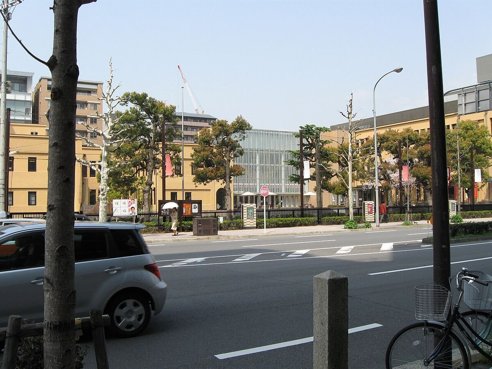
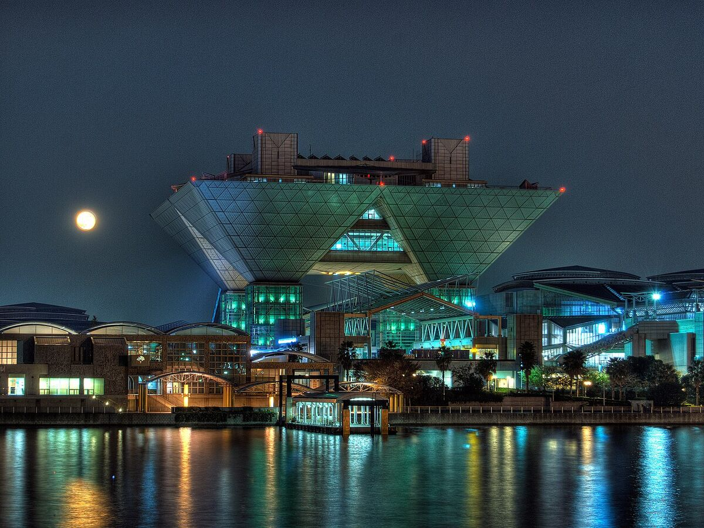
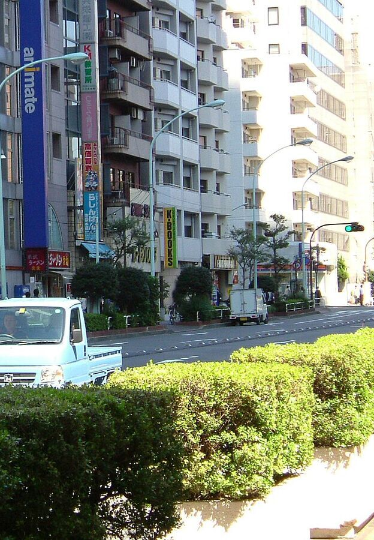
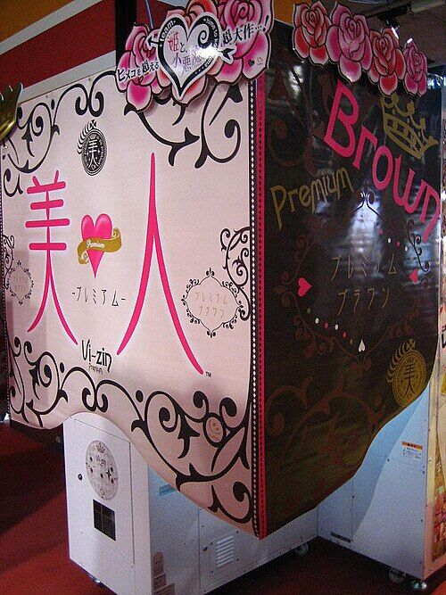
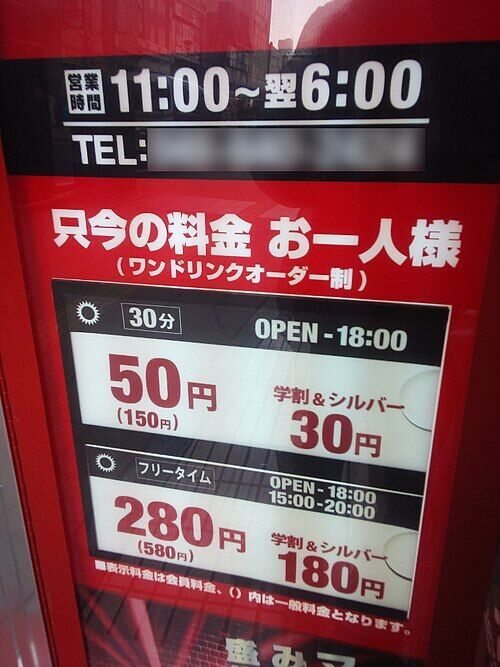

# 13. A Traveller's Guide

This chapter turns the handbook into practical advice. It only states rules, prices and dates that official sources publish, and gives the date of each. Rules change, so always check the official page before you go. Where no reliable source exists, for example for the etiquette of a particular shop, this chapter says nothing rather than repeat hearsay.

## 13.1 Museums

### Ghibli Museum, Mitaka

The museum's official rules, as of its ticket page in November 2026 (Ghibli Museum, n.d.-a):

- **Advance reservation only.** "All admission to the Ghibli Museum is by advance reservation only. No reservation or ticket purchase can be made at the Museum."
- **Prices.** Adults (19 and over) ¥1,000; ages 13–18 ¥700; 7–12 ¥400; 4–6 ¥100; 3 and under free.
- **When tickets go on sale.** Tickets from overseas are sold online through Lawson Ticket. Sales open at **10 a.m. Japan time on the 10th of each month for the following month**: for example, tickets for February go on sale on 10 January.
- **Time of entry.** Tickets are valid only for the date and entry time shown, with no set exit time.
- **No resale.** Buying tickets to resell is not allowed.
- **Tour option.** A bus tour run by Sunrise Tours (JTB) includes the museum.

The museum stands in Inokashira Park in Mitaka. Your ticket is exchanged on entry for a piece of real 35 mm film from a Ghibli film; hold it up to the light to see which scene you got (Ghibli Museum, n.d.-b).

### National Film Archive of Japan, Tokyo

The [NFAJ](https://en.wikipedia.org/wiki/National_Film_Archive_of_Japan) is at **3-7-6 Kyōbashi, Chūō-ku** (NFAJ, n.d.-a):

- **The permanent exhibition**, *Nihon Eiga: The History of Japanese Film* (Chapter 5), is on the 7th floor.
- **Hours.** 11:00–18:30, last entry 18:00. On the last Friday of the month it is open until 20:00.
- **Closed** on Mondays and during exhibition changeovers.
- **Admission** ¥600, with reductions for students and seniors. Captions are in Japanese, English, Chinese and Korean.

The 2026 Mizoguchi exhibition ran until 13 December 2026 (NFAJ, n.d.-b).

### Manga museums

- **Kyoto International Manga Museum.** The Association of Japanese Animations lists its shop among the places selling its industry reports. It is at Karasuma-Oike in Kyoto, on the site of a former elementary school (AJA 2026).
- **Tokiwa-sō Manga Museum** in Toshima, Tokyo. See the photograph in Chapter 2.

<figure>

<figcaption>The Kyoto International Manga Museum, at Karasuma-Oike, on the site of a former elementary school (AJA 2026). Photographed in 2010. <span class="credit">Image: Kento Ikeda, <a href="https://creativecommons.org/licenses/by/2.0/">CC BY 2.0</a>, via <a href="https://commons.wikimedia.org/wiki/File:Kyoto_International_Manga_Museum_exterior.jpg">Wikimedia Commons</a>.</span></figcaption>
</figure>

## 13.2 Comiket

The Comic Market (Chapter 10) publishes guidance for international visitors. As of **14 November 2026** (Comic Market Committee 2026a; 2026b):

- **Dates.** **Comic Market 109: 29–31 December 2026**, at Tokyo Big Sight. Comic Market 110: 14–15 August 2027. Genres and circles change completely each day.
- **No free entry.** Everyone needs a **wristband or a ticket** exchangeable for one, and tickets are sold separately for each day.

| Entry type | Enters from | How to get it |
|---|---|---|
| Early Entry ticket | 10:30 | Lottery (16–30 November); name printed on it, and a matching **passport** is required |
| AM Entry wristband | 11:00 | Japanese anime shops while stocks last; from abroad, an e-ticket through eplus from 5 December |
| PM Entry wristband | 12:30 | Anime shops in Japan, and on site at a higher price with long queues |

- **The 2026 lottery problem.** For C109 the lottery operator, TicketPay, blocked all access from abroad, so international visitors could not apply for Early Entry.
- **Children** 15 and under enter free with one adult holding a ticket or wristband.
- **No overnight queuing.** It "was always forbidden and is a serious safety and neighborhood issue".
- **No resale.** Resale of tickets or wristbands is strictly prohibited, and resold tickets are invalid.
- **Cosplay rules.** The changing rooms cost **¥500**. You may **not travel to or from the event in costume**, and **changing in the toilets is strictly not allowed**.

<figure>

<figcaption>Tokyo Big Sight at night. The Comic Market fills the whole complex for three days each summer and winter. <span class="credit">Image: Masato Ohta, <a href="https://creativecommons.org/licenses/by/2.0/">CC BY 2.0</a>, via <a href="https://commons.wikimedia.org/wiki/File:Tokyo_Big_Sight_at_Night.jpg">Wikimedia Commons</a>.</span></figcaption>
</figure>

## 13.3 Akihabara and other shopping districts

[Akihabara](https://en.wikipedia.org/wiki/Akihabara) is described in Chapter 10. Many of its anime shops and **maid cafés** are on the **upper floors** of mixed-use buildings and in the back streets, not only on the main road (Ushigaki 2012). Look up as well as along.

The Association of Japanese Animations lists two official anime shops in Tokyo (AJA 2026):

- **AKIBA INFO. × TOKYO ATOM**: Akihabara UDX, 2nd floor, Sotokanda 4-14-1.
- **Tokyo Anime Center** in DNP Plaza: Shibuya MODI, 2nd floor, 1-21-3 Jinnan, Shibuya.

**Nintendo.** Japan's first official Nintendo flagship store, **Nintendo TOKYO**, opened in Shibuya in 2019. **Super Nintendo World** opened at Universal Studios Japan in Osaka in 2021 (Nintendo, n.d.).

<figure>

<figcaption>Otome Road in Ikebukuro, Tokyo, 2005. <span class="credit">Image: Boyfriendback, Public domain, via <a href="https://commons.wikimedia.org/wiki/File:Otome_road_in_Ikebukuro%2C_Tokyo%2C_Japan.jpg">Wikimedia Commons</a>.</span></figcaption>
</figure>

## 13.4 Game centres

Game centres today aim at every age, with crane games ("UFO catchers") and rhythm games such as *Taiko no Tatsujin* (Inakazu et al. 2016). Lawmakers have long treated them mainly as a matter of youth protection and gambling, and the wish to keep regulating them has continued (Kawasaki 2022).

<figure>

<figcaption>The entrance of a <em>purikura</em> (photo-sticker) booth in Fukushima City, 2007. <span class="credit">Image: Brian Adler, Public domain, via <a href="https://commons.wikimedia.org/wiki/File:Purikura_Booth_1.JPG">Wikimedia Commons</a>.</span></figcaption>
</figure>

<figure>

<figcaption>A karaoke-box price board, photographed in 2013. Charges are listed per person according to time. <span class="credit">Image: Orataw, <a href="https://creativecommons.org/licenses/by-sa/3.0/">CC BY-SA 3.0</a>, via <a href="https://commons.wikimedia.org/wiki/File:Price_list_of_Karaoke-Box.jpg">Wikimedia Commons</a>.</span></figcaption>
</figure>

## 13.5 Pilgrimage towns

- **Washinomiya Shrine** (Kuki City, Saitama, about 50 km from Tokyo): the *Lucky Star* pilgrimage site. The Haji Festival is held every **September**, with a fans' *mikoshi* (Okamoto 2012; Chapter 11).
- **Sakaiminato** (Tottori): Mizuki Shigeru's Yōkai Road and museum, on a loop from the station (Greene 2016; Chapter 11).
- **Special-effects events.** Shows based on monster and hero series have been held at department stores, amusement parks and theme parks around Japan for about seventy years (Futaesaku 2022; Chapter 6).

```quiz
title: Chapter 13 self-check
? Can you buy a ticket at the Ghibli Museum on the day?
- No, admission is by advance reservation only *
- Yes, at the entrance
- Only on weekdays
> Tickets go on sale at 10 a.m. Japan time on the 10th of the previous month (Ghibli Museum).

? Can you travel to Comiket already in costume?
- No, you must change in the official changing rooms *
- Yes, if you have a ticket
- Only on the last day
> Changing in the toilets is also forbidden (Comic Market Committee 2026).

? Which Comiket entry type requires a matching passport?
- The Early Entry ticket *
- The PM wristband
- None
> The holder's name is printed on the ticket to stop scalpers.

? Where are many of Akihabara's anime shops and maid cafés?
- On the upper floors of mixed-use buildings and in back streets *
- Only at the station
- In department-store basements
> Ushigaki 2012.

? On which day is the National Film Archive of Japan closed?
- Monday *
- Sunday
- Wednesday
> Its permanent exhibition costs ¥600.
```

## Sources for this chapter

1. **AJA 2026.** See [Chapter 3](03-anime.md). Shop list on the back page.
2. **Comic Market Committee 2026a.** *Comic Market 109: Information for International Participants*. Updated 14 November 2026. [comiket.co.jp](https://www.comiket.co.jp/info-a/TAFO/C109TAFO/index.html).
3. **Comic Market Committee 2026b.** *Tickets for Comic Market 109*. Updated 14 November 2026. [comiket.co.jp](https://www.comiket.co.jp/info-a/TAFO/C109TAFO/ticket.html).
4. **Futaesaku 2022.** See [Chapter 6](06-kaiju.md).
5. **Ghibli Museum, n.d.-a.** Ghibli Museum, Mitaka. *Tickets*. Accessed November 2026. [ghibli-museum.jp](https://www.ghibli-museum.jp/en/tickets/).
6. **Ghibli Museum, n.d.-b.** Ghibli Museum, Mitaka. *Welcome!* [ghibli-museum.jp](https://www.ghibli-museum.jp/en/welcome/).
7. **Greene 2016.** See [Chapter 11](11-sacred.md).
8. **Inakazu et al. 2016.** See [Chapter 7](07-games.md).
9. **Kawasaki 2022.** See [Chapter 7](07-games.md).
10. **NFAJ, n.d.-a.** See [Chapter 3](03-anime.md).
11. **NFAJ, n.d.-b.** See [Chapter 5](05-cinema.md).
12. **Nintendo, n.d.** See [Chapter 7](07-games.md).
13. **Okamoto 2012.** See [Chapter 11](11-sacred.md).
14. **Ushigaki 2012.** See [Chapter 10](10-otaku.md).

➡️ Next: [Chapter 14: Language for fans](14-language.md)
