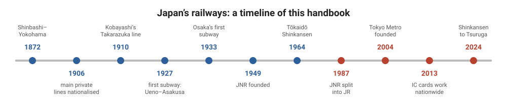

# Railways Handbook: From Steam to Shinkansen

Japan opened its first railway in 1872, with British money, materials and engineers. Ninety-two years later it opened the Tōkaidō Shinkansen. This handbook explains how that happened and how the system works, in three parts:

- **History:** the first line, nationalisation, the Shinkansen, the break-up of Japanese National Railways, the private railways that built suburbs, and the subways of Tokyo and Osaka.
- **How it works:** safety and punctuality, the Shinkansen network today, fares and tickets, local lines in decline, freight and the last night trains.
- **Travelling:** *ekiben* and station life, and the Japanese you will see and hear.

It is written for a reader who wants to understand as well as to ride. Dates and numbers are given where the sources give them.

<figure class="diagram">

<figcaption>A timeline of the events in this handbook. Diagram drawn for this handbook from the sources cited in the chapters.</figcaption>
</figure>

> ⚠️ **About the practical information.** Fares, pass prices, timetables, opening dates and rules change, sometimes several times a year. Every price and rule in this handbook carries the date of its source, and the handbook was last checked in **November 2026**. It is a guide to how the system works, not a timetable or a price list: **always check the railway company's own website, or ask at the station, before you travel.** Nothing here is an offer or a booking service, and the handbook is not connected with any railway company.

## How this handbook treats facts

- **Every factual statement comes from a named source**, cited in brackets, such as (MLIT 2012), and listed at the end of each chapter.
- **Four kinds of source are used:**
  - **The Ministry of Land, Infrastructure, Transport and Tourism (MLIT)**, which regulates the railways. Its Railway Bureau publishes a 77-page history of Japanese railways, reports on the 1987 reform, and current policy documents.
  - **The railway companies' own publications:** fact sheets, press releases and official pages of JR Central, JR West, JR Freight, Osaka Metro and the Tokyo Metropolitan Bureau of Transportation, and the Japan Rail Pass site run by the JR Group.
  - **Peer-reviewed scholarship** on J-STAGE, for the private railways and the history of *ekiben*. Quotations from Japanese are translated.
  - **The National Diet Library**, for biographical facts.
- **Encyclopaedias, railway fan sites and travel blogs are not used as sources.** Terms are linked to Wikipedia (marked ↗) only as further reading.
- **Where the sources are silent, the handbook says so.**

## Pictures

The pictures are public-domain Meiji prints and early photographs, and freely licensed photographs of trains, stations and tickets. Every picture is credited in its caption and again on the [sources page](15-sources.md). Seven diagrams were drawn for this handbook from the cited sources.

## The three parts

### Part I: How Japan built its railways

| Chapter | What it explains |
|---|---|
| [1. The first railway](01-first-line.md) | The 1869 plan, British help, Shinbashi–Yokohama in 1872, the private railway boom |
| [2. A national railway](02-national.md) | Nationalisation in 1906, the technology of the 1920s, war, and the founding of JNR in 1949 |
| [3. The Shinkansen](03-shinkansen.md) | Why it was built, the 1964 opening, and sixty years of speed and safety in numbers |
| [4. The break-up of JNR](04-jnr-reform.md) | How JNR went bankrupt, and what the 1987 split into JR companies did |
| [5. Railways that built cities](05-private.md) | Kobayashi Ichizō, Hankyu, suburbs sold on instalments, Takarazuka and the terminal department store |
| [6. The subways of Tokyo and Osaka](06-subways.md) | Japan's first subway in 1927, Osaka's in 1933, Toei and Tokyo Metro, and how Tokyo compares |

### Part II: How the system works

| Chapter | What it explains |
|---|---|
| [7. Safety and punctuality](07-safety.md) | What "on time" means in numbers, and the accidents that changed the rules |
| [8. The Shinkansen network today](08-network.md) | The 1973 plan, how new lines are paid for, Tsuruga, Sapporo and the maglev |
| [9. Fares and tickets](09-tickets.md) | How a JR fare is built, IC cards and the Japan Rail Pass, with dated prices |
| [10. Local lines in trouble](10-local-lines.md) | Falling traffic, closures, and the 2023 law on restructuring |
| [11. Freight and night trains](11-freight-night.md) | JR Freight, the "2024 problem", and the Sunrise Express |

### Part III: Travelling

| Chapter | What it explains |
|---|---|
| [12. Ekiben and station life](12-ekiben.md) | The first station lunch box of 1885 and how *ekiben* grew |
| [13. Railway Japanese](13-language.md) | Signs, announcements and phrases for the ticket office |

Finally, a [glossary](14-glossary.md) and the [complete list of sources and image credits](15-sources.md).

This handbook builds on the practical [Lesson 6: Subways in Tokyo & Osaka](../lessons/06-subways.md) of the Japan guide.

➡️ Begin with [Chapter 1: The first railway](01-first-line.md)
