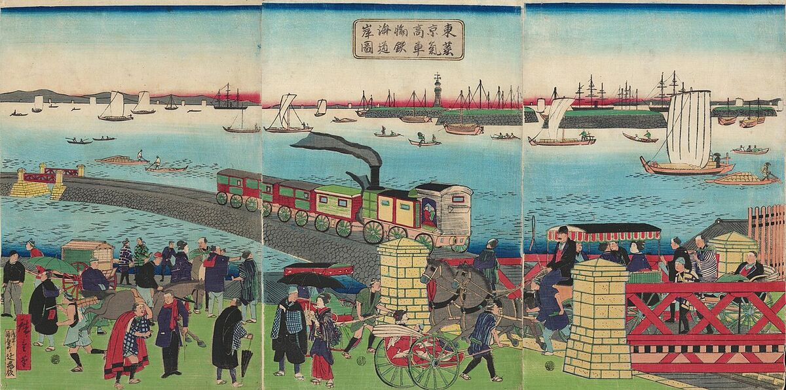
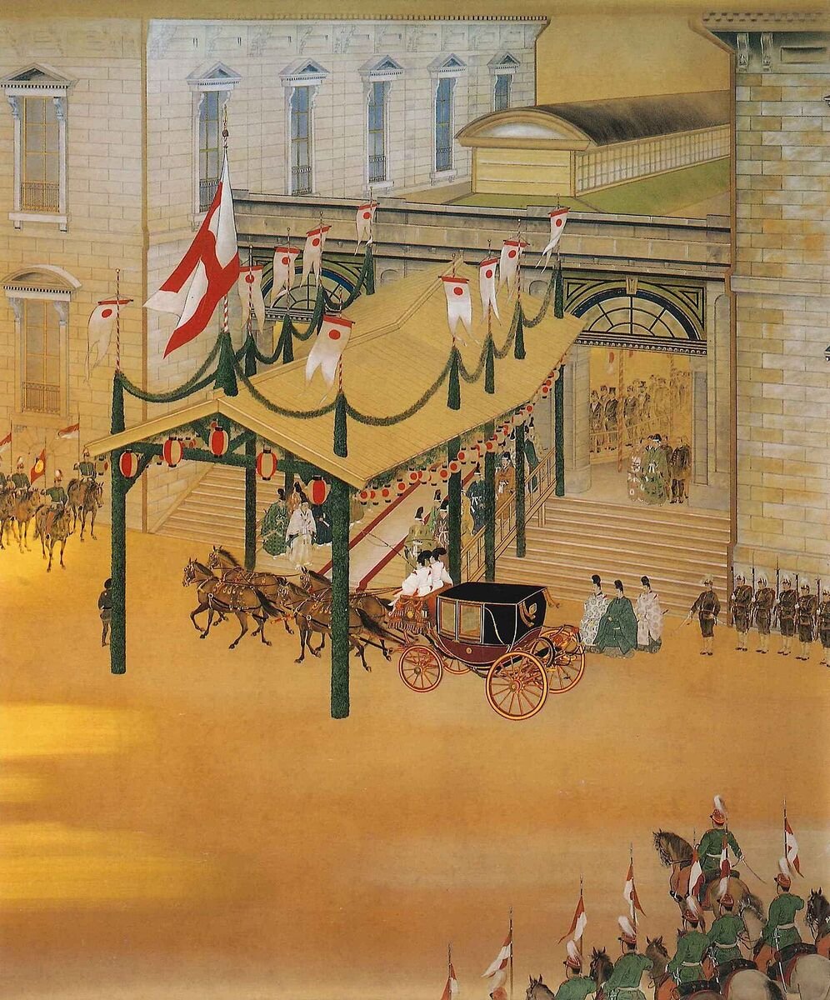
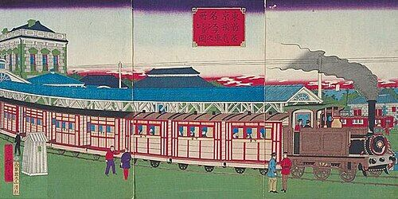
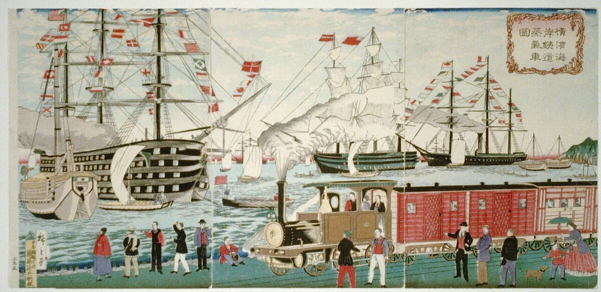

# 1. The First Railway

Japan's first railway ran 29 km from Shinbashi in Tokyo to Yokohama. It opened in 1872, four years after the Meiji Restoration. This chapter explains how a government with little money and no engineers built it, and how private companies then covered the country with lines.

## 1.1 First encounters

Knowledge of railways reached Japan in the late Edo period through Dutch books and the accounts of castaways who had seen trains abroad. When Commodore Perry returned in **1854**, his gifts included a **model steam locomotive**, which was run at Yokohama. The National Diet Library calls it the event that first showed the Japanese concretely what a railway was (NDL n.d.-a).

## 1.2 The plan of 1869

In the 11th month of **1869** (Meiji 2), the government decided to build a **trunk line between Tokyo and Kyoto**, with three branches: Tokyo–Yokohama, Kyoto–Kobe, and from Lake Biwa to Tsuruga. It was Japan's first railway construction plan (MLIT 2012).

The new government had neither the money nor the skills (MLIT 2012; NDL n.d.-a):

- **Britain supplied money, materials and engineers.** The work was entrusted to British financing and staff, under the engineer **Edmund Morel**, who began surveying near Shiodome in 1870.
- **Japan kept control.** The ministry's history stresses that the planning initiative stayed with the Japanese government. The National Diet Library makes the same point: Japan learned Western technology but did not let foreign capital run its railways.
- **Inoue Masaru**, who had studied railways in London, became the head of the government's railway office.

Construction met resistance from people along the route and from the packhorse drivers and cart men, then the main carriers on land (MLIT 2012). Part of the line was laid on an **embankment built out into the sea**. That needed no land purchase, and it avoided military land and the Satsuma domain's residence (NDL n.d.-a).

<figure>

<figcaption><em>Steam Train on the Railway along the Tokyo–Takanawa Coastline</em>, by Hiroshige III, 1871: printed before the line opened, when artists could only imagine the train. <span class="credit">Image: Hiroshige III, Public domain, via <a href="https://commons.wikimedia.org/wiki/File:Hiroshige_III_-_%E6%9D%B1%E4%BA%AC%E9%AB%98%E8%BC%AA%E6%B5%B7%E5%B2%B8%E8%92%B8%E6%B0%A3%E8%BB%8A%E9%90%B5%E9%81%93%E5%9C%96_%28Steam_Train_on_the_Railway_along_the_Tokyo-Takanawa_Coastline%29_%281871%29.jpg">Wikimedia Commons</a>.</span></figcaption>
</figure>

## 1.3 Opening day

- **12 June 1872:** Shinagawa–Yokohama opened provisionally, four months before the full line (NDL n.d.-a).
- **14 October 1872:** the **29 km** line from **Shinbashi to Yokohama** opened (MLIT 2024), 47 years after Britain's first railway and 42 years after America's (MLIT 2012; NDL n.d.-a). In the lunar calendar then in use the date was the 12th day of the 9th month of Meiji 5 (MLIT 2012).

The first rules for passengers and for order on railway land were issued the same year (MLIT 2012). Newspapers were sold in stations from the start (Chapter 12).

<figure>

<figcaption><em>Opening of the Tokyo–Yokohama Railway</em>, by Omura Taiun (1883–1938), Meiji Memorial Picture Gallery, Tokyo. <span class="credit">Image: Omura Taiun 小村大雲 (1883–1938), Public domain, via <a href="https://commons.wikimedia.org/wiki/File:Opening_of_the_Tokyo-Yokohama_Railway_by_Omura_Taiun_%28Meiji_Memorial_Picture_Gallery%29.jpg">Wikimedia Commons</a>.</span></figcaption>
</figure>

<figure>

<figcaption><em>Steam Train at Shimbashi Station</em>, by Hiroshige III, around 1875. <span class="credit">Image: Hiroshige III, Public domain, via <a href="https://commons.wikimedia.org/wiki/File:Shimbashi_Station_Hiroshige_III.jpg">Wikimedia Commons</a>.</span></figcaption>
</figure>

## 1.4 Slow progress, then private companies

Money then ran short, partly because of the Satsuma Rebellion of 1877. After Kyoto–Kobe opened in February 1877, building stalled. The **Tōkaidō line** between Tokyo and Kobe was finished only in **July 1889**, twenty years after the decision (MLIT 2012).

Private capital filled the gap (MLIT 2012):

- **Nippon Railway** (日本鉄道), Japan's first private railway, was founded in **1881** to build from Ueno to Aomori. Its investors were former daimyo and court nobles who wanted a better return on the government bonds they had received in place of their stipends. The government gave generous help: land expropriation, construction work done for the company, and a guaranteed dividend.
- **It paid.** Ueno–Kumagaya opened in July 1883, and profits in the next year exceeded 10% of the construction cost. The line reached **Aomori in September 1891**.
- **A boom followed.** By 1892 nearly **50 private railway companies** had been founded. In fiscal 1890, private lines (1,366 km) were already longer than state lines (886 km).

## 1.5 Trams and the Railway Construction Act

City transport began with the **Tokyo Horse Railway**, between Shinbashi and Nihonbashi, in June **1882**. The first electric tramway, in **Kyoto**, opened in **1895**. Steam railways had reached Japan half a century after Britain; electric trams arrived almost at the same time as in the West (MLIT 2012).

In June **1892** the **Railway Construction Act** (鉄道敷設法) named **33 lines** that the state would build. The network grew from about 3,219 km in fiscal 1893 to 8,047 km in fiscal 1906. In 1899 fares that fall per kilometre over long distances were introduced, and in 1900 the Railway Operation Act set the basic rules of the business (MLIT 2012).

<figure>

<figcaption><em>Steam Train at the Yokohama Seaside</em>, by Hiroshige III, 1874. <span class="credit">Image: Hiroshige III, Public domain, via <a href="https://commons.wikimedia.org/wiki/File:Yokohama_Railway_1874.jpg">Wikimedia Commons</a>.</span></figcaption>
</figure>

## Self-check

```quiz
? When did the Shinbashi–Yokohama railway open?
- 14 October 1872 *
- 1 October 1964
- 1 April 1987
> A provisional section, Shinagawa–Yokohama, had opened on 12 June 1872 (NDL n.d.-a).

? Who supplied the money, materials and engineers for the first line?
- Britain, but the Japanese government kept control of the plan *
- The United States, which ran the line
- Private Japanese investors only
> MLIT 2012; NDL n.d.-a.

? Why was part of the first line built on an embankment in the sea?
- It needed no land purchase and avoided military land and the Satsuma residence *
- To give passengers a sea view
- Because the British engineers insisted
> NDL n.d.-a.

? What was Nippon Railway?
- Japan's first private railway, founded in 1881 to build Ueno–Aomori *
- The state railway after 1906
- The first subway
> Its success started a private railway boom (MLIT 2012).
```

## Sources for this chapter

1. **MLIT 2012.** Ministry of Land, Infrastructure, Transport and Tourism, Railway Bureau 国土交通省鉄道局. 日本鉄道史 (History of Japanese railways), updated 25 July 2012. [mlit.go.jp](https://www.mlit.go.jp/common/000218983.pdf).
2. **MLIT 2024.** Ministry of Land, Infrastructure, Transport and Tourism 国土交通省. 鉄道主要年表 (Chronology of Japanese railways), updated March 2024. [mlit.go.jp](https://www.mlit.go.jp/common/000227427.pdf).
3. **NDL n.d.-a.** National Diet Library 国立国会図書館. 本の万華鏡 第32回「鉄道が変えたコト・モノ」：開業前夜 (Kaleidoscope of Books 32: what railways changed; on the eve of opening). [ndl.go.jp](https://www.ndl.go.jp/kaleido/entry/32/1.html).

➡️ Next: [Chapter 2: A national railway](02-national.md)
