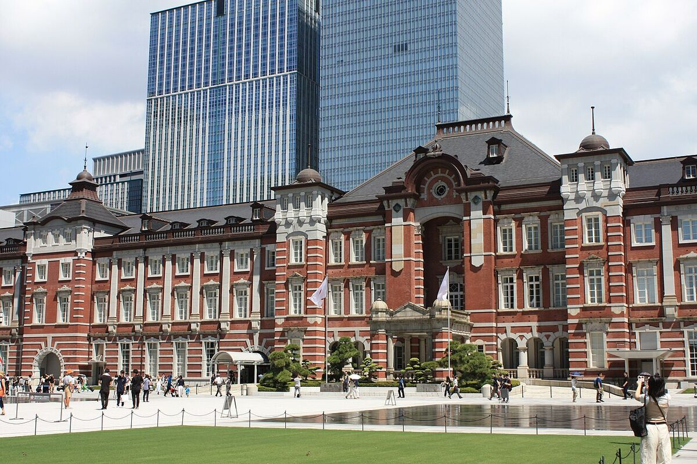

# 2. A National Railway

In 1906 the state bought most of the private main lines, and for the next eighty years Japan's railways were above all a national system. This chapter covers nationalisation, the technical progress of the 1910s to 1930s, the war, and the founding of Japanese National Railways (JNR) in 1949. The source throughout is the Railway Bureau's history (MLIT 2012) unless another is named.

## 2.1 Why the state bought the railways

By the 1890s two groups wanted the main lines in state hands:

- **The army**, from around the Sino-Japanese War of 1894–95, wanted a unified network for military transport.
- **Business** first wanted a better network for the growing industries; when recession hit struggling private railways in the late 1890s and 1900s, it wanted the state to buy them.

The government argued that nationalisation would improve the flow of traffic, lower fares and unify equipment; that it would cut operating and investment costs; and that it would help state finances after the Russo-Japanese War, promote trade and industry, and **prevent foreign control of railways**.

The **Railway Nationalization Act** (鉄道国有法) passed in **March 1906**, after the list of companies to be bought was cut from 32 to 17. In 1906–07 the state bought **17 major private railways**, among them Nippon Railway and the Sanyō, Kyūshū and Hokkaidō Tankō railways, with **4,800 km of route and over 25,000 vehicles**. State lines then made up more than **90%** of the national network. The companies were paid ¥480 million in 5% bonds, about twice their paid-in capital, and the money flowed back into new businesses.

## 2.2 Technology catches up

In the Taishō era (1912–1926), the ministry's history says, Japanese railway technology reached international standards:

- **1913:** the Tōkaidō line was double-tracked throughout.
- **1919:** electric locomotives were first built in Japan, and the 18900 class steam locomotive (later the **C51**) was among the world's largest narrow-gauge engines in speed and pulling power.
- **1920:** a **Railway Ministry** (鉄道省) was created to run the state railways.
- **July 1925:** **automatic couplers** were fitted to every vehicle of the state railways **in one nationwide operation**, more than 63,000 vehicles.
- Long tunnels were dug, among them the Shimizu (9,720 m) and Tanna (7,804 m).

<figure>

<figcaption>Tokyo Station's Marunouchi building, completed in December 1914; its restoration was completed in October 2012 (MLIT 2024). Photographed in 2019. <span class="credit">Image: Alexandr3126, <a href="https://creativecommons.org/licenses/by-sa/4.0/">CC BY-SA 4.0</a>, via <a href="https://commons.wikimedia.org/wiki/File:Tokyo_Station_%28Marunouchi_Building%29.jpg">Wikimedia Commons</a>.</span></figcaption>
</figure>

## 2.3 The age of the *Tsubame*

By the end of fiscal 1936 the state railways had grown to about 17,422 km. Electrified track grew from 103 km in fiscal 1920 to 612 km at the end of fiscal 1936.

In **October 1930** the "super express" ***Tsubame*** ("Swallow") began running. By stopping only at a few stations, among them Yokohama, Nagoya and Kyoto, it linked **Tokyo and Osaka in 8 hours 20 minutes**, more than two hours faster than before. Rotating seats, compartments, air conditioning and semi-steel coaches came in, and **sleeper trains** spread to more lines and more passengers.

Cities were changing the railways too. By **1933**, more than half of all state railway passengers were travelling in the suburbs of Tokyo and Osaka. Private electric railways grew fast in the same years (Chapter 5).

## 2.4 War

- **1938:** the Land Transport Business Coordination Act forced mergers. In Tokyo, the suburban lines were combined into four companies, and in **1941** the subway companies were merged into the **Teito Rapid Transit Authority** (Chapter 6).
- **1940–41:** the minister of railways gained power to direct, manage and take over private railways.
- **1943–44:** the state bought **22 private railways** (1,051 km) serving coal fields, war industry and ports.

At the end of the war, the history says, track and trains were "at the extreme of ruin".

## 2.5 JNR is born

Under the occupation, **Japanese National Railways** (日本国有鉄道, *Nihon Kokuyū Tetsudō*), JNR or 国鉄 (*Kokutetsu*), was created as a **public corporation**. The Japanese National Railways Act was promulgated in December 1948 and took effect in **June 1949**. Two pressures lay behind it:

- **The occupation's labour policy.** A letter from General MacArthur in July 1948 denied public servants the right to strike, but proposed that the railways, as a business rather than an exercise of state power, be reorganised as a public corporation whose workers could be treated less strictly.
- **The state of the railways.** Trains could not carry everyone who wanted to travel, track speeds were restricted, and in 1947 a series of serious accidents and widespread theft made the railways' condition a public issue.

The new corporation began with too many staff and, for the first time, losses (MLIT 2012). Chapter 4 follows what happened next.

## Self-check

```quiz
? What did the Railway Nationalization Act of 1906 do?
- The state bought 17 major private railways *
- It created JNR
- It split the railways into regional companies
> With 4,800 km of route; state lines became over 90% of the network (MLIT 2012).

? What happened in July 1925?
- Automatic couplers were fitted to every state railway vehicle at once *
- The first subway opened
- The Tsubame began running
> More than 63,000 vehicles were converted in one operation.

? How long did the Tsubame take from Tokyo to Osaka in 1930?
- 8 hours 20 minutes *
- 4 hours
- 2 hours 21 minutes
> More than two hours faster than before.

? When did JNR begin as a public corporation?
- June 1949 *
- October 1872
- April 1987
> The act was promulgated in December 1948 (MLIT 2012).
```

## Sources for this chapter

1. **MLIT 2012.** See [Chapter 1](01-first-line.md).
2. **MLIT 2024.** See [Chapter 1](01-first-line.md).

➡️ Next: [Chapter 3: The Shinkansen](03-shinkansen.md)
