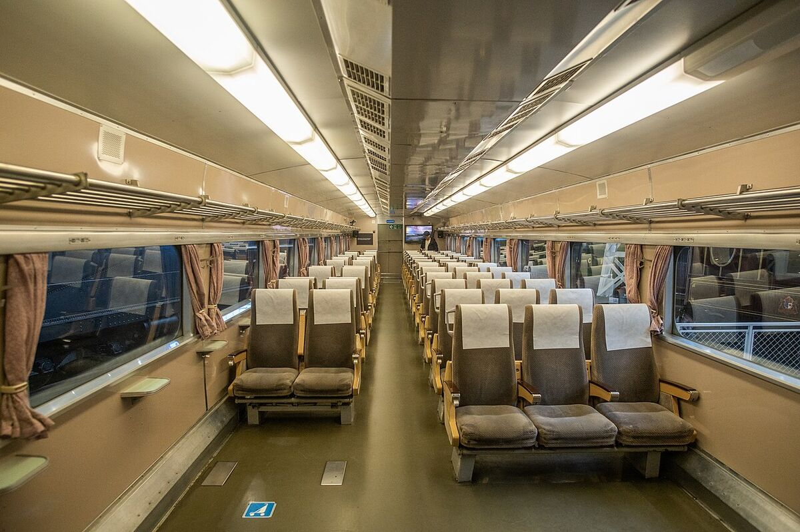
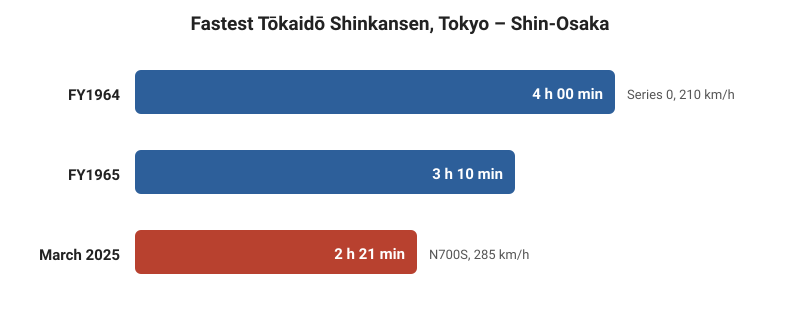
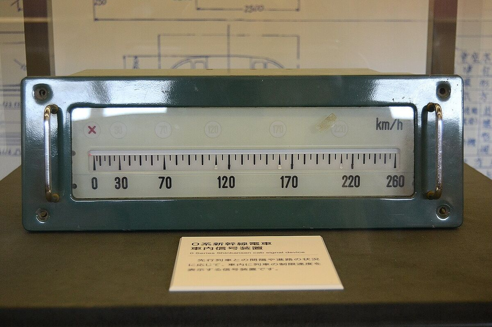
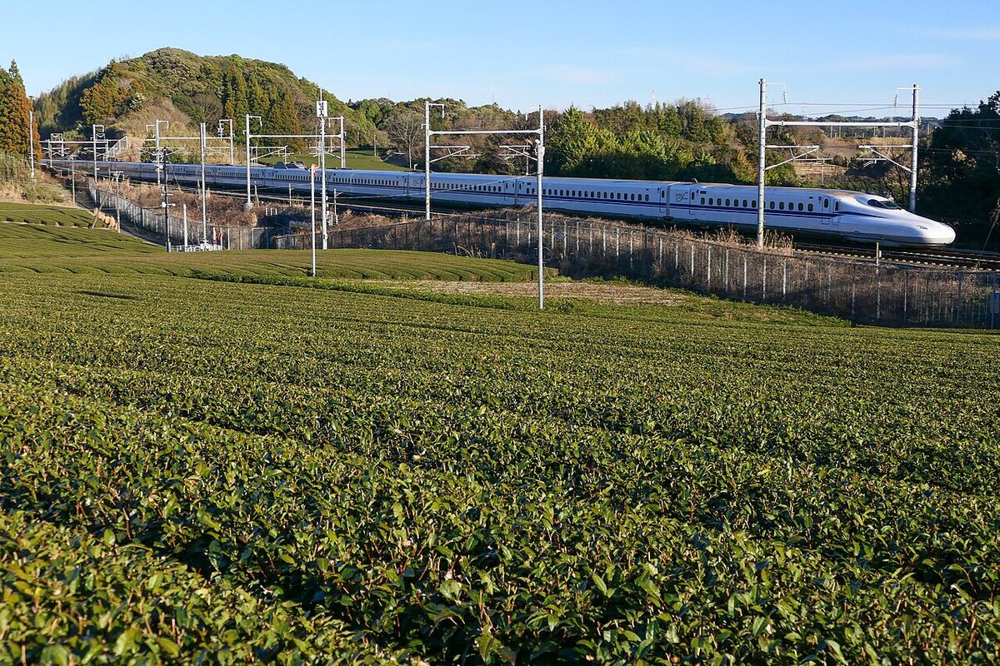

# 3. The Shinkansen

新幹線 (*shinkansen*) means "new trunk line". The first one, the **Tōkaidō Shinkansen** between Tokyo and Shin-Osaka, opened on **1 October 1964** (MLIT 2024). This chapter explains where the idea came from, why it was built, and what sixty years of operation show.

## 3.1 Half a century of dreams

In October 1964 the *Journal of the Institute of Electrical Engineers of Japan* printed an essay by the railway executive Kajiura Kōjirō, looking back at the plans that came before (Kajiura 1964):

- **1906–1907.** After the Russo-Japanese War, private promoters proposed a **standard-gauge electric railway** linking Tokyo and Osaka in about five to six hours. Application after application was **rejected**: it would compete with the state's Tōkaidō line, and the state should build such a line itself.
- **The "bullet train" of 1939.** In November 1939 a government committee proposed a new **standard-gauge, double-track line**: Tokyo–Osaka in 4½ hours and Tokyo–Shimonoseki in 9, with a future top speed of 200 km/h. Work began in fiscal 1940 with land purchase and some tunnels, including the Shin-Tanna, Nihonzaka and Higashiyama, but stopped as the war intensified.
- **1946.** A private plan for a line from Tokyo to Fukuoka was abandoned without the transport ministry's approval.
- **1964.** The line that was finally built used a new **25,000-volt, 60 Hz AC** electrical system.

Japan's existing lines were **narrow gauge** (MLIT 2012). All of these plans called for a **wider gauge** (広軌, *kōki*) on a new line of its own (Kajiura 1964).

## 3.2 Why it was built

By the late 1950s, the ministry's history explains, the shortage of rail capacity had become a bottleneck for economic growth. JNR's **second five-year plan**, from fiscal 1961, was built around the construction of the **Tōkaidō Shinkansen**, together with double-tracking and electrification. Costs rose and other work fell behind, but by fiscal 1964 the Shinkansen part of the plan was 100% funded, against about 60% for everything else. The line was completed in 1964, the year of the Tokyo Olympics (MLIT 2012).

<figure>

<figcaption>Inside a preserved Series 0 car, the type that opened the line in 1964 with a top speed of 210 km/h (JR Central 2025). Photographed in 2024. <span class="credit">Image: www.mgaylard.co.uk and thanks for looking, <a href="https://creativecommons.org/licenses/by/2.0/">CC BY 2.0</a>, via <a href="https://commons.wikimedia.org/wiki/File:0_Series_Shinkansen_at_the_National_Railway_Museum_2024-10-10.jpg">Wikimedia Commons</a>.</span></figcaption>
</figure>

## 3.3 Faster

JR Central's fact sheet traces the fastest journey from Tokyo to Shin-Osaka (JR Central 2025):

| When | Fastest time | Newest train, top speed |
|---|---|---|
| Fiscal 1964 | 4 h 00 min | Series 0, 210 km/h |
| Fiscal 1965 | 3 h 10 min | Series 0 |
| March 2025 | 2 h 21 min | N700S, 285 km/h |

All trains on the line have run at up to **285 km/h since March 2020** (JR Central 2025).

<figure class="diagram">

<figcaption>Fastest times between Tokyo and Shin-Osaka (JR Central 2025). <span class="credit">Diagram drawn for this handbook from the sources cited in the chapter.</span></figcaption>
</figure>

<figure>

<figcaption>The cab speedometer of a Series 0 train, which also showed signals from the automatic train control (ATC) system, at the Kyoto Railway Museum, 2016. <span class="credit">Image: Toshinori baba, <a href="https://creativecommons.org/licenses/by-sa/4.0/">CC BY-SA 4.0</a>, via <a href="https://commons.wikimedia.org/wiki/File:Tokaido_Shinkansen_Series_0_speedometer_and_ATC_equipment.jpg">Wikimedia Commons</a>.</span></figcaption>
</figure>

## 3.4 The line in numbers

From JR Central's fact sheet (JR Central 2025):

- **Safe.** Since operations began, there has been **no train accident in which passengers on board were killed or injured**.
- **Punctual.** The **average delay** in fiscal 2024 was **1.4 minutes per train**, including delays caused by natural disasters.
- **Frequent.** **383 trains a day** in fiscal 2024, on average, including extra trains. Each train has 1,318 or 1,314 seats.
- **Busy.** **460,000 passengers a day**, 168 million a year (fiscal 2024).
- **Efficient.** Between Tokyo and Osaka, an N700 *Nozomi* uses about **one-eighth of the energy** per seat of a Boeing 777-200, and emits about **one-twelfth of the CO₂**.

The ministry's white paper adds that rail as a whole emits about one-fifth of the CO₂ per passenger-kilometre of air travel, and one-sixth of a private car's (MLIT 2021).

<figure>

<figcaption>An N700S on the Tōkaidō Shinkansen crossing tea fields in Kikugawa, Shizuoka, 2024. <span class="credit">Image: MaedaAkihiko, <a href="https://creativecommons.org/publicdomain/zero/1.0/">CC0</a>, via <a href="https://commons.wikimedia.org/wiki/File:Tokaido-Shinkansen_N700S_Kikugawa.jpg">Wikimedia Commons</a>.</span></figcaption>
</figure>

## 3.5 West, north and abroad

From the ministry's chronology and history (MLIT 2024; MLIT 2012):

- **Sanyō Shinkansen:** Shin-Osaka–Okayama in March 1972; Okayama–Hakata, 443.6 km, in March 1975, after construction slowed by soaring land prices and the oil crisis. Tokyo to Hakata became a single high-speed line over 1,000 km long.
- **Tōhoku and Jōetsu Shinkansen:** from Ōmiya to Morioka in June 1982 and to Niigata in November 1982; extended to Ueno in 1985 and Tokyo in 1991.
- **Abroad:** the **Taiwan High Speed Rail**, which opened on 5 January 2007, was the first export of the Japanese Shinkansen system.

Chapter 8 describes the network as it is today.

## Self-check

```quiz
? When did the Tōkaidō Shinkansen open?
- 1 October 1964 *
- 14 October 1872
- 1 April 1987
> In the year of the Tokyo Olympics (MLIT 2024).

? What was the "bullet train" plan of 1939?
- A standard-gauge line Tokyo–Shimonoseki, begun in 1940 and stopped by the war *
- The first subway in Tokyo
- A maglev line
> Some land and tunnels were started (Kajiura 1964).

? What was the average delay per Tōkaidō Shinkansen train in fiscal 2024?
- 1.4 minutes, including natural disasters *
- 14 minutes
- Exactly zero
> JR Central 2025.

? What is JR Central's safety record on the Tōkaidō Shinkansen?
- No train accident has killed or injured passengers on board since operations began *
- No accident of any kind
- One fatal accident in 1964
> The claim covers passengers on board (JR Central 2025).
```

## Sources for this chapter

1. **JR Central 2025.** Central Japan Railway Company. *Fact Sheets 2025*. [global.jr-central.co.jp](https://global.jr-central.co.jp/en/company/ir/factsheets/_pdf/factsheets2025.pdf).
2. **Kajiura 1964.** Kajiura Kōjirō 梶浦浩二郎. 半世紀の夢の超特急 (The super-express, a dream of half a century). *Journal of the Institute of Electrical Engineers of Japan* 1964;84(913):1460–1461 (essay). doi:[10.11526/ieejjournal1888.84.1460](https://doi.org/10.11526/ieejjournal1888.84.1460).
3. **MLIT 2012.** See [Chapter 1](01-first-line.md).
4. **MLIT 2021.** Ministry of Land, Infrastructure, Transport and Tourism 国土交通省. 国土交通白書2021 (White Paper on Land, Infrastructure, Transport and Tourism 2021), part II, ch. 6, sec. 1-2: 幹線鉄道ネットワークの整備. [mlit.go.jp](https://www.mlit.go.jp/hakusyo/mlit/r02/hakusho/r03/html/n2612000.html).
5. **MLIT 2024.** See [Chapter 1](01-first-line.md).

➡️ Next: [Chapter 4: The break-up of JNR](04-jnr-reform.md)
