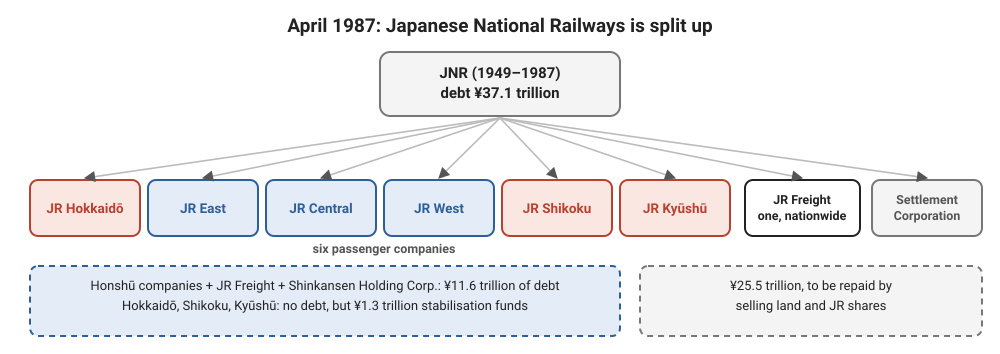

# 4. The Break-up of JNR

On 1 April 1987, Japanese National Railways ceased to run trains. Its work passed to six regional passenger companies and one freight company: the **JR Group**. This chapter explains why JNR failed, how it was divided, and what the government itself says about the results thirty years on. The sources are the Railway Bureau's own accounts (MLIT n.d.-a; MLIT 2017).

## 4.1 How JNR went bankrupt

JNR lost its dominance as roads and airports were built (MLIT n.d.-a; MLIT 2017):

| | Fiscal 1955 | Fiscal 1986 |
|---|---|---|
| JNR's share of passenger transport | 55% | 23% |
| JNR's share of freight | 52% | 5% |

**JNR first made a loss in 1964**, the year the Tōkaidō Shinkansen opened. By fiscal 1971 it was losing money even before depreciation. From fiscal 1980 it lost more than **¥1 trillion every year**, even after state subsidies (¥600 billion in 1985), which did not cover even its interest payments. In fiscal 1986 it lost ¥1.4 trillion on transport revenue of ¥3.2 trillion; its accumulated deficit was ¥15.5 trillion (MLIT n.d.-a; MLIT 2017).

The ministry lists the causes (MLIT n.d.-a):

- **Competition** from cars and planes from around 1960, without matching gains in efficiency.
- **Fares fixed by law.** Changing them required an act of parliament, and as the most visible public charge they were held down.
- **Size.** About **400,000 employees**, run as a single nationwide organisation.
- **Labour relations** that tended to be abnormal, with little concern for productivity or cost.
- **State control** of fares, staffing and investment, which left managers little room to decide and blurred responsibility.
- **Fare rises after 1981**, which drove passengers further away.
- **Unprofitable lines** were built across the country, and freight kept an outdated system of marshalling yards (MLIT 2017).

Four rehabilitation plans from 1969 failed. In 1980 an act singled out **"specified local lines"** carrying fewer than 4,000 passengers per kilometre a day: by April 1990, 38 of the 83 such lines had become **third-sector** railways (companies in which local governments hold shares) and 45 had been replaced by buses (MLIT 2017).

## 4.2 The decision to split

In **1982** the government's **Provisional Commission for Administrative Reform** concluded that JNR could not be saved within the existing system, and recommended privatising it and dividing it by region. A supervisory committee set up in 1983 reported in **July 1985**. Eight bills went to the Diet in 1986, and the reform took effect in **April 1987** (MLIT n.d.-a; MLIT 2017).

The committee's reasoning (MLIT 2017):

- **The public corporation** invited outside interference, gave managers no autonomy, made labour relations difficult, and limited what the business could do.
- **A single nationwide organisation** was too large to manage, too uniform, and let regions and divisions lean on each other's revenue; with no comparable company, it had no sense of competition.

<figure class="diagram">

<figcaption>The division of 1987 (MLIT n.d.-a; MLIT 2017). <span class="credit">Diagram drawn for this handbook from the sources cited in the chapter.</span></figcaption>
</figure>

## 4.3 How JNR was divided

From the ministry's account (MLIT n.d.-a; MLIT 2017):

- **Six passenger companies.** The three islands, **Hokkaidō, Shikoku and Kyūshū**, each got a company. Honshū was divided into three, **JR East, JR Central and JR West**, according to where passengers actually travel.
- **One freight company**, **JR Freight**, nationwide, because freight trains cross every region. It owns wagons and terminals and runs on the passenger companies' track, paying only the extra maintenance cost its trains cause (the "avoidable cost" rule).
- **Freedom to do business.** Unlike JNR, the new companies could enter any line of business, and fares needed only the minister's approval.
- **Service kept whole.** Fares for journeys across company boundaries are still calculated as one through fare; any station sells tickets for any JR company; through trains were kept.
- **The Shinkansen** lines were first owned by a separate holding corporation and leased to the Honshū companies, to even out their profits. In 1991 they were sold to the companies.

**The debt** of **¥37.1 trillion** was divided:

- **¥11.6 trillion** went to JR East, JR Central, JR West, JR Freight and the Shinkansen holding corporation (MLIT n.d.-a).
- **¥25.5 trillion** went to the **JNR Settlement Corporation**, to be repaid by selling land and JR shares (MLIT n.d.-a).
- **The three island companies took no debt.** Expected to lose money on operations, they received **management stabilisation funds** of about ¥1.3 trillion, designed to earn 7.3% a year (MLIT 2017).

**Staff:** JNR had 462,000 employees in fiscal 1965 and 277,000 in fiscal 1986. The JR companies hired 201,000; about 75,000 more were found jobs in government and private companies (MLIT 2017).

## 4.4 The results, as the ministry sees them

**Successes** (MLIT n.d.-a; MLIT 2017):

- **Traffic grew.** Passenger-kilometres had grown 0.6% a year in the five years before the reform, and **3.4% a year** in the seven years after. By fiscal 2015 the six passenger companies carried 32% more than in fiscal 1987.
- **Fares were held.** The Honshū companies have hardly raised fares since 1987, apart from consumption tax; the island companies raised them by an average 6.6% in 1996.
- **Productivity** rose from 1.13 million to 2.05 million passenger-kilometres per employee between fiscal 1987 and 2005.
- **Profits and taxes.** By fiscal 2005 the seven JR companies made an ordinary profit of about ¥500 billion and paid about ¥240 billion in taxes.
- **Service.** *Nozomi* trains from 1992; 320 km/h on the Tōhoku Shinkansen from 2013; 20% more conventional trains; railway accidents down 60%.
- **Full privatisation.** JR East, JR West and JR Central were listed from fiscal 1993 and all their shares were sold by fiscal 2006. JR Kyūshū was listed in October 2016.

**Unfinished business** (MLIT 2017):

- **JR Hokkaidō, JR Shikoku and JR Freight** were still not profitable enough to be listed in 2017. Interest rates fell far below 7.3%, and the state has repeatedly added support.
- **JR Hokkaidō** had a freight derailment in September 2013 after which falsified inspection data were found. The ministry issued improvement orders in January 2014 and added ¥120 billion of support over three years from fiscal 2016.
- **The settlement corporation failed.** Land and share sales lagged, and its debt grew to ¥28.3 trillion. In 1998 the state took over ¥24.2 trillion of it; ¥17.8 trillion of that remained at the end of fiscal 2015.

## Self-check

```quiz
? When did JNR first make a loss?
- In 1964 *
- In 1949
- In 1986
> The year the Tōkaidō Shinkansen opened (MLIT n.d.-a).

? Into how many companies was JNR's railway business divided in 1987?
- Six passenger companies and one freight company *
- One national company
- Three regional companies
> Hokkaidō, East, Central, West, Shikoku, Kyūshū, and JR Freight.

? Why did the three island companies receive stabilisation funds instead of debt?
- They were expected to lose money on operations *
- They were the most profitable
- They owned the Shinkansen
> The funds were designed to earn 7.3% a year (MLIT 2017).

? How much of JNR's debt did the state eventually take over in 1998?
- ¥24.2 trillion *
- ¥1.3 trillion
- Nothing
> The settlement corporation's land and share sales fell short (MLIT 2017).
```

## Sources for this chapter

1. **MLIT 2017.** Ministry of Land, Infrastructure, Transport and Tourism, Railway Bureau 国土交通省鉄道局. 国鉄の分割民営化から３０年を迎えて (Thirty years since the division and privatisation of JNR), 2017. [mlit.go.jp](https://www.mlit.go.jp/common/001242868.pdf).
2. **MLIT n.d.-a.** Ministry of Land, Infrastructure, Transport and Tourism 国土交通省. 国鉄改革について (On the JNR reform). [mlit.go.jp](https://www.mlit.go.jp/tetudo/kaikaku/01.pdf).

➡️ Next: [Chapter 5: Railways that built cities](05-private.md)
