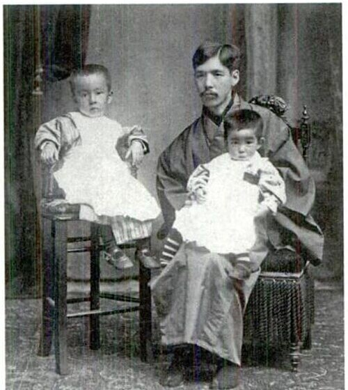
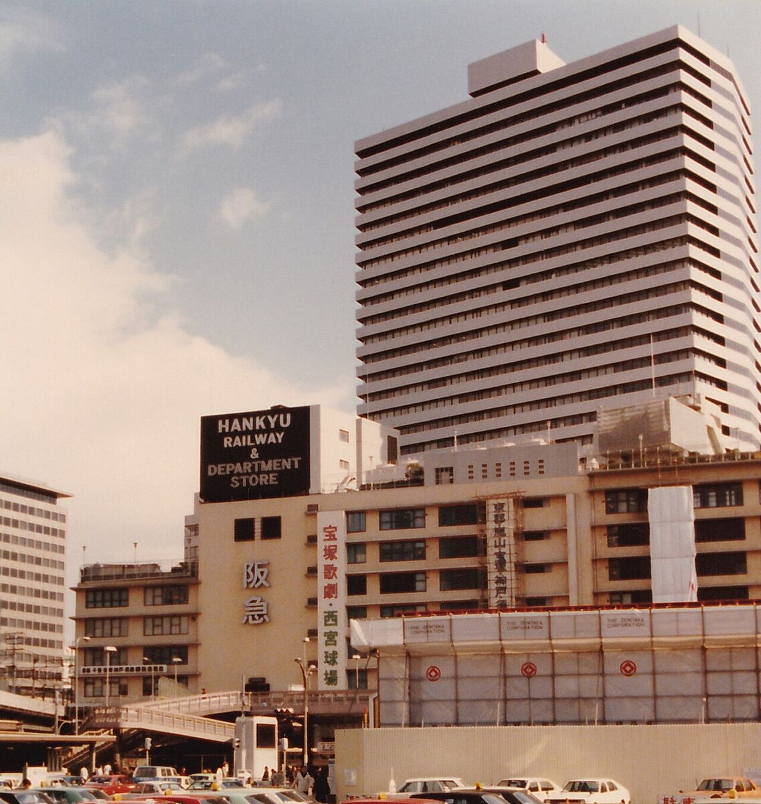

# 5. Railways that Built Cities

Japan's private railways have long been more than train operators: they develop housing along their lines, run department stores at their terminals, and stage events to attract passengers. The model was worked out in the 1910s and 1920s by **[Kobayashi Ichizō](https://en.wikipedia.org/wiki/Ichiz%C5%8D_Kobayashi)** of the Minoo-Arima Electric Railway, later **Hankyu**. This chapter follows the study by Doi Tsutomu, then of Hankyu's research institute, and the writer Kawauchi Atsurō (Doi and Kawauchi 1995).

## 5.1 Escaping the smoke

Osaka industrialised fast. Its population grew from 950,000 in 1902 to 1.27 million in 1911. Smoke and polluted water brought epidemics, and those who could afford it looked for a healthier life outside the city (Doi and Kawauchi 1995).

Two private electric railways opened between Osaka and Kobe:

- **Hanshin Electric Railway**, in **1905**, linked existing towns along the coast.
- **Minoo-Arima Electric Railway**, led by Kobayashi, opened its **Takarazuka line** (Umeda–Takarazuka) in **1910** and its **Kobe line** in **1920**. It later became Hankyu.

Hankyu was the latecomer. Its route ran **inland, away from the existing towns**, so it could not count on many passengers. As Doi and Kawauchi put it, Hankyu had to support its railway by developing housing.

## 5.2 Houses on monthly instalments

Hankyu sold housing even before its trains ran. In autumn 1909 it published a pamphlet, *What land should you choose? What house should you live in?*, contrasting the "beautiful city of water" Osaka had been with the "smoky city" it had become (Doi and Kawauchi 1995).

Kobayashi's innovation was the **monthly instalment** (月賦, *geppu*), worked out from what a salaried worker earned (Doi and Kawauchi 1995):

| Estate | Price | Terms |
|---|---|---|
| **Ikeda Muromachi**, the first | ¥2,500–3,000 for a plot of about 100 *tsubo* with a two-storey house | 20% down, ¥24 a month for 10 years |
| **Sakurai** | ¥1,200 for 50–60 *tsubo* with a two-storey house | ¥200 down, ¥12 a month for 10 years |

For comparison, the authors note that a teacher's starting salary was then ¥12–20 a month.

Hankyu's magazine, launched in 1913, sold the suburban life: healthy children, the ideal kitchen, and houses "for a monthly payment of only ¥12" that cost less than renting in Osaka (Doi and Kawauchi 1995).

<figure>

<figcaption>Kobayashi Ichizō with his sons, around 1905–06, when he still worked at Mitsui Bank. <span class="credit">Image: Unknown authorUnknown author, Public domain, via <a href="https://commons.wikimedia.org/wiki/File:Ichiz%C5%8D_Kobayashi%2C_c.1905-06.jpg">Wikimedia Commons</a>.</span></figcaption>
</figure>

## 5.3 Reasons to ride

Housing produced commuters. Hankyu also created reasons to travel at weekends (Doi and Kawauchi 1995):

- **A zoo at Minoo** in 1910, and the **Takarazuka Shin-Onsen** spa resort in 1911.
- **The Takarazuka Girls' Opera.** It first appeared in **1914**, as entertainment at a "wedding exhibition". Visitors grew from 260,000 in 1915 to 430,000 in 1918. It performed in Tokyo in 1918 and in Europe in 1938. It is today's Takarazuka Revue.
- **Schools.** Hankyu helped Kwansei Gakuin move to Nishinomiya, and girls' schools such as Kobe College settled along the line, drawing middle-class families.
- **Speed.** By 1930 a Kobe line express took 30 minutes from Umeda, and in 1934 Hankyu advertised "Osaka–Kobe in one stride: 25 minutes".

## 5.4 The terminal department store

In 1920 Hankyu built a five-storey building at its Umeda terminal, leasing the ground floor to the Shirokiya store. In 1925 it took the space back and opened its own shop and restaurants. In **1929** this became the **Hankyu Department Store**: eight floors above ground and two below, more than 10,000 m² (Doi and Kawauchi 1995).

Older department stores, such as Mitsukoshi and Daimaru, had grown out of kimono merchants in shopping districts. Hankyu's was the **first terminal department store** and the **first founded by a railway**. Others followed: Tōbu at Asakusa (1931), Nankai at Namba (1932), and Tōkyū at Shibuya (1934) (Doi and Kawauchi 1995).

The authors conclude that housing, leisure parks, events and schools became the standard business menu of Japanese railway companies, a menu complete by this time (Doi and Kawauchi 1995).

<figure>

<figcaption>Hankyu's Umeda station and the Hankyu Department Store in 1979. <span class="credit">Image: Project Kei, <a href="https://creativecommons.org/licenses/by-sa/4.0/">CC BY-SA 4.0</a>, via <a href="https://commons.wikimedia.org/wiki/File:Hankyu_Osaka_Umeda_Station_building_1979.jpg">Wikimedia Commons</a>.</span></figcaption>
</figure>

## Self-check

```quiz
? Why did Hankyu need to build housing along its line?
- Its route ran away from existing towns, so it had few passengers to begin with *
- The government ordered it
- To house its own workers
> Doi and Kawauchi 1995.

? What was Kobayashi Ichizō's innovation in selling houses?
- Monthly instalments calculated from a salaried worker's pay *
- Free houses for season-ticket holders
- Houses rented by the night
> At Ikeda Muromachi, ¥24 a month for 10 years.

? How did the Takarazuka Revue begin?
- As entertainment at a "wedding exhibition" in 1914 *
- As a Kabuki troupe from Tokyo
- As a radio programme
> It drew passengers to Hankyu's Takarazuka resort.

? What was special about the Hankyu Department Store of 1929?
- It was the first terminal department store and the first founded by a railway *
- It was the first department store in Japan
- It was underground
> Tōbu, Nankai and Tōkyū followed in the 1930s.
```

## Sources for this chapter

1. **Doi and Kawauchi 1995.** Doi Tsutomu, Kawauchi Atsurō 土井勉・河内厚郎. 鉄道沿線における郊外住宅地の開発と地域イメージの形成：阪急沿線の郊外住宅地開発と生活文化に着目して (Historical viewpoints of image formation of the suburb developed by Hankyu Railway: housing and life-style in the Hanshin area). *Historical Studies in Civil Engineering* 1995;15:1ff. [J-STAGE](https://www.jstage.jst.go.jp/article/journalhs1990/15/0/15_0_1/_pdf).

➡️ Next: [Chapter 6: The subways of Tokyo and Osaka](06-subways.md)
