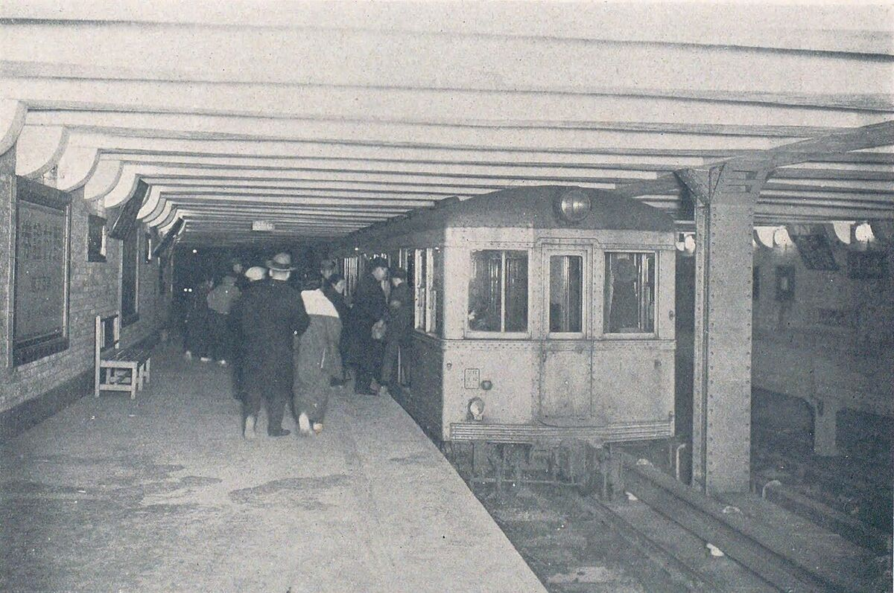
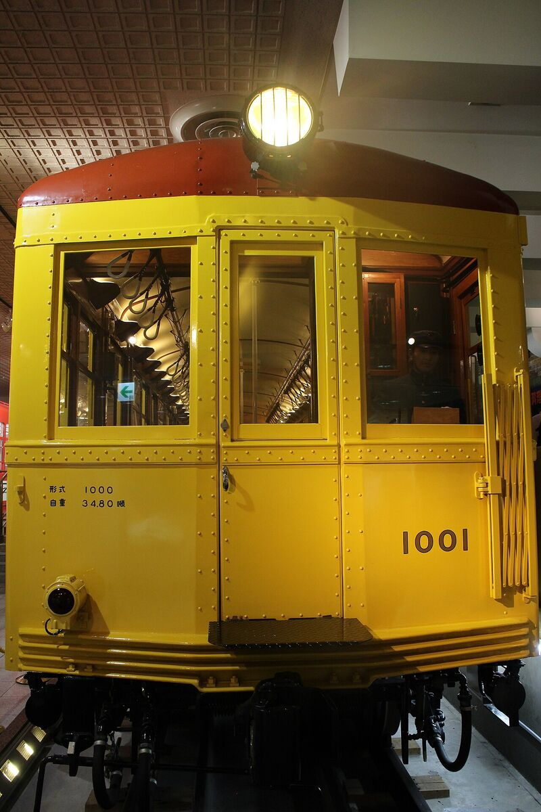
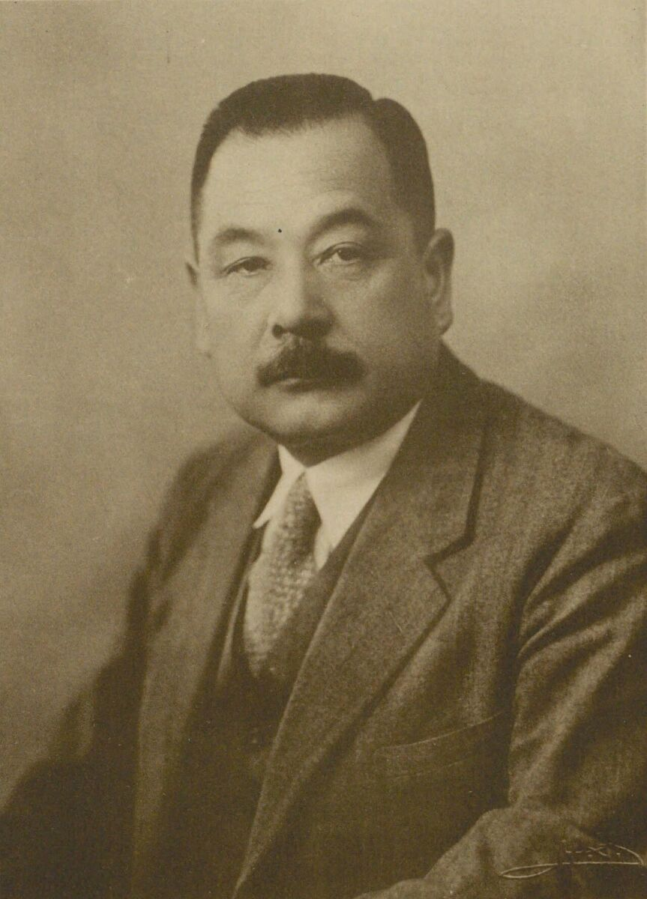
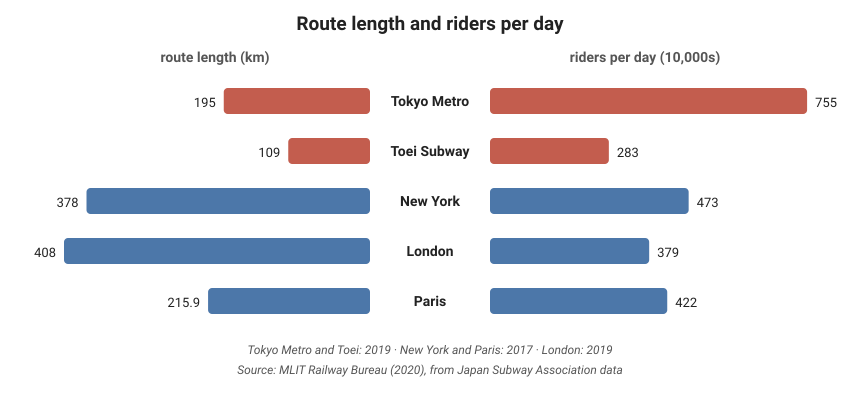
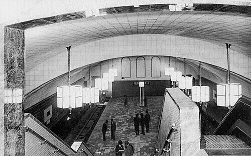

# 6. The Subways of Tokyo and Osaka

Tokyo opened Japan's first subway line in 1927, and Osaka followed in 1933. Before the pandemic, in fiscal 2019, Tokyo's two subway operators carried more than ten million passengers a day (MLIT 2020). This chapter tells the story of both cities' subways. For practical advice on riding them, see [Lesson 6 of the Japan guide](../lessons/06-subways.md).

## 6.1 Hayakawa Noritsugu and the first subway

The National Diet Library's biography of **[Hayakawa Noritsugu](https://en.wikipedia.org/wiki/Noritsugu_Hayakawa)** (1881–1942) gives the outline (NDL n.d.-b):

- He worked for the South Manchuria Railway and the government railways before running private lines.
- After a study tour of Europe and America, he founded the **Tokyo Underground Railway** (東京地下鉄道) in **1920**.
- In **1927** it opened **Ueno–Asakusa**, **Japan's first subway**.
- After a struggle for control with **Gotō Keita**'s rival Tokyo Rapid Railway, he withdrew from subway management in **1940**, through the mediation of the Railway Ministry.

The ministry's chronology dates the opening to **30 December 1927** and notes that the line is today's **Ginza line** (MLIT 2024).

<figure>

<figcaption>A Tokyo Underground Railway 1000-type car soon after the opening, in the early Shōwa era. <span class="credit">Image: Unknown authorUnknown author, Public domain, via <a href="https://commons.wikimedia.org/wiki/File:Ginza_line_in_early_Showa_era.jpg">Wikimedia Commons</a>.</span></figcaption>
</figure>

<figure>

<figcaption>Car 1001, the first of the Tokyo Underground Railway's 1000 type, preserved at the Tokyo Metro museum, 2020. <span class="credit">Image: Suicasmo, <a href="https://creativecommons.org/licenses/by-sa/4.0/">CC BY-SA 4.0</a>, via <a href="https://commons.wikimedia.org/wiki/File:Tokyo_Underground_1000_series_in_Tokyo_Metro_Museum_20200815.jpg">Wikimedia Commons</a>.</span></figcaption>
</figure>

<figure>

<figcaption>Hayakawa Noritsugu, founder of the Tokyo Underground Railway. <span class="credit">Image: Unknown authorUnknown author, Public domain, via <a href="https://commons.wikimedia.org/wiki/File:Hayakawa_Noritsugu.jpg">Wikimedia Commons</a>.</span></figcaption>
</figure>

## 6.2 Wartime merger: the Eidan

Under the 1938 Land Transport Business Coordination Act, a government committee decided in December 1940 that Tokyo's subways should be run by a single new authority (MLIT 2012). In **1941** the **Teito Rapid Transit Authority** (帝都高速度交通営団), known as the ***Eidan***, took over the lines and licences of the Tokyo Underground Railway, the Tokyo Rapid Railway, the Keihin Underground Railway and Tokyo City. Its capital was ¥60 million, invested by the state, Tokyo and private railways, and it began with **14.3 km between Shibuya and Asakusa** (MLIT 2012; MLIT 2020).

After the war (MLIT 2024):

- **20 January 1954:** the first postwar subway, Ikebukuro–Ochanomizu, the first section of the Marunouchi line, which reached Shinjuku in 1959.
- **1962:** the Hibiya line and the Tōbu railway began **through running**: trains passing from the subway onto a suburban railway's tracks.

## 6.3 Toei: the city's own subway

The Tokyo Metropolitan Government built a second network, the **Toei Subway**. From the Bureau of Transportation's chronology (Toei n.d.):

- **1954:** the Tokyo assembly resolved to build a metropolitan subway.
- **4 December 1960:** Line 1, today's **Asakusa line**, opened from Oshiage to Asakusabashi, with through running onto the **Keisei** railway from the first day.
- **1968:** Line 6, today's **Mita line**, opened.
- **1978:** Lines 1, 6 and 10 were given names (Asakusa, Mita, Shinjuku). The Shinjuku line opened that December.
- **1991:** Line 12 opened; it was named the **Ōedo line** in 2000, and its loop was completed on 12 December 2000.
- **20 February 2024:** **platform doors** were completed at all 20 Asakusa line stations, so that all **106 Toei stations** have them.

## 6.4 From Eidan to Tokyo Metro

In 1986 a government reform council recommended turning the Eidan into a fully private company once its network was nearly complete (MLIT 2020):

- **1 April 2004:** **Tokyo Metro** (東京地下鉄株式会社) was founded as a special company. It stated that the Fukutoshin line would be its last new line.
- **Shareholders** in 2020: the state 53.4%, Tokyo 46.6%.
- **Network:** 9 lines, 180 stations, 195.0 km. Every line except the Ginza and Marunouchi runs through onto other companies' tracks, adding 355.8 km of through service.
- **Passengers:** about **7.55 million a day** (fiscal 2019), more than any railway in Japan except JR East.

## 6.5 How Tokyo compares

The ministry compared Tokyo's subways with those of other cities (MLIT 2020):

<figure class="diagram">

<figcaption>Route length and riders per day (MLIT 2020). Tokyo has short routes but very heavy traffic. <span class="credit">Diagram drawn for this handbook from the sources cited in the chapter.</span></figcaption>
</figure>

| Operator | Lines | Stations | Route | Riders a day |
|---|---|---|---|---|
| Tokyo Metro (2019) | 9 | 180 | 195.0 km | 7.55 million |
| Toei Subway (2019) | 4 | 106 | 109.0 km | 2.83 million |
| New York (2017) | 25 | 472 | 378.0 km | 4.73 million |
| London (2019) | 11 | 270 | 408.0 km | 3.79 million |
| Paris (2017) | 16 | 302 | 215.9 km | 4.22 million |

## 6.6 Osaka: the first municipal subway

Osaka's city transport bureau opened **Japan's first public tram** in **1903** (Osaka Metro 2018). Its subway began on **20 May 1933**, when the **Midōsuji line** opened between **Umeda and Shinsaibashi**: Japan's first subway run by a public authority (Osaka Metro 2023).

On **1 April 2018** the city's subway became a company, **Osaka Metro** (大阪市高速電気軌道株式会社), to keep the business sustainable in the long term (Osaka Metro 2018).

<figure>

<figcaption>Umeda station on the Osaka municipal subway in the 1930s, photographed by the city's electric bureau. <span class="credit">Image: 大阪市電気局, Public domain, via <a href="https://commons.wikimedia.org/wiki/File:Umeda_Station_in_1935.jpg">Wikimedia Commons</a>.</span></figcaption>
</figure>

## 6.7 Two disasters

The ministry's history and chronology record two disasters on the Tokyo subway (MLIT 2012; MLIT 2024):

- **20 March 1995:** in the **sarin gas attack**, bags of sarin were left on Eidan trains, including on the Hibiya line. Eleven passengers and staff died and about 5,500 people were injured.
- **8 March 2000:** a derailment and collision on the Hibiya line at Naka-meguro.

## Self-check

```quiz
? When and where did Japan's first subway open?
- 30 December 1927, Ueno–Asakusa *
- 20 May 1933, Umeda–Shinsaibashi
- 4 December 1960, Oshiage–Asakusabashi
> It is today's Ginza line (MLIT 2024).

? What was the Eidan?
- The Teito Rapid Transit Authority, created in 1941 to merge Tokyo's subways *
- Osaka's municipal subway
- A private railway in Kansai
> It became Tokyo Metro in 2004.

? What does "through running" mean?
- Subway trains continuing onto another railway's tracks *
- Trains that skip stations
- Night-time services
> Tokyo Metro runs through on every line except the Ginza and Marunouchi.

? What was special about Osaka's Midōsuji line in 1933?
- It was Japan's first subway run by a public authority *
- It was Japan's first subway
- It was the first underground Shinkansen
> Osaka Metro 2023.
```

## Sources for this chapter

1. **MLIT 2012.** See [Chapter 1](01-first-line.md).
2. **MLIT 2020.** Ministry of Land, Infrastructure, Transport and Tourism, Railway Bureau 国土交通省鉄道局. 東京メトロを巡る現状及び東京の地下鉄ネットワークを巡る現状 (The situation of Tokyo Metro and Tokyo's subway network), council document 3, 2020. [mlit.go.jp](https://www.mlit.go.jp/policy/shingikai/content/001384561.pdf).
3. **MLIT 2024.** See [Chapter 1](01-first-line.md).
4. **NDL n.d.-b.** National Diet Library 国立国会図書館. 早川徳次 (Hayakawa Noritsugu). *Portraits of Modern Japanese Historical Figures*. [ndl.go.jp](https://www.ndl.go.jp/portrait/datas/6398).
5. **Osaka Metro 2018.** Osaka Metro. 4月1日 Osaka Metro 誕生 (Osaka Metro is born on 1 April), notice of 1 April 2018. [osakametro.co.jp](https://www.osakametro.co.jp/news/news/notice/_14271.php).
6. **Osaka Metro 2023.** Osaka Metro. Press release on the Midōsuji line 90th anniversary one-day ticket set, 20 April 2023. [subway.osakametro.co.jp](https://subway.osakametro.co.jp/news/news_release/20230420_midosuji_90th_anniversary.php).
7. **Toei n.d.** Bureau of Transportation, Tokyo Metropolitan Government 東京都交通局. 交通局のあゆみ：都営地下鉄 (History of the bureau: Toei Subway). [kotsu.metro.tokyo.jp](https://www.kotsu.metro.tokyo.jp/about/ayumi/subway.html).

➡️ Next: [Chapter 7: Safety and punctuality](07-safety.md)
