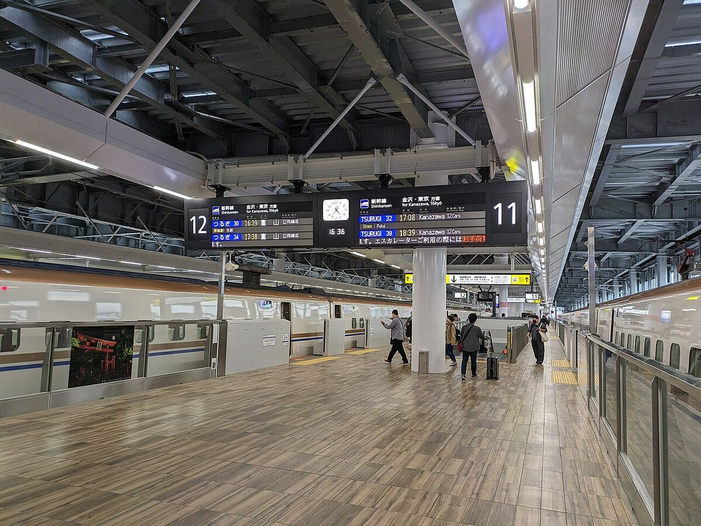
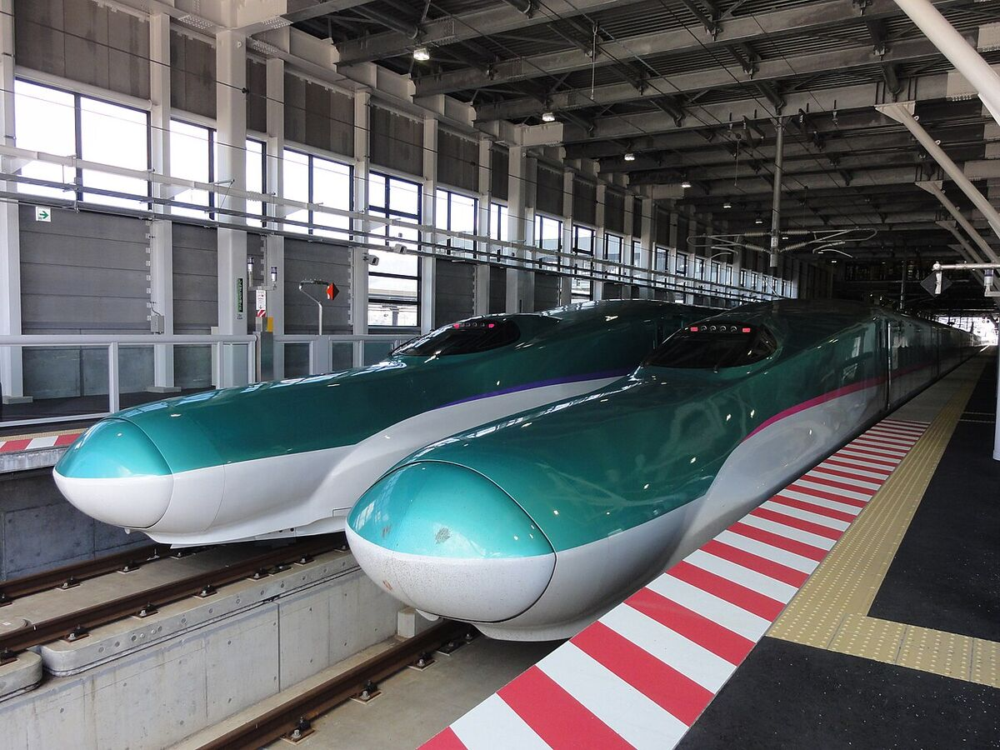
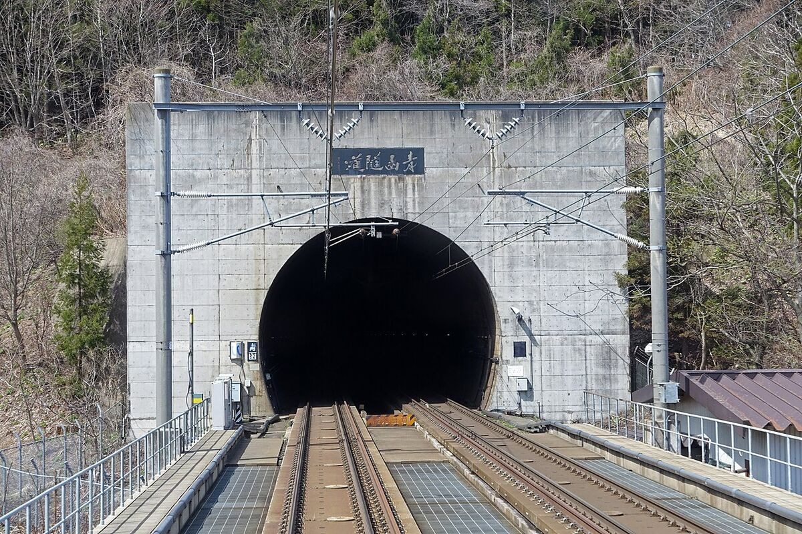

# 8. The Shinkansen Network Today

The Shinkansen now runs from Hokkaidō to Kyūshū. This chapter explains how the network grew after 1964, who pays for new lines, what is still being built, and the maglev line between Tokyo and Nagoya. Opening dates in this chapter are as of November 2026.

## 8.1 A national plan

The success of the Tōkaidō Shinkansen inspired a national plan. A development plan of 1969 envisaged a **7,200 km** Shinkansen network, and the **Nationwide Shinkansen Railway Development Act** (全国新幹線鉄道整備法) was promulgated on **18 May 1970**. Earlier lines had been built to add capacity; from now on, new lines were meant to spread development across the country (MLIT 2012).

- **1971:** plans were fixed for the Tōhoku, Jōetsu and Narita Shinkansen (MLIT 2012).
- **November 1973:** plans were fixed for **five more lines**, the ***seibi shinkansen*** (整備新幹線, "development Shinkansen"), but construction was frozen soon after because of the oil crisis (MLIT 2012), and again during the JNR crisis until 1987 (MLIT 2012).

The five *seibi* lines are (MLIT n.d.-b):

| Line | Route |
|---|---|
| Hokkaidō Shinkansen | Aomori – Sapporo |
| Tōhoku Shinkansen | Morioka – Aomori |
| Hokuriku Shinkansen | Tokyo – Osaka |
| Kyūshū Shinkansen (Kagoshima route) | Fukuoka – Kagoshima |
| Kyūshū Shinkansen (West Kyūshū route) | Fukuoka – Nagasaki |

Eleven more lines, including a Shikoku Shinkansen, remain at the earlier stage of "basic plans" (MLIT 2021).

## 8.2 Opening by stages

From the ministry's chronology (MLIT 2024):

| Date | Section |
|---|---|
| 1 Oct 1997 | Hokuriku: Takasaki – Nagano |
| 1 Dec 2002 | Tōhoku: Morioka – Hachinohe |
| 13 Mar 2004 | Kyūshū: Shin-Yatsushiro – Kagoshima-Chūō |
| 4 Dec 2010 | Tōhoku: Hachinohe – Shin-Aomori |
| 12 Mar 2011 | Kyūshū: Hakata – Shin-Yatsushiro |
| 14 Mar 2015 | Hokuriku: Nagano – Kanazawa |
| 26 Mar 2016 | Hokkaidō: Shin-Aomori – Shin-Hakodate-Hokuto |
| 23 Sep 2022 | West Kyūshū: Takeo-Onsen – Nagasaki |
| 16 Mar 2024 | Hokuriku: Kanazawa – Tsuruga |

Two "mini-Shinkansen" services run Shinkansen trains through onto conventional lines: to **Yamagata** from 1992 and to **Akita** from 1997 (MLIT 2024).

<figure>

<figcaption>The Hokuriku Shinkansen platforms at Tsuruga, the line's terminus since 16 March 2024 (MLIT 2024), photographed in May 2024. <span class="credit">Image: Suikotei, <a href="https://creativecommons.org/licenses/by/4.0/">CC BY 4.0</a>, via <a href="https://commons.wikimedia.org/wiki/File:Tsuruga_Station_Hokuriku_Shinkansen_Platform_01.jpg">Wikimedia Commons</a>.</span></figcaption>
</figure>

<figure>

<figcaption>Hokkaidō and Tōhoku Shinkansen trains at Shin-Hakodate-Hokuto, the northern terminus since 2016. <span class="credit">Image: Rsa, <a href="https://creativecommons.org/licenses/by-sa/3.0/">CC BY-SA 3.0</a>, via <a href="https://commons.wikimedia.org/wiki/File:JRH_H5_H2_JRE_E5_U14_Shin-Hakodate-Hokuto_Station_north_20160406.jpg">Wikimedia Commons</a>.</span></figcaption>
</figure>

## 8.3 Who pays

The *seibi* lines are built and owned by the **Japan Railway Construction, Transport and Technology Agency** (JRTT) and leased to the JR company that runs the trains: a separation of track and operation. After the lease income, construction costs are shared: **two-thirds by the state, one-third by local governments** (MLIT n.d.-b).

Before work starts, five conditions must be met: stable financing, profitability, a sound investment case, **the JR company's consent**, and **the consent of local governments to separate the parallel conventional line** from JR (MLIT n.d.-b).

**Parallel conventional lines** (並行在来線, *heikō zairaisen*) are the old lines that run alongside a new Shinkansen. Running both could be too heavy a burden for a JR company, so when a Shinkansen opens, with the consent of every prefecture and municipality along the line, the old line is transferred from JR to a separate railway company. Examples include Aoimori Railway, IGR Iwate Galaxy Railway, Shinano Railway, Ainokaze Toyama Railway, IR Ishikawa Railway and Hapi-Line Fukui (MLIT n.d.-b).

## 8.4 Still under construction

**Hokkaidō: Shin-Hakodate-Hokuto – Sapporo.** About 80% of this section is long tunnels. Boulders and poor ground not detected before construction have slowed the work, and the opening is now expected to slip from the end of fiscal **2030** to around the end of fiscal **2038** (MLIT 2026).

**Hokuriku: Tsuruga – Shin-Osaka.** In 2021 the ministry listed this section as not yet started, with the five conditions above still to be settled (MLIT 2021).

**The Seikan Tunnel** under the Tsugaru Strait is shared by Shinkansen and freight trains. Over the New Year of 2020–21, by keeping freight out of the tunnel at set times, Shinkansen trains ran through it at **210 km/h** in regular service for the first time (MLIT 2021).

<figure>

<figcaption>The Honshū entrance of the Seikan Tunnel, with three-rail track for both Shinkansen and freight trains, 2015. <span class="credit">Image: Bmazerolles, <a href="https://creativecommons.org/licenses/by-sa/4.0/">CC BY-SA 4.0</a>, via <a href="https://commons.wikimedia.org/wiki/File:Seikan_Tunnel_entrance_-_dual-gauge_track.jpg">Wikimedia Commons</a>.</span></figcaption>
</figure>

## 8.5 The maglev: Chūō Shinkansen

JR Central is building the **Chūō Shinkansen**, using a **superconducting maglev** system designed for **500 km/h**. A ministry evaluation committee concluded that the technology needed for commercial service has been fully developed. JR Central is paying the construction cost itself (JR Central 2025). On the Yamanashi test line a maglev reached **603 km/h** on 21 April 2015, a world record (MLIT 2024).

| | Today (fastest) | With the maglev |
|---|---|---|
| Shinagawa – Nagoya (285.6 km) | 86 min | 40 min |
| Shinagawa – Osaka (438 km) | 134 min | 67 min |

*(JR Central 2025)*

**Delays.** In December 2023 the ministry approved a plan putting completion of the Shinagawa–Nagoya section "in 2027 or later", at a cost of **¥7.04 trillion**. JR Central says it **cannot open in 2027** because tunnelling has not begun in the Shizuoka section of the Southern Alps Tunnel, and that it **cannot give a new date** (JR Central 2025).

## Self-check

```quiz
? Who pays for the seibi Shinkansen lines after lease income?
- The state two-thirds, local governments one-third *
- The JR companies alone
- Passengers through a special tax
> They are built and owned by JRTT and leased to JR (MLIT n.d.-b).

? What happens to the old line when a new Shinkansen opens?
- It is transferred from JR to a separate company, with local consent *
- It is always closed
- It becomes a freight-only line
> These are the "parallel conventional lines".

? When did the Hokuriku Shinkansen reach Tsuruga?
- 16 March 2024 *
- 1 October 1997
- It has not opened
> MLIT 2024.

? Why can't JR Central give an opening date for the maglev?
- Tunnelling has not started in the Shizuoka section of the Southern Alps Tunnel *
- The technology is not ready
- It has no funding
> JR Central 2025.
```

## Sources for this chapter

1. **JR Central 2025.** See [Chapter 3](03-shinkansen.md).
2. **MLIT 2012.** See [Chapter 1](01-first-line.md).
3. **MLIT 2021.** See [Chapter 3](03-shinkansen.md).
4. **MLIT 2024.** See [Chapter 1](01-first-line.md).
5. **MLIT 2026.** Ministry of Land, Infrastructure, Transport and Tourism, Railway Bureau 国土交通省鉄道局. 説明資料 (Explanatory material), 16 February 2026. [mlit.go.jp](https://www.mlit.go.jp/policy/shingikai/content/001982153.pdf).
6. **MLIT n.d.-b.** Ministry of Land, Infrastructure, Transport and Tourism 国土交通省. 新幹線鉄道について (On Shinkansen railways). [mlit.go.jp](https://www.mlit.go.jp/tetudo/tetudo_fr1_000041.html).

➡️ Next: [Chapter 9: Fares and tickets](09-tickets.md)
