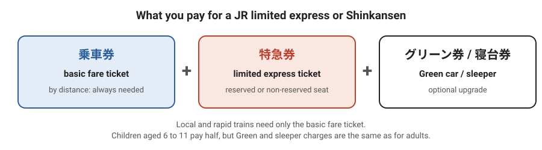
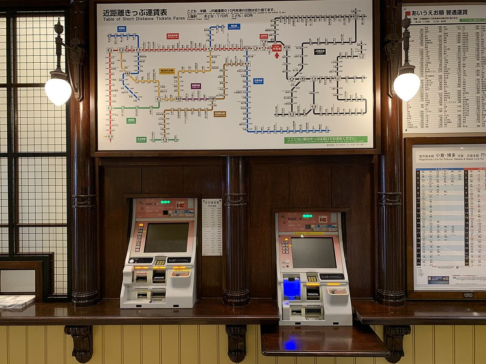

# 9. Fares and Tickets

This chapter explains how fares are built, how IC cards came to work almost everywhere, and what the Japan Rail Pass costs. It explains the system; it is not a price list.

> ⚠️ **Prices and rules change.** The prices below are quoted with the date of their source and were checked in **November 2026**. Japan Rail Pass prices changed in October 2023 and again in October 2026. Before you buy, check the price and conditions on the official site of the railway or pass, and ask at the station if anything is unclear. This handbook is not connected with any railway company and does not sell tickets.

## 9.1 How a JR fare is built

A JR journey is priced in parts (JR West 2018):

- **The basic fare ticket** (乗車券, *jōshaken*) pays for the distance. It is all you need on local and rapid trains.
- **The limited express ticket** (特急券, *tokkyūken*) is needed **in addition** on Shinkansen and limited express trains, which stop less often, run faster and offer more comfortable seats. It covers a **reserved seat** (指定席, *shiteiseki*: date, train and seat fixed) or a **non-reserved seat** (自由席, *jiyūseki*: any car marked as non-reserved).
- **Higher classes**, the **Green car** (グリーン車) above ordinary reserved seats, the GranClass, and sleeping berths, need a further ticket, issued together with the limited express ticket.

The basic fare and limited express ticket may be printed on one ticket or several (JR West 2018).

<figure class="diagram">

<figcaption>The parts of a JR fare (JR West 2018). <span class="credit">Diagram drawn for this handbook from the sources cited in the chapter.</span></figcaption>
</figure>

**Children** aged 6 to 11 pay **half**; Green car, GranClass and sleeper charges, however, are the same as for adults (JR West 2018).

**Across companies.** When JNR was split in 1987, through fares were kept: a journey over several JR companies is still charged as one distance, and any JR station sells tickets for any JR company (MLIT n.d.-a).

**Distance.** Fares that fall per kilometre over long distances were introduced by the state railways in 1899 (MLIT 2012).

## 9.2 Who sets the price

Since January 1997 the government approves only a **maximum fare**. Below that ceiling, railway companies can set or change fares simply by notifying the ministry. By May 1999, 153 companies had moved to the system, and 47 of them had introduced fares below their approved maximum on about 5,000 sections (MLIT 2012). The JR companies on Honshū have hardly raised their fares since 1987, apart from consumption tax (MLIT n.d.-a).

## 9.3 Buying a ticket

From JR West's guide (JR West 2018):

- **At a ticket machine:** find your destination and its fare on the **fare chart above the machine**, insert money, and press the button showing that fare.
- **At the ticket office** (みどりの窓口, *midori no madoguchi*) or a "green" reserved-seat machine you can pay by credit card (a PIN is needed at the machine). Credit cards cannot be used to pay a fare adjustment at the end of a journey.

Automatic ticket machines are not new: Tokyo and Ueno stations installed machines for platform tickets in April 1926 (MLIT 2024).

<figure>

<figcaption>Ticket machines under the fare map at Mojikō station, Kitakyūshū, 2020. <span class="credit">Image: Project Kei, <a href="https://creativecommons.org/licenses/by-sa/4.0/">CC BY-SA 4.0</a>, via <a href="https://commons.wikimedia.org/wiki/File:Ticket_vending_machines_at_Mojiko_Station_20200315.jpg">Wikimedia Commons</a>.</span></figcaption>
</figure>

## 9.4 IC cards

An IC card is charged with money in advance and touched on the ticket gate (JR West 2018).

- **18 November 2001:** JR East launched **Suica** (MLIT 2024).
- **18 March 2007:** **PASMO**, a common IC card for the Tokyo area, started, usable together with Suica (MLIT 2024).
- **23 March 2013:** **ten** transport IC cards became usable across each other's areas: Kitaca, PASMO, Suica, manaca, TOICA, PiTaPa, ICOCA, Hayakaken, nimoca and SUGOCA. With any one of them, you can ride the participating trains and buses in all ten areas, and, except with PiTaPa, pay at shops that accept the cards (JR West 2012; MLIT n.d.-c).
- **Gaps remain.** The ministry notes that some rural areas still have no transport IC card, or one that does not work with the ten. In 2015 the government set a target of making the cards usable in every prefecture by fiscal 2020 (MLIT n.d.-c).

## 9.5 The Japan Rail Pass

The **Japan Rail Pass** is a joint product of the **six JR passenger companies** for visitors to Japan. It comes in two classes, **Green** and **Ordinary** (standard), for **7, 14 or 21 days**. Seats can be reserved before you collect the pass only if you buy it online. To use ***Nozomi*** or ***Mizuho*** trains on the Tōkaidō, Sanyō and Kyūshū Shinkansen, pass holders need an extra special ticket for each ride, sold since 1 October 2023 (JR Group 2023; JR Group 2026a).

**Adult prices in yen** (JR Group 2023; JR Group 2026a; JR Group 2026b):

| Pass | Before 1 Oct 2023 (agency) | From 1 Oct 2023 | From 1 Oct 2026, online | From 1 Oct 2026, overseas agency |
|---|---|---|---|---|
| Ordinary, 7 days | 29,650 | 50,000 | 50,000 | 53,000 |
| Ordinary, 14 days | 47,250 | 80,000 | 80,000 | 84,000 |
| Ordinary, 21 days | 60,450 | 100,000 | 100,000 | 105,000 |
| Green, 7 days | 39,600 | 70,000 | 70,000 | 74,000 |
| Green, 14 days | 64,120 | 110,000 | 110,000 | 116,000 |
| Green, 21 days | 83,390 | 140,000 | 140,000 | 147,000 |

- **The 2023 change** raised the price of a 7-day Ordinary pass by about 69% over the overseas-agency price (JR Group 2023).
- **The 2026 change** raised only the prices of exchange orders bought from **overseas agencies**. Online prices stayed the same, but JR says only "for a limited time" and will announce when that ends (JR Group 2026a).
- **Children** aged 6 to 11 pay about half (JR Group 2026a).

Whether a pass pays off depends on your route. Compare it with the price of ordinary tickets for your itinerary before buying.

## Self-check

```quiz
? Which tickets do you need for a reserved seat on a Shinkansen?
- A basic fare ticket plus a limited express ticket *
- Only a basic fare ticket
- Only a limited express ticket
> The two may be printed together (JR West 2018).

? What do children aged 6 to 11 pay for a Green car seat?
- The same Green charge as adults, with half fares otherwise *
- Nothing
- Half of everything
> JR West 2018.

? Since when can ten IC cards be used across each other's areas?
- 23 March 2013 *
- 18 November 2001
- 1 April 1987
> Kitaca, PASMO, Suica, manaca, TOICA, PiTaPa, ICOCA, Hayakaken, nimoca and SUGOCA.

? What changed on 1 October 2026 for the Japan Rail Pass?
- Overseas-agency prices rose; online prices stayed the same for a limited time *
- The pass was abolished
- All prices doubled
> JR Group 2026a.
```

## Sources for this chapter

1. **JR Group 2023.** JR Group. *Date of the Revised Prices of the JAPAN RAIL PASS and the Expansion of Products*, notice of 26 July 2023. [japanrailpass.net](https://japanrailpass.net/assets/pdf/JRP_pressrelease_en_230802.pdf).
2. **JR Group 2026a.** JR Group. *Price Changes for the Japan Rail Pass*, notice of 9 April 2026. [japanrailpass.net](https://japanrailpass.net/assets/pdf/JRP_Price_Changes_En.pdf).
3. **JR Group 2026b.** JR Group. *Types and prices* and *About JAPAN RAIL PASS* (checked November 2026). [japanrailpass.net](https://japanrailpass.net/en/purchase/price/).
4. **JR West 2012.** West Japan Railway Company 西日本旅客鉄道. 交通系ICカードの全国相互利用サービスがいよいよ始まります！ (Nationwide mutual use of transport IC cards is about to start), press release, December 2012. [westjr.co.jp](https://www.westjr.co.jp/press/article/2012/12/page_3015.html).
5. **JR West 2018.** West Japan Railway Company. *FAQ* (English and Japanese), as of 19 March 2018. [westjr.co.jp](https://www.westjr.co.jp/global/en/howto/wjr_faq.pdf).
6. **MLIT 2012.** See [Chapter 1](01-first-line.md).
7. **MLIT 2024.** See [Chapter 1](01-first-line.md).
8. **MLIT n.d.-a.** See [Chapter 4](04-jnr-reform.md).
9. **MLIT n.d.-c.** Ministry of Land, Infrastructure, Transport and Tourism 国土交通省. 交通系ICカードの普及・利便性拡大に向けた取組 (Spreading transport IC cards and making them more convenient). [mlit.go.jp](https://www.mlit.go.jp/sogoseisaku/transport_policy/sosei_transport_policy_tk1_000011.html).

➡️ Next: [Chapter 10: Local lines in trouble](10-local-lines.md)
