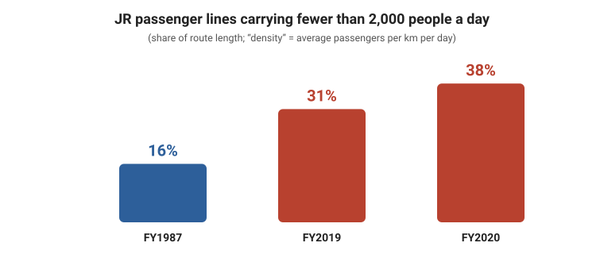
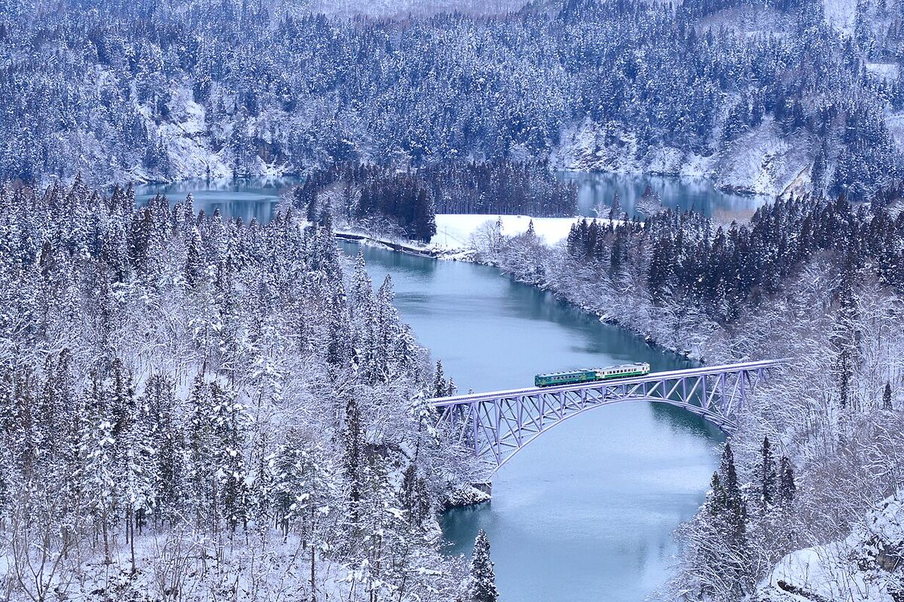
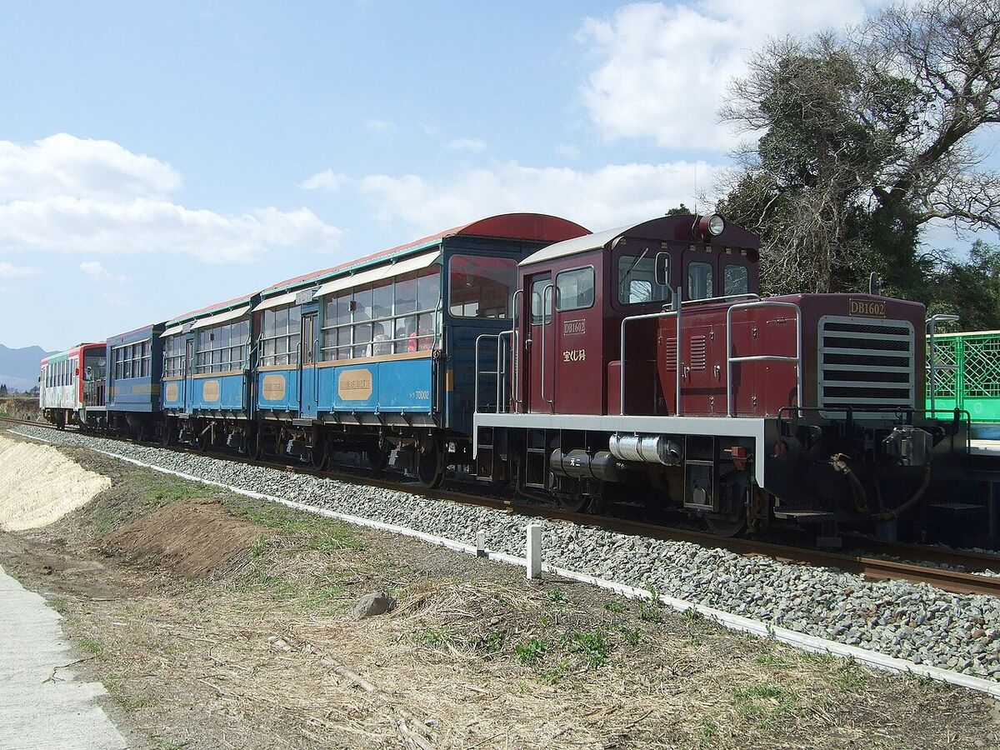

# 10. Local Lines in Trouble

Away from the cities, many Japanese railway lines carry few passengers. This chapter explains why, what has been closed, and the new law of 2023 that brings the state, local governments and railway companies to one table.

## 10.1 The 1987 bargain

When JNR was divided in 1987, the ministry recalls, the assumption was that each JR company could keep its unprofitable lines running by **cross-subsidy** from its profitable urban lines and Shinkansen (MLIT 2023).

Before the reform, JNR had already closed many lines: 83 "specified local lines" were given up between 1980 and 1990, 38 of them taken over by local railway companies and 45 replaced by buses (MLIT 2017). After 1987 the JR companies were much more restrained: **18 lines, 787 km** closed by 2023, against **83 lines and 3,157 km** at the end of the JNR era (MLIT 2023).

## 10.2 Why traffic fell

The ministry lists the changes since 1987 (MLIT 2023):

| | 1987 (or 1985) | Recent |
|---|---|---|
| Cars on the road | 29.6 million | 61.92 million (2020) |
| Expressways | 3,910 km | 9,050 km (2019) |
| Highway bus routes | 249 (1985) | 5,132 (2018) |

Add **depopulation** and an ageing society in rural areas. The result is measured by "traffic density" (輸送密度, *yusō mitsudo*): the average number of passengers per kilometre of line per day. The share of JR passenger lines with a density **below 2,000** rose sharply (MLIT 2023):

<figure class="diagram">

<figcaption>Share of JR passenger companies' route length with traffic density below 2,000 (MLIT 2023). <span class="credit">Diagram drawn for this handbook from the sources cited in the chapter.</span></figcaption>
</figure>

The ministry describes a **vicious circle**: fewer passengers lead to fewer trains and less investment, which drives away more passengers. It did not expect traffic to return to pre-pandemic levels (MLIT 2023).

<figure>

<figcaption>A local train on the JR Tadami line crossing the First Tadami River Bridge in winter, 2020. <span class="credit">Image: MaedaAkihiko, <a href="https://creativecommons.org/licenses/by-sa/4.0/">CC BY-SA 4.0</a>, via <a href="https://commons.wikimedia.org/wiki/File:Tadami-Line-First-Bridge-Winter.jpg">Wikimedia Commons</a>.</span></figcaption>
</figure>

## 10.3 The 2023 law

An expert panel met in 2022 to ask how railway companies and local communities could rebuild local transport together (MLIT 2023). Its list of options included:

- promoting use of the line;
- cutting costs through digital technology and new methods;
- linking rail with buses and other modes;
- separating the line into its own company, or revising fares;
- **public ownership with private operation** (上下分離, *jōge bunri*, "separating top and bottom"): a public body owns the track and stations, and the railway company runs the trains;
- conversion to another mode, such as buses.

The **2023 amendment** to the Act on the Revitalization of Regional Public Transport created a new procedure. Where a line can no longer sustainably provide rail service, a **local government or the railway company** can ask the minister to set up a **restructuring council** (再構築協議会), on which the **state**, local governments and the railway company sit together (MLIT 2023).

## 10.4 An example: Minami-Aso Railway

The **Minami-Aso Railway** in Kumamoto was closed by the earthquakes of **April 2016**. It was restructured with **public ownership of the infrastructure**: a public body owns the track and stations, and the company runs the trains. The whole line reopened on **15 July 2023** (MLIT 2024b).

<figure>

<figcaption>The Minami-Aso Railway's open sightseeing train, 2012, before the earthquake. <span class="credit">Image: Muyo, <a href="https://creativecommons.org/licenses/by-sa/3.0/">CC BY-SA 3.0</a>, via <a href="https://commons.wikimedia.org/wiki/File:Minamiaso_Torokko_train_Yusuge.jpg">Wikimedia Commons</a>.</span></figcaption>
</figure>

## Self-check

```quiz
? How did the 1987 reform expect JR companies to keep unprofitable lines?
- By cross-subsidy from profitable urban lines and Shinkansen *
- With a permanent state subsidy for every line
- By closing them all at once
> MLIT 2023.

? What is "traffic density"?
- The average number of passengers per kilometre of line per day *
- The number of trains per hour
- The population near a station
> The share of JR lines below 2,000 rose from 16% to 38%.

? Who can ask for a restructuring council under the 2023 law?
- A local government or the railway company *
- Only passengers
- Only the JR head office
> The state also sits on the council.

? What is jōge bunri?
- A public body owns the track; a company runs the trains *
- A double-decker train
- A fare for children
> Used, for example, by the Minami-Aso Railway.
```

## Sources for this chapter

1. **MLIT 2017.** See [Chapter 4](04-jnr-reform.md).
2. **MLIT 2023.** Ministry of Land, Infrastructure, Transport and Tourism, Railway Bureau 国土交通省鉄道局. 鉄道事業者と地域の協働による地域モビリティの刷新に向けて (Towards renewing regional mobility through cooperation between railway operators and communities), March 2023. [mlit.go.jp](https://www.mlit.go.jp/toshi/content/001735517.pdf).
3. **MLIT 2024b.** Ministry of Land, Infrastructure, Transport and Tourism 国土交通省. 令和５年度 政策レビュー結果（評価書）：地方部の鉄道の維持・活性化 (Policy review for fiscal 2023: maintaining and revitalising rural railways), March 2024. [mlit.go.jp](https://www.mlit.go.jp/seisakutokatsu/hyouka/content/001735185.pdf).

➡️ Next: [Chapter 11: Freight and night trains](11-freight-night.md)
