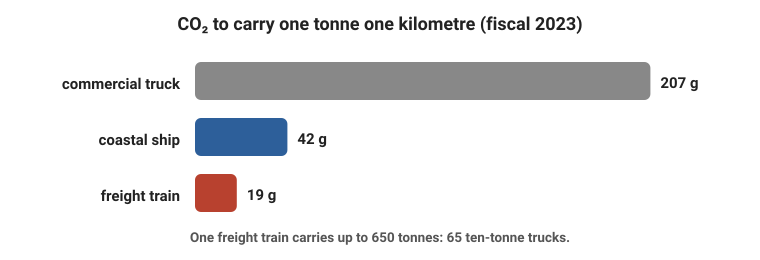
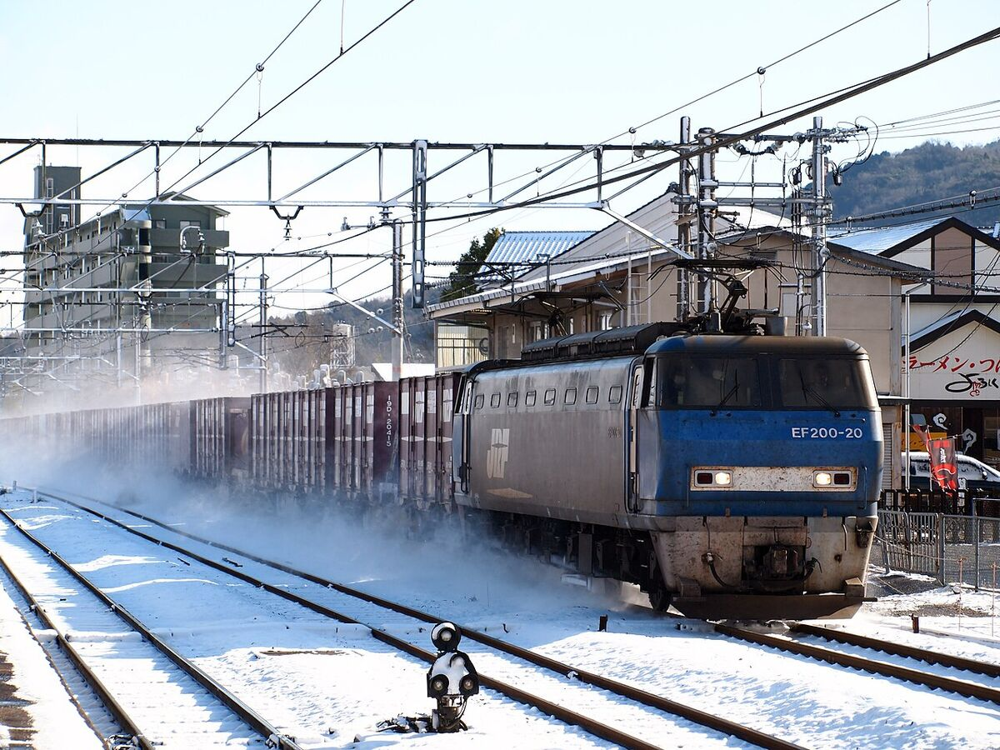
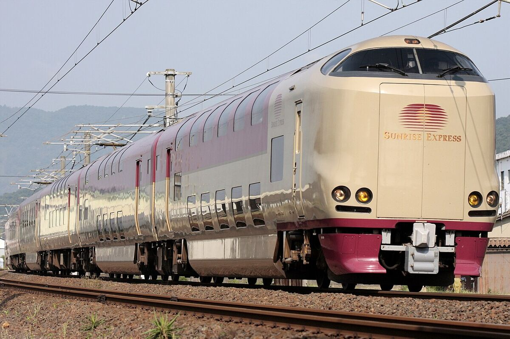

# 11. Freight and Night Trains

Two kinds of train run when most travellers are not looking: the freight trains of JR Freight, and the last sleeper trains. This chapter explains why the government wants more freight on rails, and what remains of Japan's night trains.

## 11.1 How freight lost its place

In fiscal **1955** JNR carried **52%** of Japan's freight. By fiscal **1986** its share was **5%**. Industry moved to coastal zones, trucks and coastal shipping competed, and JNR kept an old system of sorting wagons in marshalling yards that cost time and staff (MLIT 2017).

There were attempts to modernise. Large **containers** were first carried in 1959, and the number shipped grew from 64,000 in fiscal 1960 to 1.19 million in fiscal 1968, many on "Freightliner" trains running directly between terminals (MLIT 2012). But from around 1980 freight volumes fell and losses grew sharply (MLIT 2012).

In 1987 freight went to a single nationwide company, **JR Freight**, which owns its wagons and terminals but runs on the passenger companies' tracks, paying only for the extra wear its trains cause (MLIT n.d.-a; MLIT 2017). By fiscal 2015 its volume was 6% higher than in fiscal 1987 (MLIT 2017).

## 11.2 Why the government wants more freight on rail

The ministry gives two reasons (MLIT 2025):

- **Not enough trucks.** The logistics industry's "**2024 problem**" and the shortage of truck drivers leave a gap in road freight capacity. Rail is expected to take over medium-distance loads from trucks.
- **Carbon.** In fiscal 2023, carrying one tonne one kilometre emitted **207 g of CO₂ by commercial truck**, 42 g by coastal ship, and **19 g by freight train**: about one-eleventh of the truck.

One freight train can carry up to **650 tonnes**, the load of **65 ten-tonne trucks** (MLIT 2025).

<figure class="diagram">

<figcaption>Carbon dioxide per tonne-kilometre, fiscal 2023 (MLIT 2025). <span class="credit">Diagram drawn for this handbook from the sources cited in the chapter.</span></figcaption>
</figure>

## 11.3 The results so far

- **Rail's share stays small:** just under **5%** of tonne-kilometres, and flat (MLIT 2025).
- **Fiscal 2024:** container traffic was **16.36 billion tonne-km**, against a target of 17.5 billion. Tonnage rose 2.8% as shippers of drinks, beer and paper moved to rail because of the 2024 problem; but the average haul fell from 899 km to 879 km, so tonne-km grew only 0.5% (JR Freight 2025).
- **Disasters** keep breaking the network: in July 2018 heavy rain cut the Sanyō line and others for 100 days and cancelled 4,421 freight trains. After each disruption, the ministry notes, freight volumes fall and shippers lose trust (MLIT 2025).
- **Bigger containers.** JR Freight is expanding the use of **31-foot containers**, which take the load of a ten-tonne truck directly, alongside the standard 12-foot boxes (MLIT 2025).

<figure>

<figcaption>A JR Freight EF200 locomotive with a container train on the Sanyō line at Saijō, Hiroshima, 2016. <span class="credit">Image: kh ws, <a href="https://creativecommons.org/licenses/by-sa/2.0/">CC BY-SA 2.0</a>, via <a href="https://commons.wikimedia.org/wiki/File:JR_Freight_EF200-20_Saijo_20160119.jpg">Wikimedia Commons</a>.</span></figcaption>
</figure>

## 11.4 Night trains

Sleeping cars spread to more lines and passengers in the early Shōwa years (MLIT 2012). On **1 October 1967**, the ***Gekkō*** began running between Shin-Osaka and Hakata as an **electric sleeper limited express**; the ministry's chronology calls it the world's first such train (MLIT 2024).

The sources consulted for this handbook do not give a reliable account of when and why most night trains were withdrawn, so this handbook does not attempt one.

**The Sunrise Express today.** JR West describes the ***Sunrise Express*** as a sleeper limited express linking the San'in and Shikoku regions with **Tokyo**, with interiors designed with a house builder to give the warmth of wood (JR West n.d.-b). It runs as two trains coupled together (JR West n.d.-c):

- ***Sunrise Seto***: Tokyo – **Takamatsu**, in Shikoku;
- ***Sunrise Izumo***: Tokyo – **Izumoshi**, in Shimane;
- the two are **joined and divided at Okayama**.

On board are private sleeping compartments for one or two people, the "Nobinobi" carpeted berths, a **shower room** and a lounge (JR West n.d.-c).

<figure>

<figcaption>The <em>Sunrise Seto</em> on the Yosan line in Shikoku, 2009. <span class="credit">Image: kazusan, <a href="https://creativecommons.org/licenses/by-sa/3.0/">CC BY-SA 3.0</a>, via <a href="https://commons.wikimedia.org/wiki/File:JRW_Series_285_Sunrise_Seto.jpg">Wikimedia Commons</a>.</span></figcaption>
</figure>

## Self-check

```quiz
? What was JNR's share of freight in fiscal 1986?
- 5% *
- 52%
- 23%
> It had been 52% in fiscal 1955 (MLIT 2017).

? What is the "2024 problem"?
- The logistics industry's shortage of trucks and drivers *
- A computer bug
- The opening of the Tsuruga extension
> Rail is expected to take some of the load (MLIT 2025).

? How much CO₂ did a freight train emit per tonne-kilometre in fiscal 2023?
- 19 g, about one-eleventh of a truck *
- 207 g
- 42 g
> MLIT 2025.

? Where are the Sunrise Seto and Sunrise Izumo joined and divided?
- Okayama *
- Tokyo
- Takamatsu
> They run as one train between Tokyo and Okayama (JR West n.d.-c).
```

## Sources for this chapter

1. **JR Freight 2025.** Japan Freight Railway Company 日本貨物鉄道. 「今後の鉄道物流のあり方に関する検討会」中間とりまとめに対するＫＧＩ／ＫＰＩの達成状況について (Progress on the KGIs and KPIs), news release, 13 May 2025. [jrfreight.co.jp](https://www.jrfreight.co.jp/info/2025/files/20250513_03.pdf).
2. **JR West n.d.-b.** West Japan Railway Company 西日本旅客鉄道. 寝台列車・観光列車 (Sleeper trains and tourist trains), checked November 2026. [westjr.co.jp](https://www.westjr.co.jp/fan/paper/sleeper/index.html).
3. **JR West n.d.-c.** West Japan Railway Company. サンライズ瀬戸・出雲 (Sunrise Seto and Izumo), JR Odekake-net, checked November 2026. [jr-odekake.net](https://www.jr-odekake.net/railroad/train/sunriseseto_izumo/).
4. **MLIT 2012.** See [Chapter 1](01-first-line.md).
5. **MLIT 2017.** See [Chapter 4](04-jnr-reform.md).
6. **MLIT 2024.** See [Chapter 1](01-first-line.md).
7. **MLIT 2025.** See [Chapter 7](07-safety.md).
8. **MLIT n.d.-a.** See [Chapter 4](04-jnr-reform.md).

➡️ Next: [Chapter 12: Ekiben and station life](12-ekiben.md)
