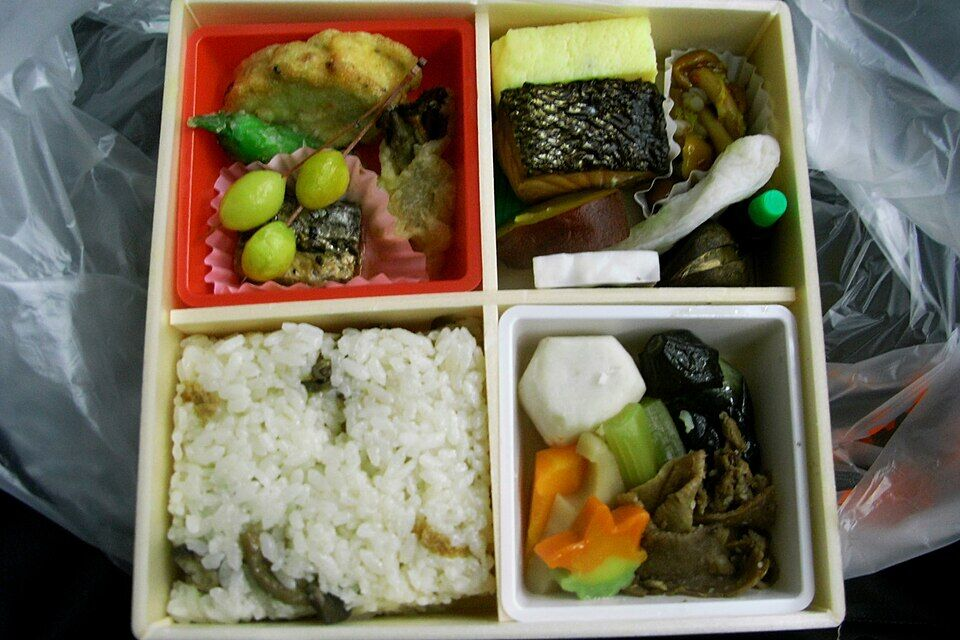
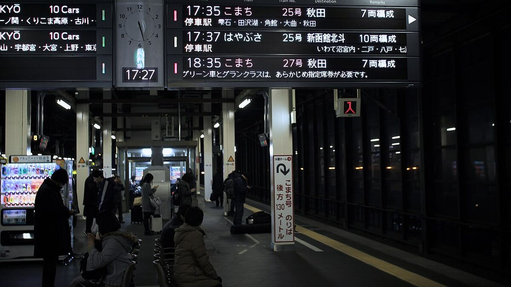

# 12. Ekiben and Station Life

駅弁 (*ekiben*), the station lunch box, is one of the pleasures of a Japanese train journey. This chapter follows its history, from rice balls wrapped in bamboo to the regional specialities of today. The main source is a three-part history by Oda Kikuko, published in 1980 in the journal of the Brewing Society of Japan (Oda 1980a; 1980b; 1980c).

## 12.1 Before the lunch box

Trade in stations began with the railway itself (Oda 1980a):

- **Newspapers.** When the first line opened provisionally in 1872, John R. Black, a British resident of Yokohama, asked permission to sell newspapers in stations. It was granted: the first station vending.
- **A station restaurant.** In August 1872 Ueda Toranosuke applied to open a Western-style restaurant at Shinbashi station.
- **Hired cushions.** From 1875 passengers in the lowest class, whose seats were bare boards, could rent a cotton cushion for the journey.

## 12.2 The first ekiben, 1885

Oda gives the beginning of the station lunch box as follows (Oda 1980a):

- **16 July 1885.** Nippon Railway opened between Ueno and **Utsunomiya**. Shirakiya Kahei, who ran an inn in Utsunomiya, was encouraged by a director of the railway to sell food at the new station.
- **The box.** Two **rice balls** coated with black sesame, with a pickled plum inside and pickled radish on the side, **wrapped in bamboo sheath**, for **5 sen**. Oda notes that a *shō* (about 1.8 litres) of rice then cost under 4 sen, so it was not cheap. She calls it "the first ekiben".
- **They spread** to Yokokawa (1885), Takasaki (1886), and Oyama and Kōzu (1888), at first always rice balls in bamboo.
- **The first "makunouchi".** The first box of the kind still called an ordinary *bentō*, with rice and an assortment of side dishes, was sold at **Himeji** from January 1889, after the Sanyō Railway reached the town. Its wooden box held sea bream, *kamaboko* fish cake, rolled omelette, sweet chestnut paste, *udo*, lily root, pickles and chicken.
- **Sushi** was first sold at Ichinoseki on 1 November 1890.
- **The name.** At first these were called 汽車弁当 (*kisha bentō*, "train lunch boxes"), not *ekiben*.

By the Taishō era about **100 million** station lunch boxes were sold a year. Vendors needed the station master's approval for prices, and railway offices inspected and ranked the boxes (Oda 1980a).

<figure>

<figcaption>A makunouchi-style <em>ekiben</em> from Sendai station, 2008. <span class="credit">Image: woinary, <a href="https://creativecommons.org/licenses/by-sa/2.0/">CC BY-SA 2.0</a>, via <a href="https://commons.wikimedia.org/wiki/File:Sendai_makunouchi_bento_by_woinary_in_Sendai_Station%2C_Miyagi.jpg">Wikimedia Commons</a>.</span></figcaption>
</figure>

## 12.3 Dining cars

The first **dining car** was attached to a Sanyō Railway express on 25 May 1899. Western food came first; a Japanese-food dining car ran on Tōkaidō third-class expresses from April 1906 (Oda 1980a).

## 12.4 War and recovery

Rationing changed the lunch box (Oda 1980b):

- **From 1939** the government pushed to save rice. Rice was mixed with other grains, and stations sold **129 kinds of "substitute food" ekiben** in 1941: buckwheat buns at Shiojiri, millet rice at Niitsu, fried *udon* at Shizuoka, and "national policy" boxes of steamed bread and vegetables at Hiroshima.
- **April 1944:** all dining cars were withdrawn.
- **After 1945**, lunch boxes could be bought only with meal coupons for a time.
- **15 September 1949:** dining cars returned with the first postwar limited express, the *Heiwa*, between Tokyo and Osaka.

From around 1960, as travel became common, came the **ekiben boom**. Lunch boxes were sold from trolleys on trains from 1960; in 1962 a newspaper ran a year-long series touring Japan by *ekiben*; by 1967–68 each travel season brought articles about them (Oda 1980b).

## 12.5 What is in the box

Oda distinguishes two kinds (Oda 1980c):

- **The ordinary *bentō*** (普通弁当): rice in one half, side dishes in the other. In a survey of **314** ordinary boxes, she counted 122 foods, 11–12 per box. The most common were **rolled omelette** (85% of boxes), ***kamaboko*** (79%), **kelp rolls** (67%) and **fish**, fried or grilled (58%). They had little regional or seasonal character, were mostly simmered, sweet and salty to keep well, and resembled New Year *osechi* food.
- **The special *bentō*** (特殊弁当): rice dishes or sushi built around one special ingredient, which give each station its identity. Oda's examples include salmon rice at Sapporo, crab rice at Oshamambe, the *Tōge no kamameshi* ("mountain-pass rice pot") at Yokokawa, the *shūmai* box of Yokohama, chicken rice at Nagoya, and trout sushi at Toyama.

The packaging tells a story too. The first boxes were bamboo sheath; then thin wooden boxes; later paper and plastic. The printed **wrapper** (掛け紙, *kakegami*) grew from a small one-colour slip before the war to a full-colour cover, and carried the slogans of the day: in wartime "save rice", in the 1970s "Discover Japan" (Oda 1980c).

## 12.6 The ticket office

On **24 September 1965** JNR opened the computerised ***midori no madoguchi*** (みどりの窓口, "green window") ticket offices (MLIT 2024). The name is still used for JR ticket offices today (JR West 2018).

<figure>

<figcaption>A departure board at Morioka station listing Tōhoku and Hokkaidō Shinkansen trains, 2018. <span class="credit">Image: MIKI Yoshihito from Sapporo City,Hokkaido., JAPAN, <a href="https://creativecommons.org/licenses/by/2.0/">CC BY 2.0</a>, via <a href="https://commons.wikimedia.org/wiki/File:Morioka_Station_Hokkaido_Shinkansen_departures_board_2018-02-09_%2839286114095%29.jpg">Wikimedia Commons</a>.</span></figcaption>
</figure>

## Self-check

```quiz
? Where and when was the first ekiben sold, according to Oda?
- Utsunomiya, 16 July 1885 *
- Shinbashi, 1872
- Himeji, 1889
> Two rice balls in bamboo sheath for 5 sen (Oda 1980a).

? What was special about the Himeji box of 1889?
- It was the first of the ordinary bentō type, rice with assorted side dishes *
- It was the first sushi
- It was the first hot meal
> Oda 1980a.

? Which foods did Oda find most often in ordinary ekiben?
- Rolled omelette, kamaboko and kelp rolls *
- Beef, potatoes and bread
- Sashimi and raw vegetables
> In 85%, 79% and 67% of 314 boxes (Oda 1980c).

? What is a "special bentō"?
- A box built around one special ingredient that identifies its station *
- A box sold only on New Year's Day
- A box with no rice
> Examples: Yokokawa's kamameshi, Yokohama's shūmai box.
```

## Sources for this chapter

1. **JR West 2018.** See [Chapter 9](09-tickets.md).
2. **MLIT 2024.** See [Chapter 1](01-first-line.md).
3. **Oda 1980a.** Oda Kikuko 小田きく子. 駅売弁当の変遷 (1) (The history of station lunch boxes, part 1). *Journal of the Brewing Society of Japan* 1980;75(1):35–39. doi:[10.6013/jbrewsocjapan1915.75.35](https://doi.org/10.6013/jbrewsocjapan1915.75.35).
4. **Oda 1980b.** Oda Kikuko 小田きく子. 駅売弁当の変遷 (2). *Journal of the Brewing Society of Japan* 1980;75(3):204–208. doi:[10.6013/jbrewsocjapan1915.75.204](https://doi.org/10.6013/jbrewsocjapan1915.75.204).
5. **Oda 1980c.** Oda Kikuko 小田きく子. 駅売弁当の変遷 (3). *Journal of the Brewing Society of Japan* 1980;75(4):263–268. doi:[10.6013/jbrewsocjapan1915.75.263](https://doi.org/10.6013/jbrewsocjapan1915.75.263).

➡️ Next: [Chapter 13: Railway Japanese](13-language.md)
