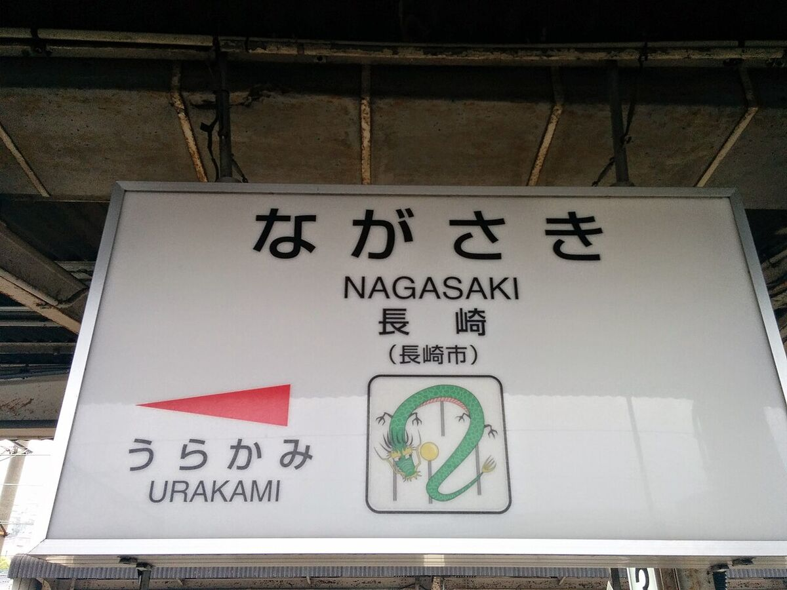
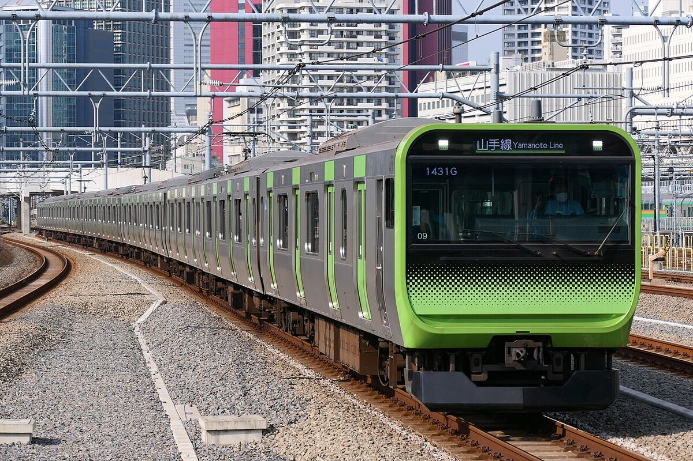

# 13. Railway Japanese

Most large stations have signs in English, but smaller ones may not, and announcements on local lines are often only in Japanese. This chapter collects the words and phrases that matter. Tap any Japanese word to hear it. For the subway in particular, see also [Lesson 6](../lessons/06-subways.md).

## 13.1 Kinds of train

Train types are named on departure boards and on the train itself. From fastest to slowest:

| Japanese | Reading | Meaning |
|---|---|---|
| 新幹線 | *shinkansen* | Shinkansen (Chapter 3) |
| 特急 | *tokkyū* | limited express (extra ticket on JR) |
| 急行 | *kyūkō* | express |
| 快速 | *kaisoku* | rapid |
| 普通 | *futsū* | local, stopping at every station |
| 各駅停車 | *kakueki teisha* | stopping at every station |
| 寝台特急 | *shindai tokkyū* | sleeper limited express (Chapter 11) |
| 始発 | *shihatsu* | first train of the day; train starting at this station |
| 終電 | *shūden* | last train of the night |

## 13.2 Tickets and seats

From Chapter 9:

| Japanese | Reading | Meaning |
|---|---|---|
| 切符 | *kippu* | ticket |
| 乗車券 | *jōshaken* | basic fare ticket |
| 特急券 | *tokkyūken* | limited express ticket |
| 指定席 | *shiteiseki* | reserved seat |
| 自由席 | *jiyūseki* | non-reserved seat |
| グリーン車 | *gurīnsha* | Green car (first class) |
| 券売機 | *kenbaiki* | ticket machine |
| みどりの窓口 | *midori no madoguchi* | JR ticket office |
| 片道 | *katamichi* | one way |
| 往復 | *ōfuku* | return |
| 大人 | *otona* | adult |
| 小児 | *shōni* | child |
| 乗り越し精算 | *norikoshi seisan* | paying the difference at the end of a journey |
| 払い戻し | *haraimodoshi* | refund |

## 13.3 In the station

| Japanese | Reading | Meaning |
|---|---|---|
| 駅 | *eki* | station |
| 改札 | *kaisatsu* | ticket gates |
| 改札口 | *kaisatsuguchi* | ticket barrier, gate |
| 新幹線のりば | *shinkansen noriba* | Shinkansen platforms |
| ～番線 | *-bansen* | track number … |
| ホーム | *hōmu* | platform |
| 乗り換え | *norikae* | transfer |
| 出口 | *deguchi* | exit |
| 入口 | *iriguchi* | entrance |
| 時刻表 | *jikokuhyō* | timetable |
| 行き | *-iki* / *-yuki* | bound for … |
| 終点 | *shūten* | terminus |
| 駅弁 | *ekiben* | station lunch box (Chapter 12) |

<figure>

<figcaption>A station name sign at Nagasaki, 2015. The name is in large <em>hiragana</em>, with romaji and kanji below; the arrow shows the next station, Urakami (うらかみ). <span class="credit">Image: NevinThompson, <a href="https://creativecommons.org/licenses/by-sa/4.0/">CC BY-SA 4.0</a>, via <a href="https://commons.wikimedia.org/wiki/File:Station_name_sign_at_Nagasaki_Station%2C_April_2015.jpg">Wikimedia Commons</a>.</span></figcaption>
</figure>

## 13.4 On the train

| Japanese | Reading | Meaning |
|---|---|---|
| 次は | *tsugi wa* | the next stop is … |
| まもなく | *mamonaku* | shortly, arriving soon |
| 優先席 | *yūsenseki* | priority seats |
| 女性専用車 | *josei sen'yōsha* | women-only car |
| 号車 | *-gōsha* | car number … |
| 遅延 | *chien* | delay |
| 運転見合わせ | *unten miawase* | services suspended |
| 振替輸送 | *furikae yusō* | transfer to another route because of a suspension |

Some lines have women-only cars at busy times; the Toei Ōedo line introduced one in January 2023 (Toei n.d.).

<figure>

<figcaption>A Yamanote line train arriving at Takanawa Gateway station, Tokyo, 2021. <span class="credit">Image: MaedaAkihiko, <a href="https://creativecommons.org/licenses/by-sa/4.0/">CC BY-SA 4.0</a>, via <a href="https://commons.wikimedia.org/wiki/File:Series-E235-0_9.jpg">Wikimedia Commons</a>.</span></figcaption>
</figure>

## 13.5 Phrases for the ticket office

| Japanese | Reading | Meaning |
|---|---|---|
| 京都までの切符をください | *Kyōto made no kippu o kudasai* | A ticket to Kyoto, please. |
| 指定席をお願いします | *shiteiseki o onegai shimasu* | A reserved seat, please. |
| 窓側の席はありますか | *madogawa no seki wa arimasu ka* | Is there a window seat? |
| 次の新幹線は何時ですか | *tsugi no shinkansen wa nanji desu ka* | What time is the next Shinkansen? |
| この電車は新宿に止まりますか | *kono densha wa Shinjuku ni tomarimasu ka* | Does this train stop at Shinjuku? |
| 大阪行きは何番線ですか | *Ōsaka-yuki wa nanbansen desu ka* | Which track for Osaka? |
| 乗り遅れました | *noriokuremashita* | I missed my train. |
| 切符をなくしました | *kippu o nakushimashita* | I lost my ticket. |

## Self-check

```quiz
? Which train type stops at every station?
- 普通 (futsū) *
- 特急 (tokkyū)
- 快速 (kaisoku)
> 各駅停車 (kakueki teisha) means the same.

? What is a 自由席?
- A non-reserved seat *
- A reserved seat
- A Green car seat
> A reserved seat is 指定席 (shiteiseki).

? An announcement says 運転見合わせ. What does it mean?
- Services are suspended *
- The train is arriving
- The doors are closing
> Check for 振替輸送, transfer to another route.

? How do you ask which track the Osaka train leaves from?
- 大阪行きは何番線ですか *
- 大阪までの切符をください
- 乗り遅れました
> 番線 (bansen) is the track number.
```

## Sources for this chapter

This chapter is a vocabulary list. Facts about the places, trains and rules it mentions are cited in the chapters it links to.

1. **Toei n.d.** See [Chapter 6](06-subways.md).

➡️ Next: [Glossary](14-glossary.md)
